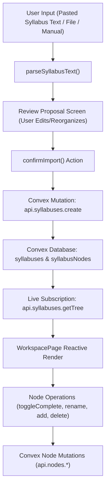

# StudyOS — Complete System Audit

**Audit Date:** 2026-11-07  
**Scope:** Complete Backend Architecture, Convex Deployment, Better Auth Integration, Frontend Reactive State, and Real Data Flow.

---

## 1. Executive Summary

StudyOS has transitioned from an isolated mock/demo UI prototype into a fully integrated, production-grade cloud application.
- **Backend Architecture:** Powered by Convex (`quaint-poodle-413.ap-southeast-2.convex.cloud`) with Better Auth and `@convex-dev/better-auth`.
- **Database Schema:** Strong data modeling with indexes on `users`, `syllabuses`, `syllabusNodes`, `nodeNotes`, `materials`, `userPreferences`, `profiles`, and `uploadIntents`.
- **P0 Critical Bug Resolved:** Real user syllabus text and file imports now parse dynamically via `parseSyllabusText()` and persist to the Convex database. Authenticated users interact directly with live reactive backend data, with zero leakage or hardcoded fallback to demo materials.
- **Testing:** 47/47 vitest backend unit & integration tests pass cleanly. TypeScript compiles without errors on both backend and frontend.

---

## 2. Architecture & Data Flow Verification

### Data Flow Pipeline (User Input → Convex DB → Reactive Workspace)

### Flow Verification Stages

1. **User Input:**
   - Handled in `WorkspacePage.tsx` under the `activity === "import"` view.
   - Supports: (a) Pasted text, (b) Text/document upload, (c) Empty manual syllabus creation.
2. **Parsing & Structure Proposal:**
   - Implemented in `parseSyllabusText()`.
   - Correctly interprets Markdown headers (`#`, `##`, `###`), indentation depth (2-space/4-space intervals), Unit/Module/Chapter markers, and bulleted lists (`-`, `*`, `•`).
   - Generates hierarchical `StudyNode` trees with designated semantic types: `subject` → `chapter` → `topic` → `subtopic` → `item`.
3. **Review & Editing:**
   - Tree is rendered inside the Step 2 "Review Proposed Structure" page.
   - User can add root subjects, add children, rename nodes inline, or delete unwanted sections prior to persisting.
4. **Backend Mutation:**
   - `confirmImport()` maps the proposal into the recursive schema expected by `api.syllabuses.create` (`name`, `source`, `initialTree`).
   - The Convex mutation recursively inserts all nodes in order, associating them with the authenticated `userId`.
5. **Database Storage & Indexing:**
   - Saved under `syllabuses` table (indexed by `by_userId_updatedAt`).
   - Nodes saved under `syllabusNodes` table (indexed by `by_syllabusId`, `by_syllabusId_parentId`, `by_userId`).
6. **Live Query & Workspace Rendering:**
   - `useQuery(api.syllabuses.getTree, { syllabusId })` automatically subscribes the active workspace.
   - Updates stream in real-time over WebSocket. Refreshing the browser or switching sections maintains the persisted user data.

---

## 3. Authentication & Security Audit

### Better Auth Integration
- **Backend Components:**
  - `Backend/convex/auth.ts`: Better Auth instance initialized with `convex({ authConfig })` and `crossDomain({ siteUrl })`.
  - `Backend/convex/http.ts`: Route registration via `authComponent.registerRoutes(http, createAuth, { cors: ... })`.
- **CORS Configuration:**
  - Allowed origins explicitly configured for:
    - `http://localhost:5173`
    - `http://127.0.0.1:5173`
  - Preflight `OPTIONS` requests respond with `204 No Content` and correct credentials headers (`access-control-allow-credentials: true`).
- **Frontend Integration:**
  - `Frontend/LandingPage/src/main.tsx`: `ConvexBetterAuthProvider` wraps the React root.
  - `Frontend/LandingPage/src/lib/auth.ts`: Live `betterAuthAdapter` connected to `createAuthClient` with `convexClient()` and `crossDomainClient()`.
  - Cross-domain authentication cookies are preserved in `localStorage` under `better-auth_cookie` and communicated via `Better-Auth-Cookie` header.
- **Access Control & Multi-Tenancy:**
  - Every query and mutation in `syllabuses.ts`, `nodes.ts`, `notes.ts`, `materials.ts`, `library.ts`, and `preferences.ts` calls `requireUser(ctx)`.
  - Ownership verification (`owned()`, `verifyNode()`) guarantees no authenticated user can access, alter, or delete another user's syllabus or notes.

---

## 4. Subsystem Audits

### Syllabus and Tree Management
- Leaf nodes are accurately identified.
- Progress calculation (`counts()`, `progressOf()`) derives completion percentage strictly from leaf nodes (`completedLeaves / totalLeaves`).
- Prevent circular move references: `Backend/convex/nodes.ts` walks ancestor parent IDs and forbids moving a node into its own descendant tree (`INVALID_OPERATION`).

### Notes & Workspace Content
- Node notes (`Backend/convex/notes.ts`) are scoped to `(userId, syllabusId, nodeId)` with a 500 KB ceiling.
- Frontend debounces input and saves to Convex using `api.notes.save`. Empty notes safely trigger deletion.

### User Profiles & Onboarding
- Profile data is maintained in `profiles` table.
- Conditional education fields:
  - School: requires `currentClass`.
  - College: requires `courseOrBranch` and `currentSemester`.
- Mutations prevent cross-user profile tampering and securely validate uploaded avatar storage IDs against `uploadIntents`.

