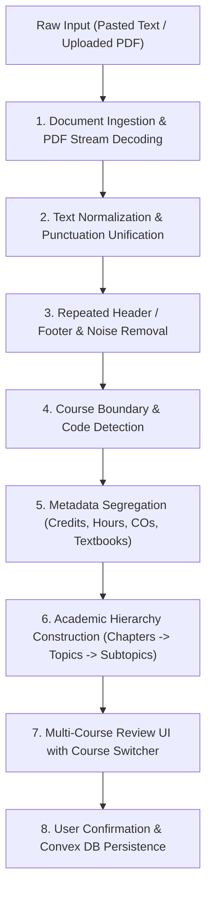

# StudyOS — Intelligent Syllabus Understanding & Structured Extraction Engine Architecture

## 1. Executive Summary

StudyOS features an intelligent, multi-stage academic syllabus understanding and structured extraction engine.
Rather than treating academic syllabuses as flat text with naive line splits, the engine performs lexical normalization, structural classification, multi-course boundary detection, metadata segregation, and hierarchical tree construction.

---

## 2. Academic Hierarchy Model

The engine models academic curricula according to the strict institutional hierarchy:

```
Document (e.g., Curriculum Handbook or Single Course Document)
  └── Subject / Course (e.g., Introduction to Programming — CS101)
       ├── Module / Unit / Chapter (e.g., Module 1: Basics of Computing)
       │    ├── Topic (e.g., Computer Architecture)
       │    │    ├── Subtopic (e.g., CPU, Memory, I/O Devices)
       │    │    │    └── Nested Subtopic
       │    │    └── Subtopic
       │    └── Topic (e.g., Number Systems)
       └── Module / Unit / Chapter
```

### Classification Taxonomy

| Category | Classification | Description | Handling in StudyOS |
|---|---|---|---|
| **Class A** | Study Content | Modules, Units, Chapters, Topics, Subtopics, Experiments | Form the hierarchical nodes of the study tree |
| **Class B** | Course Metadata | Course Name, Code, Credits, Contact Hours (L:T:P), Total Hours, Prerequisites, Objectives, Outcomes (CO1..COn), CO-PO mappings, Textbooks, References | Segregated into `metadata` store; accessible via Workspace & Review |
| **Class C** | Document Noise | Repeated university headers, page numbers, footers, legal notices | Filtered out during text normalization |
| **Class D** | Unclassified | Ambiguous lines in syllabus body | Classified with confidence rating (`high`, `medium`, `low`) |

---

## 3. Extraction Pipeline Stages



### Stage 1: Document Ingestion (`pdfExtractor.ts`)
- Decodes PDF streams using pure JavaScript stream parsing (`BT ... ET`, `Tj`, `TJ`).
- Detects non-text / scanned PDFs: if selectable text is insufficient (<50 characters), warns the user that OCR is not configured and provides immediate text input fallback.

### Stage 2: Text Normalization (`normalizer.ts`)
- Normalizes unicode smart quotes (`‘’, “”`), dashes (`–, —`), bullet glyphs (`•, ◦, ▪`), and non-breaking spaces.
- Unifies line terminators (`\r\n` → `\n`).

### Stage 3: Noise & Recurring Header Stripping (`normalizer.ts`)
- Computes line frequencies across page boundaries.
- Removes lines repeated across pages (e.g. `MAKAUT / B.Tech / CSE`, `Page 1 of 42`).
- Strips document boilerplate and draft watermarks.

### Stage 4: Course Boundary Detection (`courseDetector.ts`)
- Identifies separate academic courses using standard patterns:
  - Explicit header markers: `Course Name: ...`, `Course Code: ...`, `Subject: ...`
  - Inline course codes: `CS101`, `PH101`, `M101`, `HU101`, `HU102`, `CS191`, `PH191`, `ME194`, `HU191`
  - Numbered course lists: `1. Introduction to Programming and Problem Solving — CS101`
- Segments multi-course documents into isolated course blocks without cross-contamination.

### Stage 5: Metadata Segregation (`courseDetector.ts`)
- Extracts course code, credits, contact hours (L:T:P), total contact hours, prerequisites, objectives, and learning outcomes into an `AcademicMetadata` record.
- Extracts textbooks and reference book recommendations.
- Prevents administrative lines from ever becoming study nodes.

### Stage 6: Hierarchical Tree Construction (`hierarchyBuilder.ts`)
- Resolves Module/Unit/Chapter containers.
- Resolves numbered subtopics (e.g., `1.01 Laser (6L)`).
- Cleans lecture hour tags (e.g. `(7L)`, `(6L)`) from node names.
- Splits colon-separated concept items into parent topics and child subtopics.
- Detects laboratory courses and creates structured experiment checklists.

### Stage 7: Multi-Course Review & Human-in-the-Loop (`WorkspacePage.tsx`)
- If a document contains multiple courses, displays an interactive Course Switcher Bar with pills for each detected course code.
- Displays metadata badges (Code, Credits, Hours, Lab status) and expandable Course Outcomes & Textbooks.
- Allows full inline editing, adding topics, renaming, and deleting unwanted nodes.

### Stage 8: Convex Backend Persistence (`syllabuses.ts`)
- Stores syllabus record with `name`, `code`, `metadata`, and `source`.
- Recursively inserts nested nodes into `syllabusNodes` table.

