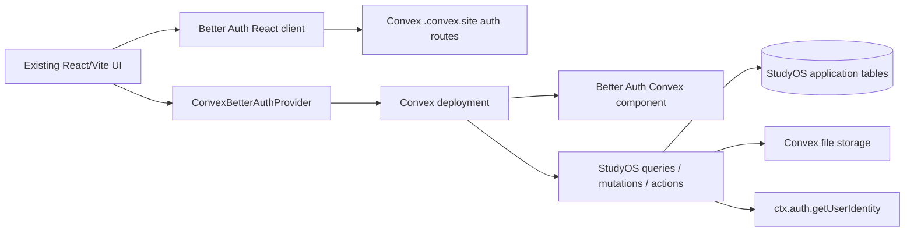
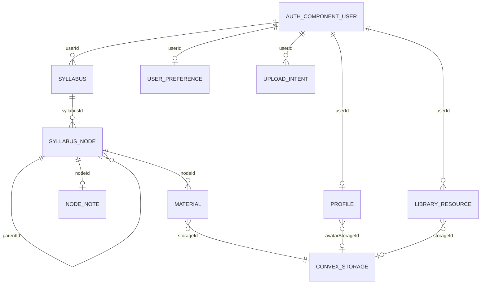

# StudyOS Backend — Technical Audit and Integration Handoff

**Audit target:** The contents of `StudyOS-Backend.zip`, extracted into a clean directory and inspected file by file. This document describes the code that is present, not the full intended StudyOS product. No backend source was changed during this audit.  
**Audit date:** 2026-11-07.  
**Readiness:** Useful implementation baseline; not deployment-verified and not production-ready yet.

## 1. Executive summary

The package is a standalone React/Vite-compatible Convex backend using the `@convex-dev/better-auth` component. It contains Better Auth configuration, eight application tables, authenticated profile/syllabus/tree/notes/material/library/preferences functions, file upload URL flows, a small pure tree/progress utility, and four unit tests. It does not contain Convex-generated files, a deployment, a live integration test suite, an email provider, a document parser, or an AI provider.

The feature files exist, but most backend operations have **not** been exercised against Convex. Only four pure functions tests were run successfully. A TypeScript check was attempted but cannot complete without a Convex deployment and generated `_generated` types. Consequently, OAuth, sessions, authorization at runtime, schema deployment, and storage behavior are not verified.

Several source-level concerns matter for integration and production: storage upload intents are not bound to the actual resulting storage ID; `ctx.storage.getUrl` returns a bearer URL that can be used by anyone who receives it; the `.env.example` does not match all variables used by the code; and `IMPLEMENTATION_REPORT.md` has stale next steps claiming upload endpoints remain to be completed even though they are present in the ZIP. Full details and safer integration steps follow.

## 2. Audit verdict on the implementation report

The report at `IMPLEMENTATION_REPORT.md` is directionally candid about missing deployment and untested behavior, but it is not fully synchronized with the source.

| Report claim | Source audit result |
|---|---|
| Better Auth email/password configured | **Implemented in configuration, not runtime-tested.** `convex/auth.ts` enables email/password and uses the Better Auth Convex component adapter. No auth deployment or signup/signin test exists. |
| Google OAuth optional | **Conditionally configured, not tested.** The provider is added only when both Google environment variables are non-empty. Missing or partial configuration does not install the provider. |
| Password reset hook | **Partial / externally configured.** `sendResetPassword` POSTs to a configured webhook; when absent, code only logs and returns. No actual mail delivery is included or tested. |
| Profiles and avatar upload | **Implemented in source, not tested.** Profile query/onboarding/update plus `generateAvatarUploadUrl` exist. Upload intents are owner/purpose/time checked but do not record which storage ID was uploaded; `profile.update` cannot clear an existing avatar using the current validator. |
| Syllabus CRUD | **Mostly implemented.** Create, list, get, getTree, rename, archive/restore, duplicate and delete are exported. No mutation-level tests. There is no import parser or `initialTree` argument on syllabus create. |
| Arbitrary-depth nodes | **Implemented structurally.** `parentId` self-reference allows arbitrary depth; semantic `type` is still one of five literals. Create/rename/get children/delete/move/reorder and leaf toggle exist. No tests of actual Convex mutations. |
| Progress | **Implemented as derived leaf counts and percentages.** Pure helper tests cover representative cases. No live mutation/reactivity tests. There is no derived `completed` boolean for parent nodes; parent progress is expressed as counts/percentage. |
| Notes | **Implemented, untested.** `nodeNotes` is indexed by node and owner. Upsert uses `.first()` rather than a uniqueness constraint; concurrent first saves may create duplicates. |
| Attachments | **Partial.** URL generation, metadata save, list, authorized URL lookup and delete exist. MIME and size checks are metadata-based; a type header is not proof of the binary contents. Upload intent does not bind the uploaded `storageId`. |
| Library | **Partial.** CRUD, URL generation for uploads and retrieval exist. Unlike node attachments, library files have no size/MIME validation; the storage ID is not bound to the particular upload intent. |
| Preferences | **Implemented, untested.** Read returns system defaults if no row exists; update upserts. |
| AI disabled behavior | **Honest unavailable action exists.** No AI provider adapter or AI request is implemented. `askAboutNode` checks identity but does not verify `nodeId` ownership; it currently makes no provider request and always throws unavailable. |
| Security | **Ownership checks are present in most record operations; runtime isolation is unverified.** Some upload/file capability limitations are detailed in §13. |
| “Every action verifies identity” | **Mostly present, but object checks vary.** All exported application actions call `requireUser`; `ai.askAboutNode` does not authorize the supplied node ID. |
| “Complete avatar and library upload endpoints” still listed in report next steps | **Stale report text.** `profiles.generateAvatarUploadUrl` and `library.generateUploadUrl` are already in the ZIP. |
| “Complete and tested” | **Not supported.** No end-to-end function, auth, storage or ownership tests were run. |

Keep `IMPLEMENTATION_REPORT.md`; this audit does not replace it. The report’s steps 6 and 7 should be interpreted alongside this newer, source-verified status.

## 3. Technologies and package versions

The ZIP’s `package.json` declares:

- `convex: ^1.25.0` — Convex schema, query/mutation/action runtime, HTTP routes, reactive frontend client and file storage.
- `@convex-dev/better-auth: ^0.13.0` — maintained Convex component and client/provider integration for Better Auth.
- `better-auth: ^1.7.16` — email/password, sessions, social OAuth and reset-token management.
- Dev dependencies: TypeScript `^5.7.0`, Vitest `^3.0.0`, and `@types/node` `^22.0.0`.

The included lockfile resolved `@convex-dev/better-auth@0.13.0`, `better-auth@1.7.18`, `convex@1.49.0`, `typescript@5.9.3`, and `vitest@3.2.7` in the audit environment. The component’s installed peer range is Better Auth `>=1.7.16 <1.8.0`, Convex `^1.25.0`, React 18.3.1 or React 19. This is why the package uses Better Auth 1.7.x despite an earlier integration-guide example pinning `~1.6.15`. Resolve versions against the actual existing frontend before merging; do not blindly replace its dependency tree.

The audit used the installed dependencies and package lock. It did not complete a full TypeScript build because generated Convex types were absent.

## 4. Package structure

```text
StudyOS-Backend/
├── convex/
│   ├── ai.ts
│   ├── auth.config.ts
│   ├── auth.ts
│   ├── convex.config.ts
│   ├── http.ts
│   ├── library.ts
│   ├── materials.ts
│   ├── nodes.ts
│   ├── notes.ts
│   ├── preferences.ts
│   ├── profiles.ts
│   ├── schema.ts
│   └── syllabuses.ts
│   └── lib/
│       ├── auth.ts
│       ├── tree.ts
│       └── validators.ts
├── src/lib/
│   ├── auth-client.ts
│   └── convex-client.ts
├── src/vite-env.d.ts
├── tests/tree.test.ts
├── vitest.config.ts
├── tsconfig.json
├── package.json
├── package-lock.json
├── .env.example
├── .gitignore
├── README.md
├── BACKEND_INTEGRATION.md
├── ENVIRONMENT_SETUP.md
├── IMPLEMENTATION_REPORT.md
├── REFERENCES.md
└── backend.md
```

There is intentionally **no** `convex/_generated/` in the ZIP. Do not make up generated API/type files. `npx convex dev` must configure a Convex project and generate them. The `convex/convex.config.ts` and any existing project schema/HTTP config must be merged carefully when integrating into an existing repository.

## 5. Architecture and execution flow



`convex/convex.config.ts` installs the Better Auth component. `convex/auth.config.ts` registers `getAuthConfigProvider()`. `convex/auth.ts` constructs Better Auth with the component adapter, `crossDomain` and `convex` plugins. `convex/http.ts` registers the component’s routes on the Convex HTTP router with CORS enabled. It defines no additional bespoke HTTP endpoint. The client files initialize `createAuthClient` and `ConvexReactClient`; the existing app must mount `ConvexBetterAuthProvider` itself.

Application functions are Convex public exports. They read identity from `ctx.auth.getUserIdentity()` via `convex/lib/auth.ts`; `identity.subject` becomes the application `userId`. Public calls do not accept a `userId` argument. Each function then reads rows by ID/index and compares their stored owner to the identity before proceeding. Convex reactive queries notify subscribed clients after successful writes; that behavior is part of Convex but has not been exercised in this package.

### Authentication flow represented in source

1. The browser uses the Better Auth client configured with the Convex `.convex.site` URL and `convexClient()`/`crossDomainClient()` plugins.
2. Better Auth endpoints are served by the Convex component routes.
3. The Convex provider supplies auth state/token integration to the Convex client (`expectAuth: true`).
4. A StudyOS query/mutation/action calls `requireUser`. Missing identity yields a `ConvexError` with `UNAUTHENTICATED`; authenticated identity returns subject/email/name.
5. For Google, provider configuration exists only when both `GOOGLE_CLIENT_ID` and `GOOGLE_CLIENT_SECRET` are set. The browser call starts the provider redirect. Callback must target the Convex site host.

Signup/login/session persistence and Google callback were not run in a browser. The implementation does not add email verification. The auth module’s password-reset delivery is a generic HTTP webhook, not a mail service.

## 6. Database schema and relationships

Application tables are declared in `convex/schema.ts`. All stored timestamps are numbers, populated with `Date.now()` (milliseconds). Convex adds `_id` and `_creationTime` to documents; those are not custom schema fields.

| Table | Actual custom fields | Indexes and relationship/owner |
|---|---|---|
| `profiles` | `userId: string`, `fullName: string`, `email: string`, optional `avatarStorageId: Id<"_storage">`, optional `institute: string`, optional `educationLevel: "School" \| "College / University"`, optional `schoolDetails: { currentClass: string }`, optional `collegeDetails: { courseOrBranch: string; currentSemester: string }`, `completedOnboarding: boolean`, `createdAt: number`, `updatedAt: number` | `by_userId(userId)`. Logical one-profile-per-auth-subject is implemented with `.unique()` reads, not a schema-level uniqueness constraint. Avatar points to Convex storage. Created by `profiles.completeOnboarding`, not auth signup. |
| `syllabuses` | `userId: string`, `name: string`, optional `source: string`, `isArchived: boolean`, `createdAt: number`, `updatedAt: number` | `by_userId(userId)`, `by_userId_updatedAt(userId, updatedAt)`. User owns many. Created only by `syllabuses.create`; `source` is metadata. |
| `syllabusNodes` | `syllabusId: Id<"syllabuses">`, `userId: string`, optional `parentId: Id<"syllabusNodes">`, `name: string`, `type: "subject" \| "chapter" \| "topic" \| "subtopic" \| "item"`, `order: number`, `completed: boolean`, `createdAt: number`, `updatedAt: number` | `by_syllabusId(syllabusId)`, `by_syllabusId_parentId(syllabusId,parentId)`, `by_userId(userId)`. Node belongs to a syllabus/user; `parentId` gives arbitrary structural depth. Type is a finite semantic label, not a depth limit. |
| `nodeNotes` | `nodeId: Id<"syllabusNodes">`, `syllabusId: Id<"syllabuses">`, `userId: string`, `content: string`, `updatedAt: number` | `by_nodeId(nodeId)`, `by_userId(userId)`. Intended one note per node; no unique index or schema constraint enforces it. |
| `materials` | `nodeId: Id<"syllabusNodes">`, `syllabusId: Id<"syllabuses">`, `userId: string`, `storageId: Id<"_storage">`, `fileName: string`, `fileSize: number`, `mimeType: string`, `kind: "pdf" \| "docx" \| "text" \| "slides" \| "image" \| "other"`, `createdAt: number` | `by_nodeId(nodeId)`, `by_syllabusId(syllabusId)`, `by_userId(userId)`. Attachment joins a node, syllabus and storage object. |
| `uploadIntents` | `userId: string`, `purpose: "material" \| "avatar" \| "library"`, `createdAt: number` | `by_userId(userId)`. Temporary owner/purpose/time record, used by upload metadata mutations. It does **not** store a storage ID, upload URL ID, hash, or consumed flag. |
| `libraryResources` | `userId: string`, `title: string`, optional `description: string`, optional `storageId: Id<"_storage">`, optional `externalUrl: string`, `kind: string`, `tags: string[]`, `createdAt: number`, `updatedAt: number` | `by_userId(userId)`, `by_userId_createdAt(userId,createdAt)`. Separate user library; no syllabus/node relation. Create requires either storage ID or external URL at runtime but schema permits both/neither. |
| `userPreferences` | `userId: string`, `theme: "light" \| "dark" \| "system"`, optional `compactMode: boolean`, `updatedAt: number` | `by_userId(userId)`. Read returns defaults without creating a record; update inserts or patches. |

Better Auth users/sessions/accounts are managed by the installed Convex Better Auth component, not represented by these application tables. No auth table schema is handwritten in `schema.ts`.



The diagram expresses intended references; Convex schema `v.id()` checks table ID types but does not define relational foreign-key cascades. Ownership and relationships are checked in function code. `nodeNotes` logical 1:1 and `userPreferences` logical 1:1 are not enforced by unique indexes.

## 7. Complete public Convex function reference

Every function below is exported from its module and is publicly callable through generated `api` references. All require authentication using `requireUser`, except no application API is intentionally anonymous. Auth framework routes are registered by the component in `convex/http.ts`; no custom HTTP function export is present.

### `profiles` (`convex/profiles.ts`)

| Function / type | Arguments and return | Auth, authorization and effects |
|---|---|---|
| `profiles.get` — query | `{}` → `null` or profile document plus `avatarUrl: string \| null` | Auth required. Queries by identity subject. Resolves avatar URL with `ctx.storage.getUrl`; URL is a bearer link. |
| `profiles.generateAvatarUploadUrl` — mutation | `{}` → `{ uploadUrl: string, uploadIntentId: Id<"uploadIntents"> }` | Auth required. Creates an avatar-purpose intent then generates Convex upload URL. |
| `profiles.completeOnboarding` — mutation | `{ fullName: string, avatarStorageId?: Id<"_storage">, uploadIntentId?: Id<"uploadIntents">, institute?: string, educationLevel?: "School" \| "College / University", schoolDetails?: { currentClass: string }, collegeDetails?: { courseOrBranch: string; currentSemester: string } }` → profile ID | Auth required. Validates nonblank name; trims fields; stores auth identity email; clears the inactive education branch; sets `completedOnboarding=true`; inserts or patches. If avatar ID is passed, checks owned avatar intent, age ≤15 minutes, storage exists, size ≤2 MiB, and MIME string starts `image/`. If an intent ID is passed without avatar ID, it is deleted without owner/purpose validation. |
| `profiles.update` — mutation | Same shape as onboarding → profile ID | Auth required; only current profile. Requires fullName, so this is not a partial-update API. Normalization clears omitted education fields. Avatar replacement checks intent/metadata. Existing avatar cannot be cleared with current optional validator; omitted avatar retains old ID. |

Errors are ordinary `Error` for missing profile or invalid avatar/name except auth/owner errors from helpers. Server-side avatar checks do not inspect actual image bytes or resize the image.

### `syllabuses` (`convex/syllabuses.ts`)

| Function / type | Arguments and return | Auth, authorization and effects |
|---|---|---|
| `syllabuses.list` — query | `{ includeArchived?: boolean }` → array of syllabus docs plus `totalLeaves`, `completedLeaves`, `percentComplete` | Auth required. Uses owner index, then for each syllabus separately collects all nodes, assembles tree and computes progress. Archived rows omitted unless true. Sequential whole-tree scans. |
| `syllabuses.get` — query | `{ syllabusId: Id<"syllabuses"> }` → owned syllabus document | Auth and owner match. |
| `syllabuses.getTree` — query | `{ syllabusId }` → `{ syllabus, tree, totalLeaves, completedLeaves, percentComplete }` | Auth and owner match. Nodes sorted recursively by `order` then `_id`; each tree node includes descendants and its own progress fields. |
| `syllabuses.create` — mutation | `{ name: string, source?: string }` → syllabus ID | Auth required. `name` trimmed, 1–200 chars; empty tree created. There is no `initialTree` input. |
| `syllabuses.rename` — mutation | `{ syllabusId, name }` → `undefined` | Owner check, validated name, updates timestamp. |
| `syllabuses.setArchived` — mutation | `{ syllabusId, isArchived: boolean }` → `undefined` | Owner check; toggles archive state and timestamp. |
| `syllabuses.duplicate` — mutation | `{ syllabusId, name }` → new syllabus ID | Owner check; copies source metadata and node names/types/order/completion into a new syllabus. Does not copy notes/materials. Inserts nodes in an order derived from current row ordering and a root/non-root sort; no tests cover nested duplication ordering. |
| `syllabuses.deleteSyllabus` — mutation | `{ syllabusId }` → `undefined` | Owner check; collects every node in syllabus, scans owner notes, deletes notes matching nodes, deletes all syllabus materials and underlying storage, deletes nodes, then syllabus. No batching/size cap. Does not remove upload intents. |

### `nodes` (`convex/nodes.ts`)

The node type validator is the five-value union shown above. Parent and anchor checks enforce the same user and syllabus. `requireUser` and owner helpers throw `UNAUTHENTICATED` or `FORBIDDEN` through `ConvexError`; other validation errors are ordinary errors.

| Function / type | Arguments and return | Behavior |
|---|---|---|
| `nodes.getChildren` — query | `{ syllabusId, parentId? }` → direct child documents sorted by `order` | Auth; verifies syllabus and optional parent belong to caller and same syllabus. |
| `nodes.create` — mutation | `{ syllabusId, parentId?, name, type, position?: "before" \| "after", anchorId? }` → new node ID | Auth; verifies syllabus and parent; clears parent’s `completed` if true. Default appends to siblings. Anchor must be a sibling. Before/after is implemented using half-step order plus incrementing some sibling orders. New node starts `completed:false`. |
| `nodes.rename` — mutation | `{ nodeId, name }` → `undefined` | Auth; verifies node and syllabus owner; validates trimmed 1–200 character name. |
| `nodes.toggleComplete` — mutation | `{ nodeId }` → new `completed: boolean` | Auth; verifies node owner and checks there are no child rows; otherwise throws “Only leaf nodes can be completed.” Toggles stored bit. |
| `nodes.move` — mutation | `{ nodeId, newParentId?, position?: "before" \| "after", anchorId? }` → `undefined` | Auth; verifies moved node. Destination parent must be same user/syllabus. Walks ancestors to reject cycles. Optional anchor must be a sibling under destination parent. Rewrites destination sibling parent/order. Does not compact old sibling orders. Clears destination parent completion if needed. The branch checking `ordered[i].children?.length` refers to a property not stored on flat Convex rows, so it does not reliably clear completion on the moved node based on descendants. |
| `nodes.reorder` — mutation | `{ nodeId, newIndex: number }` → `undefined` | Auth; gets same-parent siblings, removes node, clamps floored index, rewrites sibling `order` values sequentially. Does not explicitly reject NaN/infinite index beyond Convex number validation. |
| `nodes.deleteNode` — mutation | `{ nodeId }` → `undefined` | Auth; collects all nodes in syllabus, builds parent map, traverses descendants, scans caller notes, deletes matching notes, deletes associated materials and storage, then deletes descendant nodes in reverse traversal order. Whole-syllabus scan and single-mutation cascade. |

Stored `completed` flags are changed only on leaves by the toggle function; child creation clears parent completion. Parent completion is not a separate derived boolean. Progress comes from leaf counts/percentages in `syllabuses` and `progressOf`.

### `notes` (`convex/notes.ts`)

| Function / type | Arguments and return | Behavior |
|---|---|---|
| `notes.getByNode` — query | `{ nodeId }` → first matching note document or `null` | Auth; checks node and syllabus owner; then queries `by_nodeId`. |
| `notes.save` — mutation | `{ nodeId, content: string }` → note ID or `null` | Auth; validates ownership; rejects content >500,000 JS characters; blank/whitespace deletes first note; otherwise updates first existing node note after owner/syllabus check or inserts. `.first()` plus no unique index means duplicates are possible under races or bad pre-existing data. |
| `notes.remove` — mutation | `{ nodeId }` → `undefined` | Auth; checks node/syllabus; deletes first matching note if it belongs to caller. |

Notes remain separate from AI; no AI-generated note route is implemented.

### `materials` (`convex/materials.ts`)

| Function / type | Arguments and return | Behavior |
|---|---|---|
| `materials.generateUploadUrl` — mutation | `{}` → `{ uploadUrl, intentId }` | Auth; inserts purpose `material` intent, then generates Convex upload URL. |
| `materials.saveAttachment` — mutation | `{ nodeId, storageId, uploadIntentId, fileName, fileSize, mimeType }` → material ID | Auth; validates node/syllabus, intent owner/purpose and age ≤15 minutes, 1 byte–25 MiB, allowlisted MIME, then compares Convex storage metadata size/contentType exactly. Inserts metadata and deletes intent. Intent does not bind `storageId`. |
| `materials.listByNode` — query | `{ nodeId }` → array of materials | Auth; validates node/syllabus then lists `by_nodeId`, filters user and syllabus. |
| `materials.getFileUrl` — query | `{ materialId }` → `{ url, fileName, mimeType }` | Auth; validates material owner and node/syllabus; calls `ctx.storage.getUrl`. Returned URL is a bearer capability and is not itself protected by the Convex query after it is issued. |
| `materials.deleteAttachment` — mutation | `{ materialId }` → `undefined` | Auth; validates owner/related node; deletes storage object then metadata. |

Allowlisted MIME strings in `convex/lib/validators.ts`: PDF, DOCX, `text/plain`, `text/markdown`, PowerPoint/PPTX, JPEG, PNG, WebP. File size maximum is 25 MiB. No OCR, extraction, malware scan, content sniffing or AI runs on upload. The code verifies supplied/storage metadata, not file signatures.

### `library` (`convex/library.ts`)

| Function / type | Arguments and return | Behavior |
|---|---|---|
| `library.list` — query | `{}` → owned resource docs sorted descending by creation time | Auth; full indexed collect, not paginated. |
| `library.generateUploadUrl` — mutation | `{}` → `{ uploadUrl, uploadIntentId }` | Auth; creates `library` intent then upload URL. |
| `library.create` — mutation | `{ title, description?, storageId?, uploadIntentId?, externalUrl?, kind, tags }` → resource ID | Auth. Requires storage ID or URL. URL parse/scheme check allows HTTP/HTTPS. Storage path checks intent owner/purpose/age ≤15 min and that a storage record exists; does not validate file size/MIME, and does not bind ID to intent. Deduplicates trimmed tags and keeps first 30. If any intent ID is supplied, it is deleted after insert, even if no storage ID was provided and without first validating intent owner/purpose. |
| `library.update` — mutation | `{ resourceId, title?, description?, externalUrl?, tags? }` → `undefined` | Auth and resource owner. Can update metadata and URL/tags; cannot replace or clear storage ID. Scheme restriction for URL. |
| `library.getFileUrl` — query | `{ resourceId }` → URL string or `null` | Auth and owner; returns `ctx.storage.getUrl` if resource has storage. URL is bearer access. |
| `library.deleteResource` — mutation | `{ resourceId }` → `undefined` | Auth and owner; deletes associated storage then resource row. |

### `preferences` (`convex/preferences.ts`)

- `preferences.get` — query `{}` → user row or `{ theme: "system", compactMode: false }`. Auth; reads unique owner index. Defaults are not persisted by reads.
- `preferences.update` — mutation `{ theme?: "light" | "dark" | "system", compactMode?: boolean }` → `undefined`. Auth; patches existing unique row or inserts defaults plus supplied values. Index is not schema-unique, so `.unique()` assumes data is clean.

### `ai` (`convex/ai.ts`)

- `ai.availability` — action `{}` → `{ available: false, reason: string }`. Auth required.
- `ai.askAboutNode` — action `{ nodeId: Id<"syllabusNodes">, question: string }` → never a success result. Auth required, but ID/question are not used to query/authorize context. Throws an unavailable error regardless of whether `AI_PROVIDER` exists. No AI provider call is made.

## 8. Progress and tree model

`convex/lib/tree.ts` builds a map by `_id`, links rows by `parentId`, rejects a missing parent, and recursively sorts by numeric `order`, tie-breaking by ID. A row without children is a leaf; its `completed` flag contributes 1 to total and optionally 1 to completed. Parents sum descendants. Percent is rounded, with zero for no leaves.

`syllabuses.list` currently computes this by fetching all nodes separately per syllabus. `getTree` fetches all nodes once for the selected syllabus, assembles nested objects, and recursively annotates every node with `totalLeaves`, `completedLeaves`, and `percentComplete`. Tree size/depth is not capped. Very deep trees risk recursion depth; very large trees and list queries may exceed practical Convex limits.

## 9. Authentication, security and findings

### Existing controls observed in code

- `requireUser` uses `ctx.auth.getUserIdentity()` and `identity.subject`; no client `userId` is trusted.
- Profiles query by subject. Syllabus/node/note/material/library/preferences operations use identity-derived ownership checks in their handlers/helpers.
- Child creation validates parent owner and syllabus. Move validates destination and walks parents to reject cycles. Notes and materials validate node/syllabus consistency.
- Uploads require an authenticated URL request and upload-intent record; node attachment saves check declared file size, allowlisted MIME and Convex storage metadata.
- Server secrets are not defined as Vite variables in source.

These are code-level observations, not proof that runtime authorization or auth token verification works. There are no two-user tests or live Convex deployment tests.

### Findings and severity

| Severity | Finding | Consequence and remediation |
|---|---|---|
| **High** | Attachment/avatar/library upload intents are not bound to the resulting storage ID. `uploadIntents` records only user, purpose and time. | If a user obtains/guesses another storage ID, they can pass that ID with their own valid intent; metadata checks do not prove the binary came from that URL. Use a server-verifiable upload association (for example, a staged upload record bound to the actual storage ID after upload and before linking, with authorization and one-time consumption), and test cross-user storage IDs. Convex storage IDs are opaque, which reduces practical guessing but is not an ownership proof. |
| **Medium** | Material/library URLs returned by `ctx.storage.getUrl` are bearer URLs. | A recipient who obtains the URL may fetch the file without re-running app authorization. Treat URLs as secrets, avoid persistence/logging/public HTML, and consider an authenticated proxy/short-lived signed delivery design if stronger confidentiality is required. Verify actual Convex URL semantics in a deployed test. |
| **Medium** | No Convex mutation-level auth, ownership, move, deletion, or upload tests; TypeScript check did not complete. | Regressions and API/type errors may remain. Add two-user tests and run typecheck after `npx convex dev` codegen before production. |
| **Medium** | Cascading deletion and syllabus progress use whole-table/index collects and loops in one mutation/query; recursive deletion is unbounded. | Large imported syllabuses can hit runtime/transaction limits. Add explicit product caps or batched deletion, pagination, and load tests. |
| **Medium** | `nodeNotes` and single-row user indexes are not unique constraints; notes use `.first()` and profiles/preferences use `.unique()`. | Duplicate records can cause ambiguous reads or `.unique()` failures. Add robust single-row strategy and concurrency tests/repair migration. |
| **Medium** | File validation compares provided metadata and storage metadata but does not inspect content bytes; library files have no size/MIME check. | Spoofed MIME/extension, oversized library objects, malformed images, or malicious files are not prevented. Add server-side limits/type policies and content scanning as appropriate. |
| **Low** | `profiles.completeOnboarding`/`update` delete any supplied `uploadIntentId` when no avatar ID is passed without validating owner/purpose. `library.create` similarly deletes any supplied intent on metadata insert. | A caller who learns another intent ID may invalidate it. Validate every optional intent before deletion and only consume relevant, caller-owned intents. |
| **Low** | `ai.askAboutNode` requires a user but does not verify that its node belongs to the caller. It currently makes no external call and always returns unavailable. | No current node content is disclosed, but a future implementation could accidentally add a cross-user context leak. Authorize node/syllabus before any provider call. |
| **Low** | Reset-password mail is absent unless webhook URL/token are configured; absent path logs and returns. | The auth endpoint may not actually deliver a reset message. Configure and test a mail relay; surface an honest unavailable state to the UI. |
| **Low** | `nodes.move` uses `ordered[i].children?.length` on flat database records, which have no `children` property. | The check does not express a valid branch/leaf test. Replace with a child query or remove the dead condition; add move tests. |
| **Informational** | Email verification, parser/OCR, AI, collaboration, quotas, storage retention, and malware scanning are absent. | These are not current features and must not be implied by the UI or integration docs. |

No source finding proves a direct IDOR into a different syllabus through the normal syllabus/node/notes handlers; those handlers do compare owner IDs. Conversely, storage ID ownership is weaker than record ownership because intents do not bind the uploaded object. Whether bearer URL delivery is acceptable depends on privacy requirements and URL exposure.

## 10. File upload lifecycle and support

For materials/avatar/library, the common source pattern is: authenticated mutation creates an `uploadIntents` row and returns `ctx.storage.generateUploadUrl()`; client POSTs bytes and receives a storage ID; another mutation receives that storage ID and intent ID, checks metadata/owner/time, then creates a referencing record and consumes intent. The upload URL itself is single-use per Convex; the intent expires by a 15-minute timestamp comparison in the save handler, but there is no scheduled cleanup for abandoned intent rows.

Attachment deletion removes both file and material record. Node/syllabus cascading deletion also deletes material storage. Library delete removes its storage. Profile replacement deletes an old avatar when replacing through the relevant path; `profiles.update` cannot clear the avatar by omission. The `getUrl` result is a bearer URL, not a streaming endpoint guarded per download request.

Allowed `materials` content-type strings are defined in `convex/lib/validators.ts`: PDF, DOCX, text/plain, text/markdown, PowerPoint/PPTX, JPEG, PNG and WebP. Limit: 25 MiB per material. Avatar limit: 2 MiB and MIME metadata must start with `image/`. The library flow currently has neither size nor MIME validation. These are MIME metadata checks and not byte-level file validation.

No function performs PDF/DOCX extraction, OCR, syllabus parsing, prompt ingestion, AI analysis or background file processing.

## 11. Frontend integration guide

### Dependencies and provider

Merge `convex/` carefully into the existing project, install compatible dependencies, and add the two helper modules in `src/lib`. Do not replace the app’s existing auth UI/routes. Mount the provider around the existing app root:

```tsx
import { ConvexBetterAuthProvider } from "@convex-dev/better-auth/react";
import { convex } from "./lib/convex-client";
import { authClient } from "./lib/auth-client";

root.render(
  <ConvexBetterAuthProvider client={convex} authClient={authClient}>
    <App />
  </ConvexBetterAuthProvider>,
);
```

The package’s `src/lib/convex-client.ts` reads `VITE_CONVEX_URL` and sets `expectAuth: true`. `src/lib/auth-client.ts` reads `VITE_CONVEX_SITE_URL`, creates Better Auth client with `convexClient()` and `crossDomainClient()`. Confirm these APIs and types against installed versions after merging; no successful app build has been run.

Use session state for client route UX, not as the only security check:

```ts
const { data: session, isPending } = authClient.useSession();
if (isPending) return <Loading />;
if (!session) return <Navigate to="/auth/sign-in" replace />;
```

### Auth examples

```ts
await authClient.signUp.email({ name, email, password });
await authClient.signIn.email({ email, password });
await authClient.signIn.social({ provider: "google", callbackURL: "/auth/onboarding" });
await authClient.signOut();
await authClient.requestPasswordReset({ email, redirectTo: `${location.origin}/auth/reset-password` });
```

The reset method/options should be verified against installed Better Auth types before connecting. Password reset only delivers mail if webhook environment is configured. Signup does not itself create a StudyOS profile; call onboarding after registration. Email verification is disabled in `auth.ts`.

### Convex operations

After `npx convex dev` generates `convex/_generated/api`, import `api` and use `useQuery`/`useMutation`:

```tsx
import { useMutation, useQuery } from "convex/react";
import { api } from "../convex/_generated/api";

const syllabuses = useQuery(api.syllabuses.list, { includeArchived: false });
const createSyllabus = useMutation(api.syllabuses.create);
const createNode = useMutation(api.nodes.create);
const toggle = useMutation(api.nodes.toggleComplete);

const syllabusId = await createSyllabus({ name: "My Third Semester" });
const nodeId = await createNode({ syllabusId, name: "Data Structures", type: "subject" });
await createNode({ syllabusId, parentId: nodeId, name: "Trees", type: "chapter" });
await toggle({ nodeId: leafId });
```

Other exact call shapes include:

```ts
await useMutation(api.syllabuses.rename)({ syllabusId, name: "Renamed" });
await useMutation(api.syllabuses.setArchived)({ syllabusId, isArchived: true });
await useMutation(api.syllabuses.duplicate)({ syllabusId, name: "Copy" });
await useMutation(api.nodes.rename)({ nodeId, name: "Updated topic" });
await useMutation(api.nodes.move)({ nodeId, newParentId, anchorId, position: "after" });
await useMutation(api.nodes.reorder)({ nodeId, newIndex: 0 });
await useMutation(api.nodes.deleteNode)({ nodeId });
const tree = useQuery(api.syllabuses.getTree, { syllabusId });
const children = useQuery(api.nodes.getChildren, { syllabusId, parentId });
const note = useQuery(api.notes.getByNode, { nodeId });
await useMutation(api.notes.save)({ nodeId, content: markdown });
await useMutation(api.notes.remove)({ nodeId });
await useMutation(api.preferences.update)({ theme: "dark", compactMode: true });
const prefs = useQuery(api.preferences.get, {});
```

These examples reflect exported args. The generated API typechecking and runtime results remain unverified. In React, create each hook at component top level, not inline in event handlers; the illustrative `useMutation(...)` expressions above should be hoisted as in the first example.

### Material file upload/download

```ts
const { uploadUrl, intentId } = await generateUploadUrl({});
const response = await fetch(uploadUrl, {
  method: "POST",
  headers: { "Content-Type": file.type },
  body: file,
});
if (!response.ok) throw new Error("Upload failed");
const { storageId } = await response.json();
const materialId = await saveAttachment({
  nodeId, storageId, uploadIntentId: intentId,
  fileName: file.name, fileSize: file.size, mimeType: file.type,
});
```

Before upload, check file size and supported MIME in the UI; backend checks again. To retrieve, call `materials.getFileUrl({ materialId })` then use the returned `url`. Treat it as a private bearer secret. `materials.listByNode({ nodeId })` is reactive.

Avatar uses `profiles.generateAvatarUploadUrl({})`, then `completeOnboarding`/`update` with both `avatarStorageId` and `uploadIntentId`. Library uses `library.generateUploadUrl({})` and `library.create({... storageId, uploadIntentId, ...})`. The library flow is missing backend size/MIME checks.

For operations, expose pending/saving/error UI states. Catch Convex errors, distinguish `UNAUTHENTICATED` and `FORBIDDEN` where error serialization permits, and do not assume offline mutations or uploads are safely retried. Create/duplicate/upload actions should not be blindly retried after ambiguous network failures.

## 12. Environment variables and deployment

### Variables actually used

| Variable | Location | Public/secret | Required? | Purpose / current behavior |
|---|---|---|---|---|
| `VITE_CONVEX_URL` | Frontend Vite env | Public | Required for `src/lib/convex-client.ts` | Convex `.convex.cloud` URL. |
| `VITE_CONVEX_SITE_URL` | Frontend Vite env | Public | Required for `src/lib/auth-client.ts` | Convex `.convex.site` Better Auth base URL. |
| `SITE_URL` | Convex environment | Not a secret, server config | Required by `createAuth` | Exact frontend origin/trusted origin, e.g. localhost:5173. |
| `CONVEX_SITE_URL` | Convex environment | Not a secret, server config | Required by `createAuth` | Convex site URL used as Better Auth baseURL. |
| `BETTER_AUTH_SECRET` | Convex environment | Secret | Required | Better Auth secret. |
| `GOOGLE_CLIENT_ID` | Convex environment | Public OAuth identifier, but configure server-side as expected by source | Optional; both Google values needed | Enables Google social provider when paired with secret. |
| `GOOGLE_CLIENT_SECRET` | Convex environment | Secret | Optional; both Google values needed | Google OAuth secret. |
| `PASSWORD_RESET_WEBHOOK_URL` | Convex environment | Server config | Required for actual delivery, optional to run other auth | Outbound mail relay URL used by `sendResetPassword`. |
| `PASSWORD_RESET_WEBHOOK_TOKEN` | Convex environment | Secret | Required for actual delivery | Sent as bearer token to mail relay. |
| `VITE_SITE_URL` | Mentioned in `.env.example`/guide | Public | Not read by source client | Documentation convenience; set corresponding `SITE_URL` separately in Convex. |
| `RESEND_API_KEY` | Commented in `.env.example` | Secret placeholder | **Unused** | No source reads this variable. Do not expect Resend integration. |
| `CONVEX_DEPLOYMENT` | Convex CLI-managed local env | Deployment identifier | Created by CLI | Not read directly by source. Do not commit. |
| `AI_PROVIDER` | Convex environment | Server config | Not needed; AI remains unavailable | Presence changes error message only; no provider is integrated. |

The included `.env.example` does not list `CONVEX_SITE_URL`, `PASSWORD_RESET_WEBHOOK_URL`, or `PASSWORD_RESET_WEBHOOK_TOKEN`, although source/environment guide require them; it lists `RESEND_API_KEY`, which is unused. Treat this table and the source as authoritative; update the template when integrating.

### Local setup sequence

1. Merge modules without overwriting existing `convex/schema.ts`, `convex/http.ts`, `convex/convex.config.ts`, or existing Better Auth client/provider setup.
2. Install compatible packages; compare frontend’s installed React, Convex and Better Auth versions with the lockfile peer range.
3. Run `npx convex dev`, sign in/create the Convex project, and configure the deployment. This generates the missing `convex/_generated` files and applies schema/functions.
4. Configure `BETTER_AUTH_SECRET`, `SITE_URL`, `CONVEX_SITE_URL`, and optional Google/mail variables in the Convex deployment, never with a `VITE_` prefix.
5. Set `VITE_CONVEX_URL`, `VITE_CONVEX_SITE_URL`, and the frontend origin in the frontend `.env.local`.
6. Configure Google authorized callback as `https://<deployment>.convex.site/api/auth/callback/google` and set matching OAuth credentials in Convex.
7. Configure a trusted HTTPS mail relay compatible with the JSON body `{ to, name, resetUrl }` and `Authorization: Bearer <token>` before advertising password reset.
8. Run `npm test`, `npm run typecheck`, frontend build, and deployed two-user security tests.

Production needs separate production Convex and frontend environments, production Google redirect URL, HTTPS origins, secret rotation/storage policy, tested mail delivery, and monitoring. None is provisioned by the ZIP.

## 13. Testing and validation

Actual test command: `npm test`. It passed **4 tests** in `tests/tree.test.ts`:

1. Deep tree assembly, sibling sort and leaf-based 50% aggregation.
2. Empty tree assembly.
3. Single completed root leaf = 100%.
4. Orphan parent rejection.

These are utility tests only. They do not call Convex handlers or test auth. No tests cover registration, login, OAuth, reset email, ownership, syllabus create/delete/duplicate, notes, upload, storage URLs, preferences, ordering, moves, cycles, or concurrency.

`npm install --no-audit --no-fund` succeeded. `npm run typecheck` was attempted and failed because generated imports under `convex/_generated` do not exist. `npx convex codegen` reported there was no `CONVEX_DEPLOYMENT` and instructed configuring the project with `npx convex dev`. Because of missing generated types, the report of 93 diagnostics includes missing generated-module/type-inference errors; do not interpret it as a clean typecheck or as a resolved source-only error list. No deployment credentials were available.

Before production, add Convex test-environment tests covering at least two users and forged foreign IDs. Test file access with leaked/shared storage IDs, intent reuse, size/MIME spoofing, and storage deletion. Test mutations on maximum expected tree size and both concurrent note saves and concurrent structural edits.

## 14. Incomplete features and readiness table

| Feature | Status | Remaining work |
|---|---|---|
| Email/password auth and sessions | Implemented in configuration; requires Convex setup; untested | Generate types, deploy, verify signup/signin/session/signout in browser. |
| Google OAuth | Requires credentials; untested | Add Google credentials/callbacks, test redirect and account linking policies. |
| Password recovery | Partial / requires mail relay | Configure HTTPS webhook and confirm reset email plus completion flow. |
| Email verification | Not implemented (explicitly disabled) | Decide whether required; add mail delivery and verification UI if so. |
| Profile create/edit | Implemented, untested | Test onboarding and full replacement update semantics; support avatar clearing if required. |
| Avatar upload | Implemented, untested | Bind storage ID to upload intent; test allowed formats, malformed files and replacement cleanup. |
| Syllabus CRUD/archive/duplicate | Implemented, untested | Add handlers tests and pagination/bounds; duplicate ordering tests. |
| Import with initial tree | Not implemented | No `initialTree` input or parser. Create empty syllabus and call node create manually. |
| Tree operations | Implemented, untested | Test hierarchy, reorder and move details; fix flat-node `children` check; consider limits. |
| Progress | Utility implemented and tested | Need function-level/reactivity tests, structural mutation tests and maximum-size tests. |
| Notes | Implemented, untested | Enforce one note per node and test concurrent writes. |
| Materials | Partial; untested | Bind storage object to intent; content validation/scanning; test URL privacy and cleanup. |
| Library | Partial; untested | Add size/MIME/server file policy and storage ID binding; test file path and metadata operations. |
| Preferences | Implemented, untested | Test defaults/upsert and duplicate-row behavior. |
| AI explain/notes/practice/analysis | Not implemented | `askAboutNode` is unavailable-only; no provider, context assembler, streaming, key or billing policy. |
| PDF/DOCX extraction/OCR | Not implemented | No parser or background task. |
| Storage cleanup of abandoned upload intents/orphan files | Not implemented | Add cleanup policy/job and failure compensation. |
| Account isolation | Checks in code; runtime unverified | Two-user tests and deployed review required. |

## 15. Integration risks and recommended merge sequence

1. Back up the existing frontend repository and inspect its `package.json`, `convex/` files, Better Auth setup, and `main.tsx` before copying anything.
2. Reconcile Better Auth: package lock here resolves 1.7.18; the installed component requires `>=1.7.16 <1.8.0`. If the frontend already uses another Better Auth version, coordinate one compatible version rather than maintaining duplicate auth clients.
3. Merge the Convex component registration into existing `convex/convex.config.ts`; do not overwrite existing components. Merge auth config and HTTP route registration while preserving any existing HTTP routes.
4. Merge `schema.ts` table definitions and check names/indexes against existing production schema. Preserve generated type setup and run Convex CLI codegen; never copy stale generated files.
5. Add the React provider exactly once. Avoid nesting duplicate `ConvexProvider`/Better Auth providers if the frontend already has one.
6. Configure environment variables with the correct public/server split. Remove the unused `RESEND_API_KEY` placeholder or implement its integration; add the missing reset webhook and Convex site variables to local documentation.
7. Run typecheck and frontend build before wiring auth screens. Then validate signup, onboarding, and a protected query in dev.
8. Wire the existing auth adapter and workspace hooks function by function; use generated `api` types. Keep demo mode isolated from authenticated production data.
9. Add two-user authorization tests and file-lifecycle tests before deployment. Resolve findings in §9, then deploy.

## 16. Final readiness assessment

**Not ready to merge blindly or deploy to production.** It is a useful source package and the four utility tests pass. Its Convex integration is based on the official component package and the lockfile resolves a compatible peer set. But generated code is missing by design; no full typecheck, frontend build, deployed auth test, file test, or multi-user security test passed. Resolve upload/storage association and bearer URL exposure, update the stale report/environment template, test all handlers after Convex codegen, and then integrate into the real repository without replacing its frontend.

### References

- Convex + Better Auth React/Vite guide: https://labs.convex.dev/better-auth/framework-guides/react
- Better Auth Convex integration: https://better-auth.com/docs/integrations/convex
- Better Auth Google provider: https://better-auth.com/docs/authentication/google
- Better Auth email/password: https://better-auth.com/docs/authentication/email-password
- Package lock and source paths within this package are the evidence for implementation-specific claims.
