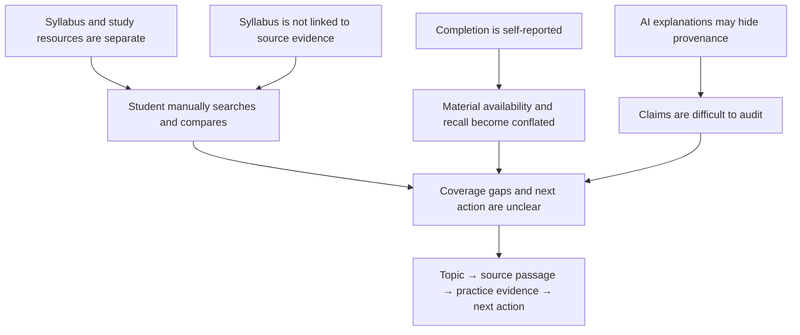
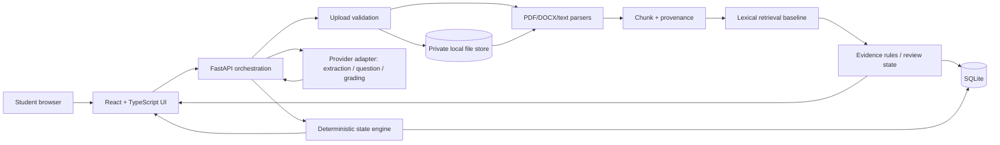
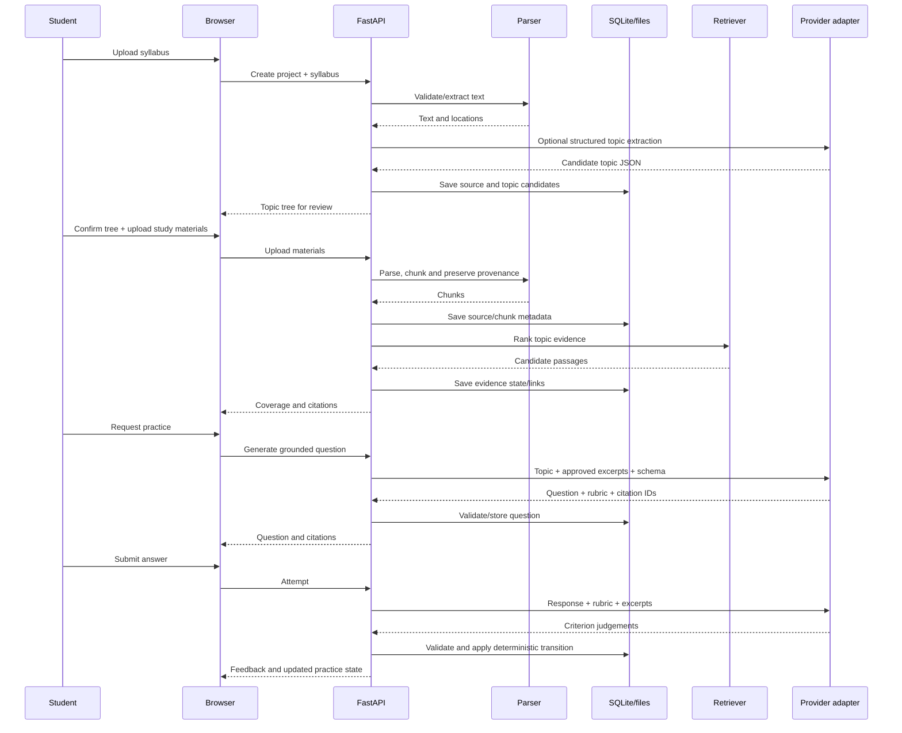
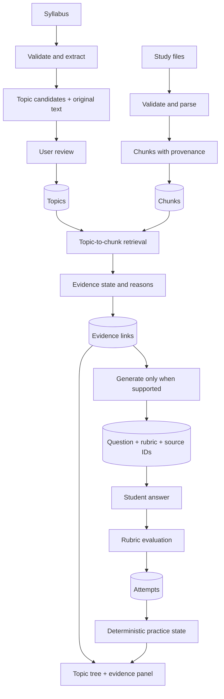
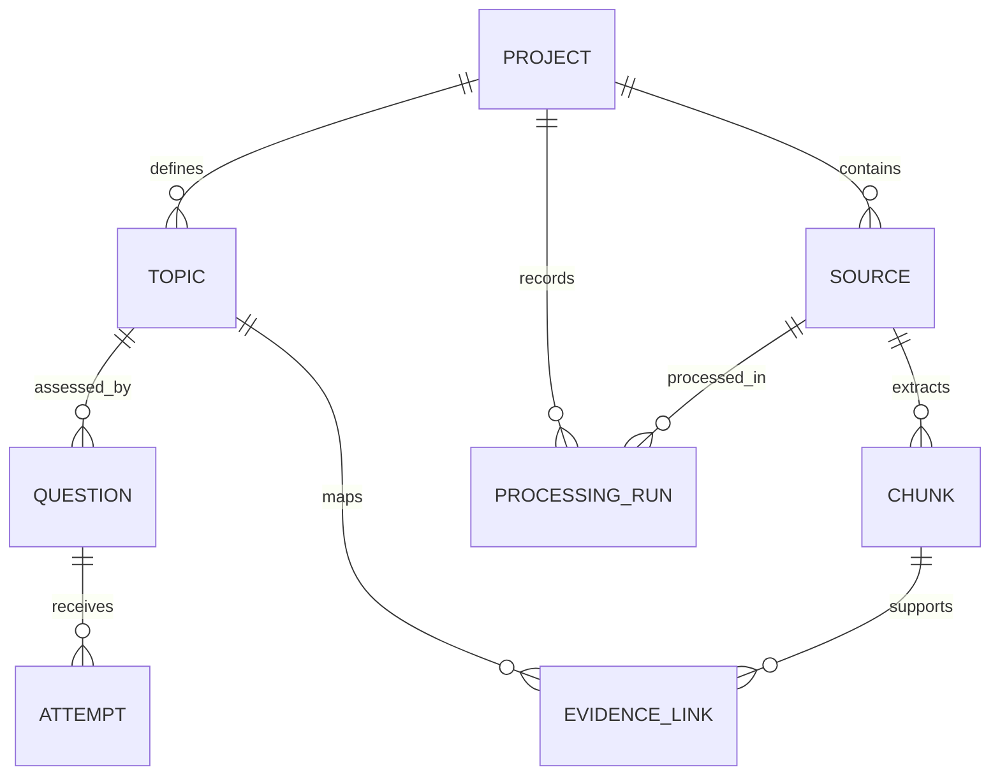

# Solution Design — Syllabus-to-Evidence Learning Gap Auditor

> **Status:** Proposed implementation design, not an official organiser-approved solution or proof of educational effectiveness.  
> **Prepared:** 24 October 2026  
> **Inputs:** `problem_research(4).md` and `problem_understanding(1).md`  
> **Planning envelope:** The source report assumes 2–4 developers, 24–48 hours, AI-assisted coding, about 8 GB RAM, no dedicated GPU and limited budget. These are assumptions, not verified event constraints.

## Evidence labels

- **[VERIFIED]** Supported by a source examined for this document.
- **[SOURCE]** Stated in an uploaded source; not necessarily independently re-verified.
- **[INFERRED]** Reasonable conclusion from the available material.
- **[PROPOSED]** Design decision or target, not an existing capability.
- **[ASSUMPTION]** Unverified condition on which the plan depends.
- **[UNKNOWN]** Not established by available evidence.
- **[CONTRADICTED]** Conflicts with evidence currently available.

Guiding principle: **a result must be inspectable; absence of evidence must not become evidence of coverage.**

---

# 1. Executive Summary

Students often prepare for a course using a syllabus, lecture slides, notes, PDFs and other resources kept separately. They may spend time searching for topics, overlook syllabus requirements that their current materials do not support, and confuse reading a topic with being able to explain it. The supplied research proposes an audit-and-action system: connect a syllabus, actual passages in the learner's own materials, and evidence from practice responses.

**Syllabus-to-Evidence Learning Gap Auditor** (working name) accepts a syllabus and study materials, extracts a reviewable topic hierarchy, indexes text with source provenance, retrieves candidate passages for each topic, and gives every topic separate **material-evidence** and **practice-evidence** states. It shows why a topic is supported, weak/uncertain or missing; offers a practice question only when relevant material exists; evaluates an answer against a rubric; and recommends a next step.

This is not primarily a chatbot. The primary interface is an expandable syllabus tree with an evidence panel. A full graph editor is optional and deliberately not on the critical path.

**Recommended build:** React + TypeScript + Vite; Python + FastAPI; PyMuPDF for text-based PDFs; `python-docx` only if the parser smoke test passes; TXT/Markdown support; SQLite; lexical retrieval using exact matching and scikit-learn TF–IDF; a provider adapter for structured extraction where needed, grounded question generation and rubric-based feedback. Add embeddings only if a labelled benchmark proves they help and a permitted model/service is available.

The meaningful technical chain is:

`Syllabus topic → candidate source passage → inspectable evidence → grounded question → response rubric → topic evidence state`

The model must not decide source coverage by assertion, make up page numbers, or directly change persistent states. The application validates chunk IDs and output schemas, then updates states through deterministic rules. One good answer is not proof of durable mastery, and this product cannot promise improved grades.

**Minimum demonstrable result:** upload an unseen syllabus and an intentionally incomplete bundle, build a topic tree, show actual passages for supported topics, flag missing topics, generate a question answerable from a cited passage, record an answer, and update the practice state. Adding a source can update material coverage; answering a question must not change whether source material exists.

**Biggest uncertainty:** the usefulness and distinctiveness of this precise workflow have not been validated with target users or same-input competitor tests. Current Google documentation describes Gemini study notebooks that accept syllabi/materials and provide diagnostic quizzes, personalised lessons and progress tracking. Generic “AI study plan,” “quiz” and “progress dashboard” are therefore not defensible novelty claims. The potential differentiation is the inspectable source-to-syllabus audit and honest handling of missing evidence; that hypothesis must be tested.

---

# 2. Problem Statement and Understanding

## 2.1 Working problem statement

Students studying from fragmented materials lack a reliable, inspectable way to compare the topics required by their syllabus with the material they currently possess, identify unsupported areas, and distinguish source availability from a demonstrated practice response. Build a student-facing system that converts a real syllabus into a reviewable hierarchy, maps uploaded materials to topic-level source evidence, highlights missing or uncertain support, enables source-grounded practice on supported topics, and recommends an actionable next step while communicating uncertainty honestly.

## 2.2 Source status

- **[SOURCE]** `problem_research(4).md` is a research report for EdTech + Generative AI. It recommends merging “Syllabus–Material Coverage Auditor” and “Evidence-Based Syllabus Mastery Auditor.”
- **[SOURCE]** `problem_understanding(1).md` explicitly says the proposed problem is derived from research, not verified as an official organiser-issued problem statement.
- **[UNKNOWN]** No event name, PS identifier, official rules, required stack, submission format, judging rubric, actual team assignment or deadline was included in the supplied files.
- **[INFERRED]** Treat this as an independently proposed student-facing product until an official brief is available.

## 2.3 Questions the system must answer

1. What topics does the syllabus explicitly require?
2. Which uploaded passages appear to support each topic?
3. Which topics have no evidence, weak evidence or ambiguous evidence?
4. Can a practice question be generated from the evidence without pretending absent content exists?
5. What did a learner's response demonstrate against an explicit rubric?
6. What is the next practical action: add a source, inspect evidence, review or practise?

## 2.4 Non-promises

The system does not prove that a syllabus is complete, that every relevant resource was uploaded, or that a learner has durable knowledge. It does not guarantee exam-score improvement, replace a teacher, train a foundation model, or require institutional LMS integration. Novelty is not established merely by using AI, a tree, embeddings or a dashboard.

---

# 3. Problem Decomposition and Requirements Traceability

These are **product requirements derived from the proposed problem**, not organiser-issued mandates. “Must Have” describes the recommended solution's core, not an official competition rule.

| ID | Requirement / source | Interpretation | Category | Priority | Verification | Planned implementation |
|---|---|---|---|---|---|---|
| R-001 | Syllabus intake (§§11,17 of source report) | User can upload a syllabus or paste text | Functional | Must Have | Upload both paths | `POST /api/projects/{id}/syllabus` |
| R-002 | Topic hierarchy | Extract units/topics/subtopics while preserving original phrases | Functional/domain | Must Have | Compare to manual annotation; allow correction | Heuristics + optional schema-constrained LLM |
| R-003 | Study-material intake | PDF and TXT/Markdown; DOCX only if verified | Functional | Must Have | Valid, empty, corrupt and unsupported files | Upload/parser adapter |
| R-004 | Provenance | Every chunk has source/chunk ID and location where available | Data integrity | Must Have | Check every reference resolves | Chunk metadata schema |
| R-005 | Topic-to-passage matching | Rank candidates for every topic | Algorithm | Must Have | Labelled passages; report precision/recall | Exact terms + TF–IDF baseline; optional embeddings only after benchmark |
| R-006 | Missing/weak detection | Do not label absent or ambiguous evidence as covered | Functional/safety | Must Have | Known missing and distracting-topic tests | Conservative state rules |
| R-007 | Inspectable evidence | User can inspect source passage behind a status | UX/auditability | Must Have | Validate sample citations | Evidence panel with excerpt/source/location |
| R-008 | Grounded practice | Question uses retrieved passages and approved chunk IDs | Functional/AI | Must Have for full MVP | Answerability audit | Provider adapter + structured question/rubric |
| R-009 | Answer evaluation | Response evaluated against visible rubric | Functional/AI | Must Have for full MVP | Strong/weak/borderline answers and human review | Rubric-based grader with inconclusive result |
| R-010 | Independent states | Material and practice status never overwrite each other | Domain/data integrity | Must Have | State-transition tests | Separate fields and handlers |
| R-011 | Next action | Prioritise gaps and weak practice without inventing syllabus weights | Functional | Should Have | Predefined recommendation cases | Deterministic rules |
| R-012 | Fresh input | Not hard-coded to demo syllabus | Acceptance | Must Have | Upload unseen syllabus | Dynamic pipeline |
| R-013 | Parser errors | Explain unsupported, empty and corrupt files | Reliability | Should Have | Bad-file tests | Per-file typed errors |
| R-014 | Source re-map | Added/changed material updates affected evidence | Functional | Should Have | Add source to a gap topic | Versioning + invalidation |
| R-015 | Persistence | Project state survives browser refresh for demo | Persistence | Should Have | Refresh and reopen | SQLite |
| R-016 | Data handling | Explain local and external processing/deletion | Privacy | Must Have | Inspect copy and deletion path | Local-first prototype; provider disclosure |
| R-017 | Secure upload | Limit type, bytes/pages and processing; inspect actual content | Security | Must Have | Mismatch/malicious/oversized file cases | Upload guard and parser limits |
| R-018 | Reproducible evaluation | Provide fixtures and labels | QA | Must Have | Run documented benchmark | `tests/fixtures`, benchmark script |
| R-019 | Hierarchy UI | Main interface is an expandable syllabus tree | UX | Must Have | Task walkthrough | Nested tree + detail pane; graph editor deferred |
| R-020 | External AI failure | Do not corrupt state or silently show fake outputs | Reliability | Must Have | Timeout/schema failure tests | Provider adapter, typed errors and safe failure |
| R-021 | Event compliance | Verify rules/submission/rubric if competition is confirmed | Submission | Unknown/gate | Official source review | Do not infer event rules |

**Release gate:** R-001–R-010, R-012 and R-016–R-020 should work end-to-end. If AI generation/grading cannot be connected, deliver only the verified coverage-audit subset and label it honestly as partial. OCR, video/URL ingestion, multilingual generation, spaced repetition, accounts/classrooms, LMS, exam-score prediction, inferred prerequisites and custom model training are out of scope.

---

# 4. Root-Cause Analysis



This is a conceptual model derived from the uploaded report, not a causal model validated by user research.

### Why existing approaches may not fully solve this specific workflow

The source report describes strong but distinct categories: source-grounded notebooks, AI study tools, guided tutoring, adaptive systems and educational knowledge graphs. **[VERIFIED]** Google's official post of 25 June 2026 says Gemini study notebooks can use syllabi/class materials, provide diagnostic quizzes, create personalised lessons and track progress. Thus broad claims that competitors lack studying, quizzes or progress tracking are contradicted. The possible gap is the combined, inspectable relationship among each syllabus topic, actual source passages, separate practice evidence and status invalidation when material changes. That gap must be tested, not asserted.

### Within team control

- Store original wording and provenance; make evidence inspectable.
- Prevent “supported” status when no adequate passage is available.
- Validate outputs/citation IDs and use deterministic state transitions.
- Test distracting and missing-source cases.
- Tell the truth about uncertainty and unimplemented features.

### External dependencies

Document quality, user-provided corpus completeness, model provider availability/policy/cost/retention, actual user demand and official judging constraints. The hardest technical work is reliable mapping and question/grading quality on messy, unseen inputs; market uniqueness and learning gains are not established.

---

# 5. Stakeholders and User Roles

| Stakeholder | Goals/actions | Inputs and outputs | Risks/permissions | Success criterion |
|---|---|---|---|---|
| Self-directed student (primary) | Upload, review tree, inspect passages, practise, delete project | Own syllabus/materials → topic evidence and next action | Must understand where documents go; should access only their own uploads | Completes workflow without developer help |
| Student with incomplete notes | Identify missing material and add it later | Partial sources → explicit missing/weak state | False coverage can mislead | Added source repairs material state without proving learning |
| Teacher/TA (future) | Review curriculum/material alignment | Would review course resources | Multi-user permissions and accuracy expectations increase scope | Not MVP |
| Institution/curriculum team (future) | Audit multiple courses | Authoritative documents and many users | Governance, privacy and integration requirements | Needs separate discovery |
| AI provider (dependency) | Return extraction/question/grading results | Minimal relevant excerpts/answers | External disclosure; current terms unknown until selected | Smoke test passes; outage cannot corrupt state |
| Judge/evaluator | Verify technical claim | Fresh input or test case | Demo cannot disguise fixture/mock as live | Can inspect source, missing state and practice transition |
| Content author/rightsholder | Control use of content | May own notes/textbooks | Copyright/confidentiality | No unnecessary redistribution; deletion and provenance clear |

**MVP access model:** no login for a local single-user prototype. If deployed for multiple users, authentication and server-side project ownership checks are mandatory before storing private uploads. An unguessable project ID is not authorization.

---

# 6. Goals, Non-Goals and Success Metrics

## Goals

1. Extract a reviewable hierarchy from an unseen syllabus.
2. Link each topic to real source passages where available.
3. Identify missing/ambiguous evidence conservatively.
4. Generate practice grounded in accepted passages.
5. Record answer evidence separately from material evidence.
6. Recommend a reasoned next action and support repeatable evaluation.

## Non-goals

Predicting exam marks; proving long-term mastery from one attempt; institutional analytics; redistributing textbooks; universal prerequisite discovery; model training; OCR/video ingestion in v1; a graph editor for decoration; unmeasured performance superiority.

## Metrics

Targets are **provisional engineering targets**, not official criteria or results already achieved.

| Metric | Definition | Proposed gate/measurement | Limitation |
|---|---|---|---|
| Topic extraction precision/recall | Extracted topics vs manual annotation | Report both; provisional target ≥0.85 on a small labelled sample if representative enough; inspect omitted units | Small sample won't generalise |
| Missing-topic detection | Deliberately absent topics correctly flagged | 100% of absent topics in the scripted demo fixture must not be marked supported | Narrow functional check only |
| Evidence precision | Returned passages judged relevant among items treated as supported | Provisional ≥0.85 on labelled pairs; report sample size | Reviewers may disagree |
| Citation integrity | References resolve to stored chunks/locations | 100% technical resolution; relevance is a separate human check | Valid ID alone does not mean relevant |
| Question grounding | Question answerable from cited passage | Manually audit each question used in live demo; sample generated questions | Demo audit doesn't establish broad reliability |
| Grading agreement | Model results vs human rubric labels | Report agreement and all disagreement types on strong/weak/borderline samples | Not psychometric validation |
| State-transition correctness | Status result vs documented rules | 100% of deterministic unit tests pass | Does not prove evidence quality |
| Latency/reliability | Time and errors by stage | Measure on fixed bundle, machine and provider; set targets after smoke test | Network/model dependent |
| User utility | User locates gap and understands why | Brief task test with a non-team user if available | Not market validation |

Baseline: ask a student to manually compare the same syllabus/material set and record task time and missed topics. Claim improvement only if both workflows are measured comparably.

---

# 7. Research Methodology and Evidence Register

The design uses the two uploaded files as project sources and checks current official technical/product references where material to feasibility. Product pages show advertised capabilities, not independent educational effectiveness. The files report no student interviews, controlled efficacy experiment, executed benchmark or verified official event rubric.

| Ref | Source and date | Supports | Does not establish |
|---|---|---|---|
| P1 | `problem_research(4).md`, dated 24 Oct 2026 | Candidate choice, workflow, demo, proposed architecture, planning assumptions | Official status, demand or implemented performance |
| P2 | `problem_understanding(1).md`, dated 24 Oct 2026 | Requirements, boundaries, acceptance tests, unknowns | Passing tests or official rules |
| S1 | Google, “5 ways to learn with study notebooks in the Gemini app,” 25 Jun 2026, https://blog.google/innovation-and-ai/products/gemini-app/gemini-study-notebooks/ | Advertised syllabus/material uploads, diagnostic quizzes, personalised lessons, gaps and progress | Exact parity with our workflow or independent efficacy |
| S2 | UNESCO, “Guidance for generative AI in education and research,” published 7 Sep 2023; page updated 16 Jan 2026, https://www.unesco.org/en/articles/guidance-generative-ai-education-and-research | Human-centred use, privacy and validation concerns | Product-specific efficacy or legal advice |
| S3 | FastAPI, “Request Files,” checked 24 Oct 2026, https://fastapi.tiangolo.com/tutorial/request-files/ | `File`/`UploadFile` and spooled-file handling; `python-multipart` requirement | Secure upload without extra controls |
| S4 | PyMuPDF, “Text,” checked 24 Oct 2026, https://pymupdf.readthedocs.io/en/latest/recipes-text.html | PDF extraction techniques and unexpected reading-order/line-break caveats | Perfect extraction or OCR for scans |
| S5 | scikit-learn, `TfidfVectorizer`, https://scikit-learn.org/1.7/modules/generated/sklearn.feature_extraction.text.TfidfVectorizer.html | Text-to-TF–IDF feature representation | Semantic understanding or coverage validity |
| S6 | React Flow, https://reactflow.dev/ and https://reactflow.dev/learn/concepts/building-a-flow | Node/edge UI capability and advertised MIT licence | That graph UI is needed or improves this product |
| S7 | OWASP, “File Upload Cheat Sheet,” https://cheatsheetseries.owasp.org/cheatsheets/File_Upload_Cheat_Sheet.html | Allowlisted types, content validation, safe names, limits and safe storage | Complete protection against all parser risks |
| S8 | SQLite, “Foreign Key Support,” https://www.sqlite.org/foreignkeys.html | Foreign-key enforcement often must be explicitly enabled per connection | That schema declarations alone ensure enforcement |
| S9 | OpenAI, “Structured model outputs,” https://developers.openai.com/api/docs/guides/structured-outputs | Compatible models can constrain output to supported schemas | That OpenAI is selected, or valid schema means factual answer |
| S10 | Li et al., “CourseKG,” *Applied Sciences* 14(7), 2710, 23 Mar 2024, https://doi.org/10.3390/app14072710 | Prior educational knowledge-graph research | Novelty of this product |
| S11 | Trumble et al. (2024), retrieval/distributed-practice systematic review, https://pubmed.ncbi.nlm.nih.gov/37615780/ | Context for considering retrieval practice; source report notes 56 studies/63 experiments and caveats | Proof the app improves grades or a single answer proves mastery |
| S12 | Quizlet AI study tools, https://quizlet.com/features/ai-study-tools | Product feature lead described in source report | Independent efficacy or absence of syllabus auditing |
| S13 | Khan Academy / Khanmigo, https://www.khanacademy.org/khan-labs | Guided tutoring lead described in source report | Current exact access/behaviour without direct testing |
| S14 | Uedu knowledge graph https://uiuc.uedu.tw/doc/knowledge-graph; Squirrel Ai https://squirrelai.com/ | Leads for knowledge graph/adaptive learning | Independent validation or direct comparability |

## Verification before implementation lock

1. Obtain actual official event rules/rubric if this is a competition.
2. Run clean installs and pin actual dependency versions.
3. Test parsers against actual demo files and decide whether DOCX is ready; OCR is not promised.
4. Smoke-test the AI provider for schema output, insufficient evidence, timeout, quota, cost and data terms.
5. Benchmark lexical retrieval before adding embeddings.
6. Same-input test competitors before making differentiation claims.

---

# 8. Existing Solutions and Related Work

| Approach | Strength | Limitation relative to proposed workflow | Decision |
|---|---|---|---|
| Manual syllabus/notes comparison | Transparent, low-cost, no model dependency | Tedious; no persistent evidence ledger | Use as baseline |
| Tick-box topic tracker | Simple hierarchy and status | Status may be self-reported; no passage evidence | Keep tree, not as complete solution |
| Source-grounded notebook | Useful explanations and source Q&A | May not present the exact per-topic evidence and separate practice state we intend | Adopt grounding principle; test product overlap |
| AI quiz generator | Fast practice material | Questions can be detached from topic coverage/source evidence | Generate only after evidence step |
| Adaptive system | Learner-specific pathways | Potentially larger infrastructure and learner data needs | Borrow simple next-action rule only |
| Educational knowledge graph | Represents relationships | Graph display doesn't prove passage support | Keep minimal relational model |
| Pure LLM agent | Fast, flexible prototype | Opaque decisions, weaker repeatability, possible unsupported claims | Reject as coverage authority |
| TF–IDF lexical search | Lightweight and reproducible | Can miss paraphrases/synonyms | Implement as baseline |
| Hybrid lexical/semantic retrieval | May retrieve paraphrases | Extra model/provider work; similarity isn't proof | Add only if benchmark justifies it |

## Competitor-gap discipline

Current Google study-notebook documentation overlaps with syllabus/material uploads, quizzes, knowledge gaps, personalisation and progress tracking. This contradicts broad claims that these features are absent from current products. Test whether competitors provide topic-by-topic inspectable source passages, a separate source-coverage/practice distinction, and source-driven state updates. Record date, account/region constraints, exact inputs and observed results. Non-documentation is not proof a feature does not exist.

---

# 9. Alternative Solution Plans

Four materially different plans are considered. Effort estimates are planning assumptions for a small team starting from an empty repository, not promises.

## Plan A — Deterministic Coverage Auditor

**Concept/workflow:** Upload syllabus → heuristic headings/list extraction → review tree → upload notes → parse page text → exact phrase and TF–IDF search → display ranked excerpts and missing states → use a small author-written practice fixture. Core coverage requires no model call.

**Architecture/technology:** React/TypeScript, FastAPI, PyMuPDF, optional `python-docx`, scikit-learn TF–IDF, SQLite, pytest.

**Strengths:** Reproducible, cheap, no GPU or API required, easy to test, lower external-data exposure.

**Weaknesses:** Topic extraction can be brittle; synonyms/paraphrases may be missed; a fixed question bank is not live generative practice; users need more corrections.

**Estimate:** 12–24 person-hours for a narrow baseline, plus polish/integration; roughly 24–36 elapsed hours for a small team depending on experience.

**Risks/demo/evaluation:** False negatives from different wording; test fresh syllabus plus known present/partial/missing topics and citation integrity. A fixed question must be labelled prewritten, not “generated live.”

**Best when:** Model access is unavailable, unacceptable for privacy, or time is extremely short. **Poor when:** a live GenAI feature is a core judging expectation.

## Plan B — Hybrid Evidence Auditor with Grounded Generation (recommended)

**Concept/workflow:** Deterministic parsing and provenance → optional model-assisted extraction into a schema → user confirms tree → chunk/index sources → lexical retrieval plus optional semantics → conservative evidence states → inspect passages → generate question/rubric from approved passages → grade response against rubric → deterministic practice-state update → next action.

**Architecture/technology:** React/TypeScript client; FastAPI; parser, chunker, retriever, evidence classifier, provider adapter, deterministic state engine; SQLite and private local file storage. AI is an optional external service for bounded tasks, not the system's source of truth.

**Strengths:** Balances traceability, technical depth and visual demonstration; AI works on language tasks, while source IDs and state transitions remain testable; supports new inputs.

**Weaknesses:** API cost, delay, policy and data-handling issues; short-answer grading can be inconsistent; provider access must be checked early.

**Estimate:** 24–40 person-hours for a credible MVP. Plausible for 2–4 developers over 24–48 elapsed hours only with early contracts, familiar tools and a working provider.

**Risks/demo/evaluation:** Bad extraction, false source match, hallucinated question, unreliable grading or interface drift. Demo an unseen syllabus, incomplete notes, valid citations, one grounded question, a state transition and a repaired topic after new source upload. Evaluate on the same labelled benchmark as Plan A plus question-grounding and grader agreement.

**Best when:** A permitted model service passes preflight and the team wants a credible EdTech + GenAI workflow. **Poor when:** no provider is accessible and no tested local model is available.

## Plan C — End-to-End LLM Study Agent

**Concept/workflow:** Upload everything; one/few prompts ask the model to produce topic tree, coverage, questions, grading and plan; UI displays its answer.

**Architecture:** Thin UI/API, file ingestion, one model service and minimal state.

**Strengths:** Fast to prototype; flexible for irregular text; low initial orchestration work.

**Weaknesses:** Hard to prove where a coverage claim came from; model can mix general knowledge and uploaded sources; difficult to reproduce; states can shift between calls; susceptible to prompt injection and malformed results.

**Estimate:** 8–20 person-hours for a narrow prototype, but auditability adds work afterwards.

**Risks/demo/evaluation:** Can look impressive but fail judge spot-checks. Compare generated states to a labelled corpus and inspect every cited passage.

**Best when:** Doing a quick UX experiment with no auditability claim. **Poor when:** provenance and honest coverage are defining requirements.

## Plan D — Local-First Semantic Audit with Open Models

**Concept/workflow:** Parse and embed locally; retrieve semantically; run question generation/grading locally; store locally.

**Architecture:** Local React/API, model runtime, SQLite and filesystem.

**Strengths:** Better potential privacy boundary, no per-call hosted inference charge after setup, less network dependence once models are installed.

**Weaknesses:** Model downloads, compatibility, CPU latency, memory pressure and licences require verification. The assumed 8 GB RAM/no dedicated GPU makes generative inference feasibility unknown; it must not be assumed.

**Estimate:** 30–60+ person-hours when setup, performance tuning and packaging are included; may exceed the window.

**Risks/demo/evaluation:** OOM, slow results, installation/platform failure, licence mismatch. Report actual model identifier, quantisation, memory and latency. Compare quality/latency with same inputs and fair controls.

**Best when:** Local processing is mandatory and a suitable model is already tested. **Poor when:** no prior inference setup exists and build time is tight.

---

# 10. Comparative Evaluation of Alternatives

Weights are a **proposed internal decision tool**, not official event criteria. The 1–5 scores are ordinal assessments, not measured performance.

| Criterion | Weight | Reason |
|---|---:|---|
| Traceability/correctness | 20% | False support breaks the product's central promise |
| Feasibility in assumed window | 20% | A small completed solution beats an unfinished ambitious one |
| Requirement coverage | 15% | Needs syllabus, evidence and practice—not only generated text |
| Reproducibility/testability | 10% | Evaluators must inspect outputs |
| Demo clarity | 10% | Core state changes must be obvious |
| Privacy/resilience | 10% | Documents may be sensitive; model services fail |
| Cost/resource fit | 10% | Budget/hardware assumptions matter |
| Extensibility | 5% | Useful after core succeeds |

| Plan | Traceability | Feasibility | Coverage | Testability | Demo | Privacy/resilience | Cost/resource | Extensibility | Weighted / 5 (approx.) |
|---|---:|---:|---:|---:|---:|---:|---:|---:|---:|
| A. Deterministic baseline | 5 | 5 | 3 | 5 | 4 | 5 | 5 | 3 | **4.45** |
| B. Hybrid evidence + generation | 4 | 4 | 5 | 4 | 5 | 3 | 3 | 4 | **4.05** |
| C. End-to-end LLM agent | 2 | 4 | 3 | 2 | 4 | 2 | 3 | 3 | **2.85** |
| D. Local semantic models | 4 | 2 | 4 | 3 | 3 | 5 | 3* | 4 | **3.35** |

`*` Local inference avoids per-call cost but may incur significant model-download, memory and setup costs. The ranking assumes that model/hardware setup is not already solved.

Plan A wins under a strongly risk-averse weighting. Plan B is chosen because the intended theme includes generative AI and source-grounded practice is a core workflow, while Plan B keeps Plan A's deterministic backbone. If AI setup fails, the team should deliver a clearly labelled **coverage-only partial build**, not pretend the full GenAI MVP works.

### Sensitivity check

- Increase feasibility/privacy weights: Plan A wins.
- Increase requirement coverage and genuine GenAI demonstration: Plan B wins if provider access/terms pass preflight.
- Plan C wins only if rapid non-auditable prototyping dominates correctness, contrary to the core problem.
- Plan D becomes more attractive if a tested local model and suitable hardware are already available.

Scores cannot capture unknown judging rules, team skill or provider access; a short smoke test can change the recommendation.

---

# 11. Feature-Level Analysis and Compatibility

| Feature/technique | Source plan | Benefit | Risk/compatibility | Decision | Destination |
|---|---|---|---|---|---|
| Editable syllabus tree | A/B/C | Mirrors hierarchy; supports correction | Low cost; extraction errors need review | Adopt | Primary curriculum UI |
| Chunk IDs/page metadata | A/B/D | Makes claims inspectable | PDF layout may be imperfect | Adopt | Parser and chunk schema |
| TF–IDF lexical retrieval | A/B | Lightweight reproducible baseline | Misses paraphrases | Adopt | First retriever |
| Semantic embeddings | B/D | May improve paraphrase matching | Additional model/provider and quality risk | Defer/adapt | Add behind `Retriever` only if benchmark improves |
| Schema-guided topic extraction | B/C | Handles irregular formatting | Schema-valid result can still be wrong | Adopt selectively | Optional extractor plus user review |
| LLM directly asserts coverage | C | Minimal implementation effort | Opaque, can hallucinate support | Reject | Retrieval + review rules determine coverage |
| Grounded question/rubric generation | B/C/D | Links AI to a real topic/source | May generate unanswerable question | Adopt cautiously | Provider adapter, allowed chunk IDs and audit |
| LLM short-answer grading | B/C/D | Supports open responses | Grading variance | Adopt cautiously | Rubric criteria; inconclusive option and benchmark |
| Deterministic state engine | A/B | Clear semantics; easy to test | Depends on input quality | Adopt | Domain module |
| Prewritten test question | A | Reliable test fallback | Not live generation | Keep for fixture/testing only | Clearly labelled demo content |
| Interactive graph editor / React Flow | B/D | Diagram and edge editing | Extra UI time; not required by syllabus tree | Defer | Optional only after user test proves usefulness |
| Spaced repetition / exam prediction | Adaptive variant | Could help long-term learning | Needs history/validation; predictions unsupported | Reject from MVP | Reconsider after usage data |
| OCR/URLs/video | Extended variants | Wider input coverage | New parser and failure paths | Defer | Later only if validated need |
| Prerequisite inference | Graph variants | Could organise sequence | May invent dependencies | Defer | Only explicit prerequisites or separately labelled inference |
| Cloud database/auth | Hosted variant | Multi-user access | Deployment/security burden | Defer for local MVP; mandatory before shared private hosting | Revisit when deployment is decided |

### Resolve combination conflicts

1. **Semantic similarity is not proof:** display the passage and use weak/uncertain when the evidence is not clearly adequate.
2. **Model extraction vs stable IDs:** preserve original text, assign application IDs, validate parents/no cycles, and require review.
3. **AI grades vs deterministic states:** return criterion-level results; validate schema and have application code decide status; ambiguous results become inconclusive.
4. **Multiple formats vs reliability:** PDF/text first; DOCX only after real extraction tests; no silent success for scan-only PDFs.
5. **Graph UI vs learner task:** nested tree first; graph view only if task testing shows that it helps users identify gaps.

---

# 12. Final Integrated Solution and Selection Rationale

**Select Plan B with Plan A as its deterministic backbone.** The combination uses stable parsing/provenance, lexical retrieval, optional semantic enrichment, bounded schema-based AI tasks and deterministic state updates.

- **Borrow from A:** lexical baseline, editable topics, citation integrity, local storage and test-first acceptance criteria.
- **Use from B:** grounded question/rubric generation, provider isolation and evidence-first interaction.
- **Use selectively from C:** a language model for messy syllabus formatting, but not as a black-box coverage authority.
- **Borrow from D:** local-first privacy principles, without requiring local generative inference until it is benchmarked.

This is stronger than a pure deterministic tracker because it can offer genuinely grounded generated practice; stronger than an all-LLM agent because evidence and states remain inspectable; and more achievable than local-first generation under unverified low-resource hardware.

### Non-negotiable design rules

1. No adequate evidence → no source-grounded question.
2. Similarity score is a retrieval signal, not “percent of syllabus covered.”
3. Material and practice states are independent.
4. Every citation resolves to actual chunk metadata; models do not invent page numbers.
5. The application, not the model, owns state transitions and database writes.
6. Say “demonstrated on this attempt,” not “mastered forever.”
7. Provider/schema failure is visible, not replaced silently by a mock.
8. Users can correct extraction while original wording remains available.

### Still undecided

Provider/model and budget; official requirements/rubric; local vs hosted demo; reasonable upload limits; and whether embeddings outperform lexical search on the actual corpus.

---

# 13. Product Scope and Feature Inventory

## Product definition

- **Name:** Syllabus-to-Evidence Learning Gap Auditor (provisional).
- **One-line description:** Checks whether uploaded study material supports syllabus topics, exposes the source passages, and links supported topics to observable practice evidence.
- **Primary user:** Self-directed student preparing for a course assessment.
- **Value:** Replace manual source searching and tick-box confidence with an inspectable topic-to-source map plus separate practice evidence.
- **Differentiation hypothesis:** Transparent coverage audit and source-linked state changes, not novelty of AI tutoring.
- **First version:** One project at a time; nested syllabus tree; PDF and text sources; DOCX only after validation; passage matching; material states; one grounded question type; rubric feedback; next action; project deletion.
- **Excluded:** accounts, multi-user institution dashboards, OCR, video/web ingestion, grade prediction, custom model training, universal prerequisite inference, spaced repetition.

## Feature inventory

| ID | Feature | Trigger/input | Processing/output | Success/failure and acceptance | Priority |
|---|---|---|---|---|---|
| F-01 | Create project | Title + syllabus | Project/source ID | Persists/reopens; malformed input returns clear error | P0 |
| F-02 | Parse syllabus | File/text | Reviewable topic hierarchy | Labelled fixture compared; no fabricated defaults | P0 |
| F-03 | Edit hierarchy | Rename/add/delete/re-parent | Canonical tree with original text preserved | Edits persist; invalid parent/cycle rejected | P1 |
| F-04 | Upload source | PDF/TXT; DOCX if verified | Parse status and source record | Each file reports success/failure; corrupt file fails explicitly | P0 |
| F-05 | Chunk with provenance | Parsed source | Chunk ID, source/page/section | Every chunk points to source and valid location | P0 |
| F-06 | Map evidence | Topics + chunks | Ranked candidates and state | Known missing cases not falsely supported; report precision/recall | P0 |
| F-07 | Inspect evidence | Topic selection | Excerpt, source and reason | Displayed citation matches real passage | P0 |
| F-08 | Generate practice | Supported topic + excerpts | Question, expected concepts, rubric, chunk IDs | Question answerable from citations; invalid IDs rejected | P0 for full MVP |
| F-09 | Submit answer | Response + question | Attempt record | Correct topic/question linkage; empty response rejected | P0 |
| F-10 | Grade response | Answer + rubric + sources | Per-criterion feedback | Strong/weak/borderline tests align or return inconclusive | P0 for full MVP |
| F-11 | Recommend next step | Current material/practice state | Action + explanation | Scripted examples return expected action | P1 |
| F-12 | Re-index source | Add/remove/change source | Updated evidence and stale history flags | Related material state updates; practice doesn't become demonstrated | P1 |
| F-13 | Delete project | User confirms | Delete DB/files/derived records | Files and rows removed or partial failure stated | P0 privacy |
| F-14 | Benchmark report | Labelled dataset + pipeline | Metrics and failure list | Reproducible output file with data/version metadata | P0 QA |

---

# 14. User Journeys and User-Perspective Walkthrough

## Journey A — Start a course

1. Student has a syllabus PDF and opens “Create course map.”
2. Upload or paste text; server checks type, size, signature, parse result and non-empty extraction.
3. Parser extracts headings/list structure; original heading text is retained.
4. UI shows a nested Unit → Topic → Subtopic tree; ambiguous nodes are marked for review.
5. Student edits labels/parents and confirms the tree.
6. If the PDF is scan-only or parsing fails, explain the problem and offer pasted text/manual entry. Do not silently produce a blank tree.
7. Success means a persisted and confirmed topic hierarchy exists.

## Journey B — Audit materials

1. Student adds lecture notes/slide PDFs.
2. API validates each file independently and records successes/errors per file.
3. Parser extracts text and location metadata; chunker assigns stable chunk IDs.
4. Retrieval ranks chunks for each confirmed topic.
5. UI shows `SUPPORTED`, `WEAK_OR_UNCERTAIN`, `NO_EVIDENCE` or `NEEDS_REVIEW`.
6. Selecting a topic reveals matching excerpts, filenames and page/section where available.
7. Student may reject an incorrect match, attach a passage or add a source and rerun mapping.
8. Errors preserve prior valid state and show stale/error labels, not a fabricated replacement.
9. Success means the student can inspect why a topic was marked supported or missing.

## Journey C — Practise a topic

1. Student selects a topic whose material state is `SUPPORTED`.
2. App sends only relevant topic metadata and approved excerpts to the configured model service.
3. Service returns structured question, expected concepts, rubric and source chunk IDs.
4. API validates the schema and checks that every citation ID exists and was included in the call's allowlist.
5. Student submits an answer.
6. Grader returns criterion-level judgement; invalid/ambiguous output may become `INCONCLUSIVE`.
7. Deterministic code persists the attempt and updates practice state; material coverage remains unchanged.
8. UI shows feedback, rubric and source passage.

## Journey D — Repair a material gap

1. Student sees “No relevant passage found in your uploaded files” for Trees.
2. They add a resource that covers Trees.
3. App parses/indexes the new file and remaps affected topics.
4. Material state may change to supported or weak/uncertain, with new citations.
5. Practice remains `NOT_ATTEMPTED` until a question is answered.

## Microcopy rules

- Say “No relevant passage found in your uploaded files,” not “This topic is not covered anywhere.”
- Say “Supported by these passages; check the excerpts,” not “100% covered.”
- Say “Demonstrated on this attempt,” not “Mastered.”
- Say “We could not confidently grade this answer,” not silently mark it correct.

---

# 15. System Architecture

## High-level architecture



The AI provider is a bounded external dependency, not the source of truth for evidence identifiers or state updates. Database and local-file storage are proposed for a local prototype; final deployment topology is unknown.

## Component responsibilities

| Component | Input/output | Responsibility and failure behaviour | Test |
|---|---|---|---|
| Browser client | User input/API JSON → visual states | Upload, topic review, evidence and practice; inline errors; disable duplicate actions | Component tests and browser walkthrough |
| Upload validator | File stream → validated temp file or typed error | Allowlist formats, size/page limits, content checks; reject unsafe input | Malformed/oversize/mismatched-type tests |
| Parser adapter | Valid file → text/location records | Extract per page/section; flag partial/empty/scanned files | Actual sample fixtures and manual extraction QA |
| Syllabus extractor | Syllabus text → topic candidates | Use heuristics first; model only when helpful; validate parent IDs, duplicates, cycles | Annotated syllabus fixtures |
| Chunker | Extracted text → stable chunks | Preserve source ID/page/section/version; reject empty chunks | Metadata tests |
| Retriever | Topics + chunks → ranked candidates | TF–IDF/exact phrase baseline; optional semantic layer only after benchmark | Labelled evidence benchmark |
| Evidence classifier | Candidates + rules → state/reason/links | Conservative statuses; no adequate candidates means no question generation | Positive, partial, absent and adversarial cases |
| AI adapter | Approved excerpts/rubric → structured result | Isolate vendor calls; check schema; allow provider swap; no direct DB writes | Contract tests and provider smoke test |
| State engine | Validated evidence/graded result → status update | Enforce independent states and stale invalidation | Unit tests over transition table |
| Persistence layer | Domain objects → IDs/records | SQLite transactions and relationships; safe file lifecycle | Integration and integrity tests |
| Benchmark runner | Fixture + labels → metrics/errors | Measures extraction, mapping, citations and grading agreement | Repeat run and report comparison |

## Execution sequence



## Architecture decisions

- One backend application is sufficient; no microservices.
- Parse small demo files synchronously first. Add a job/status mechanism only if observed timeouts require it.
- Keep retrieval, parser, state and recommendation logic out of API endpoint functions.
- Use stable IDs and a shared contract so frontend work can progress against fixture JSON.
- The syllabus tree is the primary view. React Flow is unnecessary for the core and remains deferred.

---

# 16. Data Flow and Component Responsibilities



## Provenance contract

Every chunk must include `chunk_id`, `source_id`, `text`, `page_start/page_end` where available, optional `section_path`, `chunk_index`, `parser_status`, `source_version` or content hash, and creation metadata. Citation references must resolve to a stored chunk; page/section comes from parsing, not a model's generated prose.

## Independent status model

**Material state**

- `UNMAPPED`: current corpus has not been analysed.
- `NO_EVIDENCE`: no candidate passage meets the configured rule in currently uploaded/extracted material.
- `WEAK_OR_UNCERTAIN`: related candidates exist but support is ambiguous/insufficient or needs confirmation.
- `SUPPORTED`: one or more inspectable passages meet the evidence rule.
- `NEEDS_REVIEW`: source/topic structure or alignment is ambiguous enough to need user input.

**Practice state**

- `NOT_ATTEMPTED`: no response exists.
- `QUESTION_READY`: a grounded question/rubric exists; may be derived rather than persisted.
- `PRACTICE_NEEDS_REVIEW`: response misses a required rubric criterion.
- `DEMONSTRATED_ON_ATTEMPT`: response meets configured rubric for this attempt only.
- `INCONCLUSIVE`: answer/output cannot be evaluated confidently.
- `STALE`: source/question/rubric version changed; history remains but is not treated as evidence against changed content.

## State-transition invariants

1. Material state changes only after source/syllabus mapping or explicit evidence correction.
2. Practice state changes only after question/attempt evaluation or invalidation.
3. No question for `NO_EVIDENCE`, `UNMAPPED`, or unresolved `NEEDS_REVIEW`.
4. Model response cannot directly write `SUPPORTED` or `DEMONSTRATED_ON_ATTEMPT`.
5. Schema/provider failure preserves prior valid state.
6. Source changes invalidate affected evidence; attempts retain the version on which they were answered.
7. Adding material never marks practice demonstrated; an answer never marks material supported.

---

# 17. Technology Stack and Alternatives

The stack is a proposal for the assumed small web-first team. Pin actual dependency versions after clean-install testing; no untested compatibility combination is claimed as already installed.

| Layer | Selection | Alternative | Rationale | Limitations / verification |
|---|---|---|---|---|
| Frontend | React + TypeScript + Vite | Next.js/plain HTML | Fast SPA build, typeable API contracts, low overhead | Clean install/build; deployment target unknown |
| Styling | CSS variables + component CSS; Tailwind optional if already familiar | Full UI framework | Custom accessible UI without extra stack lock-in | More manual styles; check contrast/focus/responsive layout |
| Curriculum view | Nested tree/list | React Flow | Mirrors syllabus hierarchy, faster to build; React Flow better for node-edge editors [S6] | Graph view deferred unless user test validates it |
| Backend | FastAPI + Pydantic | Flask/full-stack JS | Clear request validation and API contract; file upload docs available [S3] | Upload security/storage/auth still application responsibilities |
| PDF parser | PyMuPDF | pypdf/cloud parser | Text/page extraction without OCR service [S4] | Scanned PDFs and complex layouts can fail |
| DOCX parser | `python-docx` if verified | Defer DOCX | Avoids conversion API | Page-location provenance is weaker; test extraction |
| Text parser | UTF-8 TXT/Markdown input | Browser-only text | Low dependency footprint | Handle encoding errors |
| Retrieval v1 | Exact phrases + scikit-learn TF–IDF | BM25/embeddings only | Local, repeatable baseline [S5] | Does not guarantee semantic match; labelled benchmark needed |
| Semantic retrieval | Optional adapter for embeddings | TF–IDF only | May improve paraphrase retrieval if measured | Provider/model, cost and data handling unknown; do not add before benefit is shown |
| AI tasks | Provider adapter to selected permitted model; local model only if tested | Hard-coded vendor / fully local | Can swap provider; schema validation is separate from state logic | Exact model/account/cost/quota/terms must be checked |
| Schema validation | Pydantic plus provider structured outputs if supported | Manual JSON parse | Validates shape before storage; constrained format does not prove truth [S9] | Contract tests plus semantic review |
| Database | SQLite | PostgreSQL/Supabase | Minimal local setup and relational constraints | Hosted concurrent use needs separate design; enable FK enforcement [S8] |
| File store | Private local directory outside webroot | Object store | Simple local prototype and deletion | Not a production multi-instance storage design |
| Backend tests | pytest | unittest | Fixtures and parametrization | Run from clean environment |
| Frontend tests | Vitest + React Testing Library; Playwright if feasible | Manual only | Covers state rendering and key journey | Full browser automation may cost time |
| Quality | Ruff/Black and ESLint/Prettier if compatible | Manual style | Less integration churn | Confirm config and run before release |
| Version control | Git branches/PRs or reviewed merges | Shared worktree | Rollback and isolated work | Shared API contract needed |
| Deployment | Local demo first; hosted only if allowed/tested | Desktop-only | Keeps infrastructure off critical path | Hosted app needs auth, privacy, CORS and secrets review |

## Why not a graph database?

The MVP has simple relations: project→topics, source→chunks, topic→evidence, question→attempt. SQLite is sufficient for a small prototype; a visual graph component does not require a graph database. A graph database does not itself improve retrieval accuracy or evidence validity.

## AI provider decision gate

Before locking implementation, confirm account/access and budget; perform a small schema-output call; test insufficient evidence; test timeout/rate limit/invalid output; check current pricing, quota, retention and data-use terms; record actual model ID/date/latency. If no permitted provider is available, keep the lexical audit and clearly mark live generation/grading as unavailable; do not fake it.

---

# 18. Technical Methodology and Core Algorithm

## 18.1 Formal model

Let `T = {t1…tn}` be confirmed syllabus topics, `C = {c1…cm}` chunks from uploaded material, `meta(c)` source/page/section/version metadata, `R(t,c)` retrieval signals, `E(t)` selected inspectable evidence, `M(t)` material state, `Q(t)` a grounded question/rubric, `A(t)` a practice attempt and `P(t)` its state. The objective is not a validated “percentage of learning covered”; it is a traceable evidence map, conservative status and repeatable source-grounded practice.

## 18.2 Syllabus extraction

1. Parse headings, numbering, bullets and nesting deterministically first.
2. Use a model only if the structure is ambiguous, asking for a typed hierarchy derived from the extracted syllabus text.
3. Store stable `topic_id`, `parent_topic_id`, original phrase, canonical label, source location if available, order index, extraction method and review status.
4. Validate unique IDs, existing parents, no cycles and non-empty output.
5. Show the hierarchy to the user before finalising.
6. On extraction failure, allow pasted text/manual entry; never invent a default topic tree.

Canonicalisation must never replace or discard the original syllabus phrase.

## 18.3 Source parsing and chunking

For each file, assign a random internal filename; keep its display name as metadata; validate type/signature/size; parse page by page; report partial/empty/scanned results; split by headings and paragraphs before fixed-size fallback; preserve page/section metadata; record content hash/source version. Chunk size and overlap are tunable parameters to test, not settled facts. Overlap helps retain context but may duplicate evidence, so deduplicate similar/overlapping passages. PyMuPDF docs warn that PDF reading order and line breaks can be unexpected [S4]; inspect actual fixtures.

## 18.4 Topic-to-passage retrieval

**Baseline:** query from original/canonical label, parent labels and user-confirmed aliases; boost exact heading/phrase matches; fit TF–IDF over chunks; rank by sparse-vector similarity; optionally add character n-grams; show excerpts and source metadata. Do not display similarity as probability.

**Optional semantics:** add embeddings behind a retriever interface only if the labelled test shows lexical recall is inadequate and a permitted, affordable model is available. Embeddings can rank candidate evidence; they do not prove support.

**Material states:** `NO_EVIDENCE` when no candidate meets the rule; `WEAK_OR_UNCERTAIN` when related passages are partial/ambiguous; `SUPPORTED` only when a relevant, inspectable passage meets the configured rule; `NEEDS_REVIEW` for unresolved extraction/matching. Distinguish “parser extracted no text” from “no relevant evidence found.” Thresholds must be selected on labelled data; if that data is too small, use conservative rules and stronger human review.

## Pseudocode — evidence mapping

```text
function map_topics_to_evidence(topics, chunks, retriever, policy):
    index = retriever.build_index(chunks)
    results = []
    for topic in topics:
        if topic.needs_review:
            results.append(NEEDS_REVIEW(topic, "Review topic structure"))
            continue
        candidates = index.search(compose_query(topic.original_text,
            topic.canonical_label, topic.parent_labels, topic.confirmed_aliases))
        candidates = deduplicate_by_source_and_overlap(candidates)
        candidates = validate_candidate_metadata(candidates, chunks)
        if not candidates:
            results.append(NO_EVIDENCE(topic, "No relevant passage found in uploads"))
            continue
        evidence = evaluate_support_signals(candidates, policy)
        if evidence.ambiguous or evidence.between_thresholds:
            results.append(WEAK_OR_UNCERTAIN(topic, evidence.candidates, evidence.reason))
        elif evidence.meets_support_rule:
            results.append(SUPPORTED(topic, validated_chunk_ids(evidence.selected)))
        else:
            results.append(NO_EVIDENCE(topic, "Candidates did not meet the support rule"))
    persist_atomically(results)
    return results
```

## 18.5 Grounded question generation

Allowed only when material state is `SUPPORTED`. Send topic wording, selected excerpts and chunk IDs, instructions to use only that evidence, a strict output schema and an insufficient-evidence path. Required fields include question text/type, expected concepts, rubric criteria, source chunk IDs and `source_insufficient` flag. The app must check every ID against the supplied allowlist and the database, reject malformed/blank output, display excerpts beside the question and manually audit demo questions. A valid schema can still contain a wrong question.

Illustrative schema (not an observed live response):

```json
{
  "question_text": "...",
  "answer_type": "short_answer",
  "expected_concepts": ["...", "..."],
  "rubric": [
    {"criterion_id": "R1", "description": "...", "points": 1},
    {"criterion_id": "R2", "description": "...", "points": 1}
  ],
  "source_chunk_ids": ["chunk-id-1"],
  "source_insufficient": false
}
```

## 18.6 Answer evaluation

Provide question, expected concepts, rubric, source excerpts and student answer. Request criterion-level labels (`present`, `partially_present`, `missing`, `cannot_assess`) and a concise evidence-based explanation. Do not rely on a single unconstrained total score. Validate the response and compute state in code.

**Proposed mapping:** all required criteria pass → `DEMONSTRATED_ON_ATTEMPT`; one or more critical criteria are missing/partial → `PRACTICE_NEEDS_REVIEW`; ambiguous/invalid evaluation → `INCONCLUSIVE`. Criteria and pass threshold must be explicit. The product does not claim psychometric validation or durable mastery.

## 18.7 Next-action rules

1. `NO_EVIDENCE` → add/find a source.
2. `NEEDS_REVIEW` / `WEAK_OR_UNCERTAIN` → inspect candidates or correct topic structure.
3. `SUPPORTED` + `NOT_ATTEMPTED` → practise.
4. `PRACTICE_NEEDS_REVIEW` → revisit cited passage and retry.
5. `DEMONSTRATED_ON_ATTEMPT` → continue to a gap or consider later review.
6. For ties, preserve syllabus order rather than inventing topic importance.

## 18.8 Complexity and known limitations

Parsing time depends on bytes/page structure. Sparse TF–IDF is reasonable for small corpora, but topic-to-chunk comparisons scale with topics × chunks. Hosted generation latency depends on model/network. Local generation on the assumed 8 GB/no-GPU laptop has not been tested. Cap upload bytes/pages/chunks based on actual hardware tests.

Retrieval can miss a relevant passage; `NO_EVIDENCE` means “not found in current extracted uploads,” not global absence. A passage may mention a topic without explaining it; duplicate notes can inflate apparent support; a question may be answerable from general knowledge but not its citation; a grader may accept unsupported answers or reject valid alternate wording. Track these errors and limit claims to tested formats/languages.

---

# 19. Data Strategy and Data Model

## 19.1 Data principles

- Treat the syllabus as the authoritative *scope input supplied by the user*, not as proof that the syllabus itself is complete or current.
- Keep the original extracted text and canonical display labels separate. Never discard the original wording during normalization.
- Every evidence result must point to stored source text and metadata. A model cannot invent a filename, page number, or chunk ID.
- Preserve material coverage and practice attempts as independent dimensions.
- Store only what the MVP needs. Make retention behaviour explicit and provide deletion for a whole project and its uploaded sources.
- Track extraction/mapping versions so changed sources or changed thresholds do not leave apparently current but stale results.

## 19.2 Proposed relational model

SQLite is sufficient for a single-user local prototype. Use stable UUIDs or equivalent opaque IDs generated by the application. Enable `PRAGMA foreign_keys=ON` on every SQLite connection; SQLite foreign-key enforcement must not be assumed to be on by default (SQLite documentation: https://www.sqlite.org/foreignkeys.html).



| Entity | Suggested fields | Integrity rules / purpose |
|---|---|---|
| `project` | `id`, `title`, `created_at`, `updated_at`, `settings_json`, `schema_version` | Root scope for a syllabus, materials and progress. No login is implied for local-only MVP. |
| `source` | `id`, `project_id`, `kind` (`syllabus`/`material`), `original_name`, `stored_path` or object key, `sha256`, `mime_detected`, `byte_size`, `status`, `created_at`, `deleted_at` | Store generated names rather than trusting user filenames for paths. Hash helps identify unchanged uploads; it is not a malware scan. |
| `topic` | `id`, `project_id`, `parent_id` nullable, `position`, `original_label`, `canonical_label`, `source_locator`, `editable`, `material_state`, `practice_state`, `state_reason`, `state_version`, `updated_at` | `parent_id` defines the tree; `position` preserves syllabus order. Enforce parent belongs to the same project. Do not persist a single ambiguous “mastery score.” |
| `chunk` | `id`, `source_id`, `chunk_index`, `text`, `page_start`, `page_end`, `section`, `char_start`, `char_end`, `content_hash`, `extractor_version` | `source_id` scopes provenance. Page/section may be null if unavailable. Restrict text length and number of chunks. |
| `evidence_link` | `id`, `topic_id`, `chunk_id`, `retrieval_method`, `lexical_score`, `semantic_score` nullable, `classifier_state`, `review_state`, `threshold_version`, `created_at` | Unique or deduplicated on topic/chunk/mapping run. Keep raw scores for inspection; they are not calibrated probabilities. |
| `question` | `id`, `topic_id`, `question_text`, `question_type`, `rubric_json`, `answer_key_json` for objective questions, `source_chunk_ids_json`, `generation_provider`, `generation_model`, `prompt_version`, `created_at`, `status` | Questions link to actual source chunks. Avoid storing more provider metadata than necessary. Never use an untrusted model ID as a path. |
| `attempt` | `id`, `question_id`, `response_text` or selected option, `evaluation_json`, `outcome`, `created_at`, `grader_provider`, `grader_model`, `rubric_version` | Immutable attempt history is preferable to overwriting. The displayed current state is derived from documented rules. |
| `processing_run` | `id`, `project_id`, `source_id` nullable, `operation`, `status`, `started_at`, `finished_at`, `error_code`, `configuration_version`, `summary_json` | Supports recovery, debugging and honest reporting of partial failure without logging full private source text. |

### Constraints and indexes

Recommended constraints: foreign keys with explicit deletion behaviour; check constraints for enumerated statuses; `UNIQUE(source_id, chunk_index, extractor_version)` for chunks; and indexes on `project_id`, `source_id`, `topic_id`, `parent_id`, and `(topic_id, chunk_id)`. Avoid cascading deletion unless the desired data lifecycle is explicit; deleting a source must invalidate affected evidence and questions rather than leave broken citations.

Keep JSON columns for provider-specific or variable rubric data only where this reduces early schema churn. Core relationships, states and searchable fields should remain relational. Introduce migrations from the first schema change, even if the application initially has only one developer.

## 19.3 Source lifecycle and invalidation

1. Receive file into a temporary/quarantined location.
2. Validate extension, detected file type, size and parser support.
3. Calculate hash; extract into a temporary run.
4. Save chunks and metadata only after extraction succeeds enough to be useful.
5. Map chunks to topics; store evidence with a mapping/threshold version.
6. When source content, parser version, topic label or mapping configuration changes, mark affected links/states `STALE` or recompute them.
7. When a source is deleted, delete its chunks, invalidate evidence links and mark related questions as stale; retain past attempt records only if the user-visible retention policy says so, and avoid displaying a stale question as current.
8. When a project is deleted, remove its database records and stored files. Verify deletion in a test.

## 19.4 Data quality and benchmark data

Create a tiny manually annotated evaluation pack: one syllabus; several short sample notes with known topic coverage; selected intentionally missing and superficially mentioned topics; and a rubric for a small set of questions. Record expected topics, relevant passages, unsupported topics and answer cases. Synthetic examples must be labelled synthetic; they are useful for deterministic smoke tests but are not real evidence about education outcomes.

The benchmark should include edge cases: synonymous wording, acronym, heading-only mention, duplicate passage, relevant detail split over a chunk boundary, empty PDF, scanned PDF that yields no text, multi-column order issues, malformed document and an unsupported language. Keep benchmark inputs stable and record versions/hashes so results can be reproduced.

## 19.5 Privacy, licensing and retention

The user may upload copyrighted notes or private educational documents. Ask users to upload materials they are entitled to process; do not redistribute source files. For a local demonstration, keep files local where practical. If using a hosted LLM, send only the selected evidence snippets needed for the request; do not send the entire corpus by default. Before selecting a provider, inspect its current data-handling terms, retention controls, jurisdiction and pricing. Do not claim provider-side deletion or “not used for training” unless the exact applicable terms have been verified.

---

# 20. Functional Specification

The functional inventory below separates observable behaviour from the technology used to provide it. The acceptance criteria are proposed product criteria, not official event rules; all tests are planned until executed.

| Feature ID | Feature | Trigger / input | Required behaviour and output | Failure behaviour | Acceptance criteria | Priority |
|---|---|---|---|---|---|---|
| F-01 | Create project | User enters a project/course title | Creates isolated project context and empty state | Validation error if title empty or too long | New project receives unique ID and opens an empty workspace | Must Have |
| F-02 | Add syllabus | Select supported file or paste text | Extract and show editable units/topics, preserving source wording | Explain parse failure; allow paste/manual topic entry | Known syllabus topics can be compared with annotated expected hierarchy | Must Have |
| F-03 | Review topic tree | Topic hierarchy shown | Allow label edits, add/remove/reorder, preserve stable identity where possible | Confirm destructive removal if evidence/attempts exist | Edits are saved and related mapping becomes stale when necessary | Should Have (high value) |
| F-04 | Add study materials | Select PDF/TXT; DOCX if parser is verified | Extract text and source metadata; show per-file status | Per-file error without losing successful files | Every accepted source yields chunks; unsupported or empty extraction is clearly reported | Must Have |
| F-05 | Build provenance chunks | Parser returns text | Split text; store page/section and stable chunk IDs | Null locator labelled unavailable; no fabricated page references | Every citation resolves to stored chunk and source | Must Have |
| F-06 | Map topic to evidence | User triggers audit or source changes | Retrieve/rank chunks and calculate conservative evidence state | Low/ambiguous signal returns uncertainty | On benchmark, report precision and recall; do not present unvalidated score as probability | Must Have |
| F-07 | Inspect evidence | User expands topic/evidence card | Show excerpt, source name, page/section and match explanation where possible | If source missing or stale, block citation and explain | Test reviewer can verify excerpt exists and is relevant | Must Have |
| F-08 | Recommend next action | Audit result or practice update | Select missing source, review candidate, or practice based on state rules | Unknown state falls back to “review evidence”; do not hallucinate advice | Recommendations match a scripted rule table | Should Have |
| F-09 | Generate practice question | User selects topic with `SUPPORTED` evidence | Build one question and rubric using cited chunk IDs | Refuse grounded generation with insufficient evidence; provider failure is visible | Each question is answerable from linked evidence and every cited ID exists | Must Have |
| F-10 | Answer practice | User submits MCQ or short answer | Store response and evaluate against explicit rubric | Empty response rejected; ambiguous grading is inconclusive | Strong/weak/ambiguous fixture responses trigger expected results | Must Have |
| F-11 | Update practice state | Evaluation returns criterion outcomes | Deterministic state machine updates practice dimension only | Invalid/missing evaluation does not mutate state | Replaying identical rubric outcome yields same state | Must Have |
| F-12 | Refresh coverage after new file | New material accepted | Recompute affected topic evidence and invalidate stale results | Partial run shows which files/topics were not processed | Previously absent topic becomes supported only when relevant evidence is actually found | Should Have |
| F-13 | Persistence/session recovery | Refresh browser or restart local server | Reopen a saved local project if implemented | Show recovery message for corrupt/unavailable database | Project data survives the defined restart scenario | Should Have |
| F-14 | Export report | User requests export, if implemented | Export topic states and source locators, not raw private corpus by default | Explain unavailable fields | Export matches the visible current state and flags uncertain records | Could Have |
| F-15 | Delete data | User deletes source/project | Remove file and related active evidence according to policy | Partial failure is reported; do not claim deletion until confirmed | Test file and dependent data absence after deletion | Must Have for persistent uploads |
| F-16 | Provider diagnostics | Developer or demo operator runs health check | Confirm configured provider/model and small structured-output request | Clear diagnosis for missing key, quota, timeout or invalid schema | Model-provider dependency is tested before the demo | Must Have before relying on live AI |

### State ownership rule

The frontend may display state and optimistically show loading, but only the backend's validated deterministic logic owns persisted evidence-state transitions. The LLM may provide candidate topics, a proposed question, or criterion-level grading evidence; it does not directly write database states.

---

# 21. UI/UX Design and Screen Specifications

## 21.1 Product design direction

The primary interface should feel like a clear academic workspace, not a generic AI chat product. The central object is the syllabus tree and each topic's evidence status. Use neutral paper/ink surfaces, restrained status colours and readable typography. Avoid neon “AI system” motifs, decorative charts that do not add meaning, and a chat-first landing dashboard.

### Core interaction principles

- Make **topic structure** the primary navigation, with expand/collapse for units, chapters and subtopics.
- Display **Material evidence** and **Practice evidence** as separate labelled fields. Never use one green “mastered” check to represent both.
- Show a reason for each missing/uncertain label and let the student inspect the source passage.
- Keep original syllabus wording visible when canonical labels have been normalised.
- Do not show precise-looking percentages unless the metric is well-defined and empirically evaluated. Prefer “No evidence found”, “Evidence uncertain”, “Supported by these passages”, and “Demonstrated on this attempt”.
- Make upload progress, extraction failures and provider errors visible. A failed AI request must not look like an empty syllabus result.
- Support keyboard navigation, visible focus, labels for icon-only controls, sufficient contrast, reduced motion and responsive layouts.

## 21.2 Information architecture and route map

For the MVP, a single project route with a left-side topic tree and a main evidence panel reduces navigation overhead. Use multiple routes only if needed for project creation and documentation.

| Route / screen | Purpose | Inputs | Main actions | Processing | Outputs | Failure states / navigation |
|---|---|---|---|---|---|---|
| `/` — Start / projects | Explain product and create/open a project | Project name, optional saved-project selection | Create project, open existing project | Local database/API creates project | Empty workspace or recent projects | Database error shown with retry instructions |
| `/project/:id` — Workspace | Primary overview of current course evidence | Topic selection, files, audit action | Add syllabus/material, run audit, select topic, inspect evidence | Parsing/retrieval/state updates | Topic tree, separate evidence states, next action | Loading, empty, partial processing, all evidence uncertain |
| Workspace — Syllabus review panel | Validate extracted hierarchy | Labels, parent/order edits | Confirm tree, edit topic, add a topic manually | Persist topic structure; mark affected mappings stale | Confirmed curriculum tree | Warn on removal of topics with attempts/evidence |
| Workspace — Evidence panel | Inspect coverage reasoning | Selected topic | Expand/click cited source | Retrieve stored chunk by ID | Excerpt, file, page/section if known, status reason | Stale or deleted citation is not clickable as if current |
| Workspace — Practice panel | Ask and answer a question for a supported topic | Question response / option selection | Generate question, submit response, retry | Provider generates; backend validates/grading and stores attempt | Question, source references, rubric feedback, practice state | No source evidence; provider timeout; ambiguous grade |
| `/settings` or project settings | Display file retention and provider mode | Delete project/files, choose local/provider mode only if supported | Delete, view configuration | Server performs deletion/update | Clear completion confirmation | Never show success before deletion is confirmed |
| `/help` or in-product limitations | Explain states and limitations | None | Open source/limitations guidance | Static content | Definitions of states and what tool cannot prove | Must work offline |

## 21.3 Workspace layout

**Desktop:** a narrow left rail for projects/actions; a resizable syllabus tree on the left; a main content region showing the selected topic, material evidence and practice status; a detail drawer/modal for a source passage. Keep the upload flow prominent until a syllabus is confirmed. On laptop screens, prioritise the tree and evidence passage instead of forcing a large graph onto the page.

**Mobile/small viewport:** collapse navigation and topic tree into separate panels; stack the current topic header, material status, citations and practice card vertically. Buttons must remain reachable without horizontal scrolling. File upload controls should clearly indicate supported types and limits.

**Visual status conventions:**
- Neutral grey: `NOT_ATTEMPTED`, `UNMAPPED` or not yet assessed.
- Amber: weak/uncertain evidence or practice needs review.
- Red/warning: no material evidence found or blocking input issue; do not imply the topic itself is impossible.
- Green: a topic is supported by identifiable source passages or an attempt was demonstrated, with the dimension written explicitly.
- Blue is optional for informational process states only; never use colour alone to communicate status.

## 21.4 Interaction contracts

| Element | Action | Validation / disabled state | Success | Failure |
|---|---|---|---|---|
| Syllabus upload | Sends file to syllabus extraction operation | Accept only configured formats and byte limit; disable while upload runs | Preview appears for review | Per-file message, retry/paste-text alternative |
| Confirm topic tree | Saves the reviewed hierarchy | Require non-empty tree; prevent duplicate IDs/circular parents | Workspace proceeds to material upload/audit | Inline topic error; preserve edits |
| Add materials | Uploads one or multiple files | Format/size validation; never trust client MIME alone | Per-file extraction status and count | Failed file isolated; other successful files remain |
| Run audit | Calls mapping operation for current topic/source versions | Disable duplicate concurrent audit for same project | Statuses and evidence cards refresh | Show partial/error state, do not silently mark all missing |
| Topic row | Selects topic | Keyboard and pointer accessible | Evidence panel reflects selected topic | Deleted topic selection cleared safely |
| Citation card | Retrieves the existing chunk | Chunk/source must be current and belong to project | Opens exact text excerpt and location | Show stale/deleted source notice |
| Generate question | Requests one grounded question | Only enabled for supported evidence; disable during request | Question and source are shown | Explicit insufficient-evidence/provider failure |
| Submit answer | Sends response and question ID | Reject empty/oversized response; prevent double submission | Attempt and rubric outcome appear | Clear retry/inconclusive state without duplicating attempts |
| Delete source/project | Requests destructive deletion | Confirmation required; pending operations must be handled | UI updates only after confirmed deletion | Report which deletion failed; do not imply success |

## 21.5 Loading, empty, error and success language

- **Empty project:** “Add a syllabus to create your topic tree.”
- **Topic structure preview:** “Review the extracted topics before running the coverage audit.”
- **No evidence:** “No sufficiently relevant passage was found in the materials currently uploaded. This does not prove the topic is absent from all your resources.”
- **Uncertain result:** “Possible support found; review these passages before treating the topic as covered.”
- **Supported:** “Supporting passages found in these sources.”
- **Practice state:** “Demonstrated on this attempt” or “Needs another review”; never “You have mastered this forever.”
- **Text extraction failed:** “We could not extract usable text from this file. It may be scanned or malformed; try a text-based PDF or paste the relevant text.”
- **AI unavailable:** “Evidence mapping is available, but question generation/evaluation is temporarily unavailable.”
- **Partial run:** list completed and failed files separately; never present partial processing as a full audit.

## 21.6 Accessibility and motion

Use semantic headings and form labels; ensure focus order follows the visible layout; add keyboard operation for expand/collapse and topic selection; describe status with text as well as colour; avoid forced animation; honour reduced-motion preferences; ensure modal focus is trapped and restored correctly; announce asynchronous status updates accessibly. These are planned requirements and must be tested; do not claim formal conformance without an audit.

---

# 22. API and Integration Contracts

The application can use a local HTTP API even in a single-user prototype because this creates explicit boundaries between parsing, evidence logic, provider calls and frontend work. The API is not an external service by itself. Avoid adding authentication merely because an API exists; add it before exposing private uploaded data to multiple users over a network.

## 22.1 Proposed endpoints

All paths are illustrative project-owned endpoints, not existing third-party APIs. Use JSON unless the request contains file bytes (`multipart/form-data`). Prefix with `/api/v1` so changes can be versioned.

| Method / path | Purpose | Request | Success response | Important failures |
|---|---|---|---|---|
| `POST /api/v1/projects` | Create project | `{ "title": "Data Structures" }` | `{ "id": "...", "title": "Data Structures" }` | `400` invalid title, `500` persistence error |
| `GET /api/v1/projects/{project_id}` | Read workspace state | Path ID | Project, sources, topic hierarchy and state summaries | `404` unknown project |
| `POST /api/v1/projects/{id}/syllabus` | Upload syllabus | Multipart `file` OR JSON `{ "text": "..." }` | Extraction run ID and topic draft | `400` malformed/unsupported, `413` too large, `422` no usable text |
| `PUT /api/v1/projects/{id}/topics` | Save reviewed hierarchy | Array of topic draft records with parent/order | Saved topics + new state version | `400` invalid parent/cycle/duplicate; `404` project missing |
| `POST /api/v1/projects/{id}/sources` | Upload material(s) | Multipart file(s) | Per-source extraction status and IDs | Per-file validation/parser errors; request-level `413` |
| `GET /api/v1/projects/{id}/topics/{topic_id}/evidence` | Inspect evidence | Optional current mapping version | Coverage state + evidence records with chunk IDs/locators | `404`, `409` stale evidence, `422` unmapped topic |
| `POST /api/v1/projects/{id}/audit` | Run topic-to-source mapping | `{ "topic_ids": ["..."], "force": false }` | Run ID and per-topic audit results | `409` duplicate run, `422` no topics/materials, `503` required dependency unavailable |
| `POST /api/v1/projects/{id}/topics/{topic_id}/questions` | Generate grounded question | `{ "question_type": "short_answer" }` | Validated question, rubric, source chunk IDs | `409` evidence not supported, `502/503` provider failure, `422` invalid model output |
| `POST /api/v1/questions/{question_id}/attempts` | Submit response | `{ "response_text": "..." }` or option ID | Attempt result, criterion labels and updated practice state | `400` empty response, `404`, `422` malformed/ambiguous output |
| `DELETE /api/v1/projects/{id}/sources/{source_id}` | Delete source | Path IDs | Confirmed deletion and recalculation/invalidation result | `404`, `500` deletion failure |
| `DELETE /api/v1/projects/{id}` | Delete project and owned data | Path ID | Confirmed result | `404`, deletion failure with partial-state report |
| `GET /api/v1/health` | Process health | None | `{ "status": "ok", "provider_configured": true }` without secrets | This is liveness, not proof that the provider works |
| `POST /api/v1/diagnostics/provider` | Optional explicit provider smoke-test | No user document; fixed harmless test | Provider/model/schema/latency summary | Missing key, quota, timeout, unsupported structured response |

### Example question request

```http
POST /api/v1/projects/project-123/topics/topic-456/questions
Content-Type: application/json

{ "question_type": "short_answer" }
```

### Example response shape

```json
{
  "question_id": "question-789",
  "topic_id": "topic-456",
  "question_type": "short_answer",
  "question_text": "Why can insertion at the head of a singly linked list be O(1)?",
  "rubric": [
    { "criterion_id": "C1", "description": "Identifies updating the new node's next pointer", "required": true },
    { "criterion_id": "C2", "description": "Identifies updating the head reference", "required": true }
  ],
  "source_chunk_ids": ["chunk-abc"],
  "source_insufficient": false
}
```

The example is illustrative, not a real generated result. The cited chunk must actually contain enough information to support the question and rubric.

## 22.2 Error schema

Prefer a consistent response such as:

```json
{
  "error": {
    "code": "SOURCE_TEXT_EMPTY",
    "message": "No usable text could be extracted from this file.",
    "retryable": false,
    "details": { "source_id": "source-123" }
  }
}
```

Do not return raw stack traces, API keys, full prompt contents or full private source text to the browser. Use stable error codes for UI behaviour and logs.

## 22.3 Provider adapter

Define an internal interface such as:

```python
class LearningModelProvider(Protocol):
    async def extract_topics(self, text: str) -> TopicDraft: ...
    async def generate_question(self, request: GroundedQuestionRequest) -> GroundedQuestion: ...
    async def evaluate_answer(self, request: AnswerEvaluationRequest) -> AnswerEvaluation: ...
```

A chosen provider may not support all operations, JSON schema enforcement, async clients or the same context size; confirm this with its current official documentation and a smoke test before selecting it. The adapter must validate every response using Pydantic (or equivalent), reject citations not included in the allowed chunk IDs, limit retries, apply an explicit timeout and record a provider-neutral error. JSON-schema/structured-output support, where available, reduces formatting errors but does **not** establish factual correctness. Provider-specific examples should only be added after provider selection.

## 22.4 Timeouts, retries and idempotency

- Set a bounded timeout for every provider request and surface timeout separately from unsupported output.
- Retry only transient failures, and cap retries (for example, one bounded retry after confirming the provider's rate-limit semantics); do not loop indefinitely.
- Cache successful generation by a key containing topic ID, source chunk hashes, rubric/prompt version, model/provider and question type. Invalidate when source text changes.
- A client retry after a network interruption must not create duplicate attempts. Accept an idempotency key for attempt submission or detect duplicate submissions within the same short-lived request context.
- Do not automatically retry requests that could incur duplicate cost unless safe to do so.
- Add rate limiting and authentication if exposed publicly; for local demo, bound file sizes, task count and concurrent work regardless.

## 22.5 Upload security

FastAPI's `UploadFile` uses a spooled file interface and is useful for large uploads, but that is not a full upload security policy. Follow the OWASP File Upload guidance: allowlist extensions, validate detected content, impose size limits, generate server-side filenames, store outside a public web root, avoid trusting client MIME types, and handle malformed content safely. Do not execute or render uploaded HTML, JavaScript, macros or embedded active content. Parser execution and extraction should have resource limits. Source: OWASP, “File Upload Cheat Sheet,” https://cheatsheetseries.owasp.org/cheatsheets/File_Upload_Cheat_Sheet.html (consulted 24 October 2026).

---

# 23. Repository Structure and Coding Conventions

## 23.1 Proposed tree

Keep the monorepo simple so the team can integrate within the assumed short build window.

```text
syllabus-evidence-auditor/
├── README.md
├── solution.md
├── problem_understanding.md
├── .gitignore
├── .env.example
├── frontend/
│   ├── package.json
│   ├── vite.config.ts
│   ├── tsconfig.json
│   ├── src/
│   │   ├── main.tsx
│   │   ├── app/
│   │   │   ├── App.tsx
│   │   │   └── routes.tsx
│   │   ├── components/
│   │   │   ├── TopicTree.tsx
│   │   │   ├── EvidencePanel.tsx
│   │   │   ├── SourceUpload.tsx
│   │   │   ├── PracticePanel.tsx
│   │   │   └── StatusLabel.tsx
│   │   ├── api/
│   │   │   ├── client.ts
│   │   │   └── schemas.ts
│   │   ├── hooks/
│   │   ├── styles/
│   │   └── tests/
│   └── public/
├── backend/
│   ├── pyproject.toml
│   ├── app/
│   │   ├── main.py
│   │   ├── config.py
│   │   ├── api/
│   │   │   ├── routes_projects.py
│   │   │   ├── routes_sources.py
│   │   │   ├── routes_topics.py
│   │   │   ├── routes_practice.py
│   │   │   └── routes_health.py
│   │   ├── schemas/
│   │   ├── domain/
│   │   │   ├── states.py
│   │   │   ├── topic_tree.py
│   │   │   └── evidence_rules.py
│   │   ├── services/
│   │   │   ├── syllabus_parser.py
│   │   │   ├── material_parser.py
│   │   │   ├── chunker.py
│   │   │   ├── retrieval.py
│   │   │   ├── audit.py
│   │   │   ├── question_service.py
│   │   │   └── grading.py
│   │   ├── providers/
│   │   │   ├── base.py
│   │   │   └── selected_provider.py
│   │   ├── repositories/
│   │   │   ├── db.py
│   │   │   └── repositories.py
│   │   └── logging_config.py
│   ├── migrations/
│   └── tests/
│       ├── unit/
│       ├── integration/
│       ├── fixtures/
│       └── e2e/
├── data/
│   ├── sample/              # synthetic/demo inputs only; label clearly
│   └── benchmark/           # expected output labels; no private uploads
├── scripts/
│   ├── seed_demo.py
│   ├── run_benchmark.py
│   └── verify_environment.py
├── docs/
│   ├── architecture.md
│   ├── data-handling.md
│   ├── testing.md
│   └── known-limitations.md
└── artifacts/               # ignored: local DB, uploads, generated runtime files
```

This is a target structure, not a claim that these files already exist. For the first vertical slice, it is acceptable to keep fewer router files and split them only when the modules become hard to navigate. Do not build an abstraction with no second implementation simply to fill this tree.

## 23.2 Essential files first

Start with `backend/app/domain/states.py`, `backend/app/schemas/`, `backend/app/services/material_parser.py`, `backend/app/services/retrieval.py`, the first API route, `frontend/src/api/client.ts`, `TopicTree.tsx`, and the test fixtures. The state and API schema contract must be agreed before parallel UI/backend work proceeds. Provider integrations are behind an interface and are not required to make the deterministic coverage tests run.

## 23.3 Coding conventions

- Python: type hints, Pydantic validation at system boundaries, deterministic pure functions for scoring and transitions, formatted/linted code, structured error codes.
- TypeScript: strict type checking, typed API responses, no duplicated frontend state logic for backend-owned states, accessible semantic components.
- IDs: generate server-side; never use file names as IDs or paths.
- Configuration: environment variables via a typed settings module. `.env.example` contains names and placeholders only.
- Secrets: never commit keys, provider credentials, local databases or uploaded source documents.
- Logging: log operation IDs, durations, byte counts, error codes and provider/model IDs where acceptable; do not log full prompts or uploaded passage content by default.
- Dependency management: pin or lock dependencies after a working compatibility check; record runtime versions in README and test output.
- Tests: place test fixtures under version control only if they are synthetic, licensed, and free of personal data.
- Commits: small, task-related commits with a brief message; use pull requests or peer review where team workflow permits.

---

# 24. Team Roles and Ownership

The supplied research report assumes a team of 2–4, but the actual team composition and skills have not been confirmed. The following allocation is flexible and role-based rather than tied to named people.

| Role | Primary ownership | Deliverables / modules | Interfaces and dependencies | Definition of done / backup |
|---|---|---|---|---|
| A — Evidence pipeline / domain logic | Parse/chunk, retrieval benchmark, state rules, source provenance | `material_parser.py`, `chunker.py`, `retrieval.py`, `evidence_rules.py`, benchmark labels | Agrees chunk schema and evidence state fields with B; exposes pure functions for tests | Tests show known covered/missing examples behave as expected; B can review state rules and run benchmark script. |
| B — Backend / persistence / integration | API contracts, SQLite schema, project/topic/source routes, provider adapter, error model | `main.py`, schemas, repositories, routes, `providers/` | Publishes OpenAPI/API contracts early; receives service functions from A and question schema from C | All UI-required routes work against fixtures; data survives chosen restart scenario; A or D can start backend locally. |
| C — Frontend / UX | Topic tree, upload/review flow, evidence panel, practice interaction, status wording | `frontend/src/components/`, `api/client.ts`, responsive/accessibility styling | Uses shared typed response examples before endpoints are final; does not invent backend state | Complete core workflow against live API or stable mock contract; B can replace fixture adapter without rewriting screens. |
| D — Testing / AI integration / demo (if fourth person) | Provider smoke test, question/rubric quality, adversarial fixtures, E2E checks, demo protocol | Provider implementation/diagnostics, `tests/`, benchmark scripts, `docs/known-limitations.md` | Coordinates with A on labels, B on provider adapter and C on demo controls | Test report and fallback demo work from a clean checkout; any person can execute the demonstration. |

### If there are only two developers

Person 1 owns domain/evidence pipeline plus data and benchmark. Person 2 owns frontend/API and integration. Use a single supported question type; skip auth, graph visualization, export, OCR, and multi-user hosting. Pair-review state transitions and deletion/privacy paths even if that slows non-core polish.

### If there are three developers

Combine role D into A/B responsibilities for evaluation/provider work. Do not leave testing as “everyone’s job” without assigning a person to maintain the benchmark and run the final test matrix.

### Cross-training and single points of failure

At least two people should know how to: start the backend; run the benchmark; reset/seed demo data; check provider credentials; recover from a failed model request; and deliver the scripted fallback demo. The evidence-state contract is a single point of failure if only one person understands it, so document labels and transition rules in code and `docs/architecture.md`.

---

# 25. Integration and Collaboration Strategy

## 25.1 Repository and branch workflow

Use one shared repository with a stable `main` branch and short-lived branches such as `feat/topic-parser`, `feat/evidence-panel`, or `test/coverage-benchmark`. Avoid long-lived parallel rewrites. Every branch should include the smallest useful test or fixture and merge only when the agreed interface remains compatible. If the hackathon platform requires a particular Git workflow, follow its verified rules; none were supplied here.

## 25.2 Contract-first integration

The first collaboration artefact must be a tiny, committed contract containing:

```json
{
  "topic_id": "topic-demo-01",
  "original_label": "Linked Lists",
  "canonical_label": "Linked Lists",
  "material_state": "SUPPORTED",
  "practice_state": "NOT_ATTEMPTED",
  "evidence": [
    {
      "chunk_id": "chunk-demo-01",
      "source_name": "lecture-02.pdf",
      "page_start": 2,
      "page_end": 3,
      "excerpt": "...actual excerpt from a synthetic fixture...",
      "retrieval_method": "hybrid"
    }
  ],
  "next_action": "PRACTISE"
}
```

This is an example schema only; the excerpt is a placeholder and must not be interpreted as real course evidence. Agree exact enumerations, nullability and versioning before implementing clients. Commit the OpenAPI schema or a typed fixture; frontend work must not infer unpublished backend fields from screenshots.

## 25.3 Integration checkpoints

1. **Checkpoint 1 — data contract:** topic, source, chunk, evidence, question and attempt objects reviewed by the team.
2. **Checkpoint 2 — parser vertical slice:** a real sample text/PDF is extracted, stored, and returned through one API route.
3. **Checkpoint 3 — deterministic audit:** a known syllabus plus intentionally incomplete notes returns expected topic IDs and inspectable evidence before any live AI integration is required.
4. **Checkpoint 4 — UI to API:** upload, topic review, audit and citation inspection work end to end.
5. **Checkpoint 5 — practice path:** question generated from cited material, answer recorded, rubric outcome transformed into the state machine.
6. **Checkpoint 6 — fresh-input test:** use an input bundle not copied from the implementation fixtures; record failures and results.
7. **Checkpoint 7 — release candidate:** freeze core schema; run the test matrix and rehearse the demo from a clean restart.

## 25.4 Ownership and merge rules

- Feature owner opens the PR/merge request and supplies test notes.
- At least one other teammate reviews state-affecting, file-processing, security or provider code.
- Never merge a change that alters state names or API fields without updating schemas and fixtures together.
- Resolve disagreements by choosing the smaller testable contract for the MVP; record deferred proposals in the decision log.
- Do not reformat unrelated files or combine large refactors with feature work near the freeze point.
- Integrate incomplete modules using an explicit adapter/fixture, not hidden hard-coded production behaviour.

## 25.5 High-risk integration seams

| Seam | Typical failure | Preventive contract | Verification |
|---|---|---|---|
| PDF parser → chunker | Missing page number, wrong reading order, duplicated text | Chunk always has source ID and nullable location; parser version included | Multi-page, two-column and malformed fixture audit |
| Topic extraction → IDs | Editing a label loses evidence/history or duplicates a topic | Stable topic ID separate from display label; parent/position separately stored | Rename/reorder test without cross-link corruption |
| Retrieval → coverage state | Similarity score mistaken for confidence | Raw scores, threshold version, classification reason are distinct fields | Benchmark false positives and false negatives |
| Provider → rubric | Model emits malformed or ungrounded output | Schema validation; source-chunk allowlist; uncertainty state | Invalid JSON, unknown citation ID, empty rubric fixtures |
| Backend → frontend | Different state names/nullable fields | Shared examples/schema; API smoke tests | Type checking plus integration test |
| Source deletion → practice state | Stale question shown as current | Explicit invalidation/version IDs | Delete source, reopen topic and inspect question/citation |

---

# 26. Implementation Roadmap and Task Breakdown

## 26.1 Planning assumptions

The report assumes 2–4 builders and a 24–48 hour build. The following effort figures are planning estimates in **person-hours**, not promises, and overlap is possible. They assume the team can use AI coding tools, is capable of basic web development, and selects one supported provider only after a smoke test. Actual team skill and API access remain unknown.

| Task ID | Task | Owner | Prerequisites | Deliverable | Acceptance criteria | Estimate | Priority |
|---|---|---|---|---|---|---:|---|
| T-01 | Confirm event constraints, intended data handling and provider access | Lead / all | None | `docs/decision-log.md` initial entries | Unknowns and blockers recorded; no invented submission rules | 1–2 h | P0 |
| T-02 | Create repository, env setup, minimal frontend/backend shells | B + C | T-01 | Runnable empty app | Clean install and health endpoint work | 1–2 h | P0 |
| T-03 | Freeze domain schemas/state names | A + B + C | T-02 | Pydantic/TS contract fixtures | Frontend and backend compile against same states | 1–2 h | P0 |
| T-04 | Implement PDF/TXT extraction with source metadata | A / B | T-03 | Parser service and fixtures | Extracted text chunks retain real locations where available | 2–4 h | P0 |
| T-05 | Implement syllabus-to-topic extraction and editable tree | A + C | T-03 | Topic draft endpoint and UI preview | Annotated syllabus extraction can be inspected/corrected | 2–4 h | P0 |
| T-06 | Implement chunking, lexical baseline, hybrid retrieval if needed | A | T-04 | Retrieval module | Labelled benchmark reports precision/recall and misses | 2–4 h | P0 |
| T-07 | Implement evidence state rules and invalidation | A + B | T-03, T-06 | State logic and tests | Known present/missing/ambiguous fixtures map correctly | 2–3 h | P0 |
| T-08 | Implement persistence and project/source/topic routes | B | T-03, T-04 | SQLite repositories + API | Data relationships survive restart; FK tests pass | 2–4 h | P0 |
| T-09 | Build workspace, topic tree, upload and evidence panels | C | T-03, fixture JSON | Responsive core UI | Can complete upload/review/audit flow against API/adapter | 3–5 h | P0 |
| T-10 | Choose provider and implement smoke test/adapter | B / D | Account/key, pricing/terms check | Provider adapter + diagnostics | One schema-validated question generation call succeeds; fallback tested | 1–3 h | P0 for AI practice |
| T-11 | Grounded question generation with cited chunk IDs | A + B / D | T-06, T-10 | Question endpoint | Rejects unsupported topic; all cited chunk IDs exist | 2–3 h | P0 |
| T-12 | Answer rubric evaluation and state transition | A + D | T-11 | Attempt endpoint | Strong/weak/ambiguous fixtures update expected state | 2–4 h | P0 |
| T-13 | End-to-end integration and adversarial file tests | All; D coordinates | T-04–T-12 | Test report/issues | Missing topic, invalid source and provider failure paths behave honestly | 2–4 h | P0 |
| T-14 | Visual polish, accessible states and error copy | C | T-09, T-13 | Polished demo UX | Primary workflow has no dead controls; status not colour-only | 1–3 h | P1 |
| T-15 | Run clean-start check and package demo data | B + D | T-13 | Reproducible demo kit | Teammate can run from README; synthetic content labelled | 1–2 h | P0 |
| T-16 | Rehearse demonstration and prepare limitations/Q&A | All | T-15 | Timed demo script and fallback | One primary and one fallback rehearsal completed | 1–2 h | P0 |

**Total rough effort:** about 26–49 person-hours depending on parser/model complexity and parallel work. This can fit into 24–48 elapsed hours with two to four people only if dependencies are tested early, work is parallelised, and optional features are cut. It is not a guarantee that every person-hour estimate will hold.

## 26.2 Critical path

`T-01 → T-03 → T-04 → T-06 → T-07 → T-08/API integration → T-11 → T-12 → T-13 → T-15 → T-16`

Frontend layout can start after T-03 using fixture JSON. Practice generation depends on trustworthy chunk IDs and source state; avoid spending the first half of the event on a polished graph UI while the evidence pipeline is untested.

## 26.3 First-hour feasibility gates

- Confirm PDF extraction on a representative syllabus and notes PDF.
- Confirm whether source files are text-based; if scanned, decide whether to exclude OCR for MVP or allow manual paste.
- Confirm model-provider credentials and current terms/pricing, then run one small schema-constrained response. If credentials cannot be obtained or provider terms are unsuitable, retain the deterministic audit and use only a clearly labelled pre-generated example for explanation; do not claim live generation.
- Confirm the team can run the selected frontend/backend toolchain on available hardware.
- Freeze supported file formats and size/page caps after testing, not by guesswork.

---

# 27. Minimum Viable Product and Enhanced Version

## 27.1 Plan A — Minimum viable submission

**Objective:** prove the central evidence-audit workflow with a small but real implementation that can run on a fresh syllabus/material pair.

**Included:**
- Single-user or local project flow without account management.
- Syllabus upload or paste; editable topic tree.
- Material upload for text PDF and TXT. Add DOCX only after tested.
- Chunking with valid source/chunk IDs and page references where actually available.
- Lexical baseline (TF–IDF or a simpler tested term-based method) plus manually reviewable evidence candidates.
- Conservative states: no evidence / uncertain / supported.
- Citation panel linked to extracted text.
- One short-answer or multiple-choice question type when source evidence is sufficient and provider smoke test succeeds.
- Basic criterion rubric; practice states separate from material coverage.
- Small labelled benchmark, error handling, README and recorded known limitations.

**Excluded:** accounts, multi-user tenancy, institutional integration, OCR, video ingestion, large knowledge graph, predictive exam marks, custom model training, automatic prerequisite discovery, spaced repetition scheduler and advanced analytics.

**Success condition:** on a new input set, the system extracts the intended topics, finds evidence for the provided covered topics, signals deliberately absent topics, renders citations to the true source passages, and updates one topic’s practice evidence after a response. If AI service is unavailable, state that live practice generation/grading is unavailable; do not simulate a successful live provider call.

## 27.2 Plan B — Enhanced submission

Add only when Plan A is stable:
- Hybrid retrieval with embeddings from a verified affordable provider or local model that fits tested memory limits.
- Better passage-level relevance review and user-assisted attachment of evidence to topics.
- DOCX and more robust PDF layout extraction.
- Evidence coverage benchmark with labeled edge cases and a baseline comparison.
- Structured question generation, citation validation and multi-attempt practice history.
- Exportable topic audit and limitations report.
- Optional simple visualization of topic/evidence relationships only if the nested tree remains understandable.
- Deployment with clear access control and retention policy, if the event requires a hosted submission.

**Do not add merely for judging spectacle:** custom model fine-tuning, a vector database, blockchain, multi-agent architecture or graph database. Each would add maintenance burden without evidence that it improves the defining task.

## 27.3 Freeze rule

Freeze features when roughly the final 20–25% of available build time remains, or earlier if integration is behind. After freeze, allow only blocker fixes, correctness/security fixes and minor clarity improvements. Any optional feature must be removed if it threatens the complete end-to-end workflow or the ability to demonstrate it reliably.

---

# 28. Testing, Experiments and Evaluation

**Status note:** the matrices below define tests to run. No result should be described as passing until a team member actually runs it and records evidence. Numeric thresholds are provisional targets for a hackathon benchmark, not established educational standards.

## 28.1 Test matrix

| Test ID | Component | Scenario / input | Expected result | Verification | Priority / status |
|---|---|---|---|---|---|
| UT-01 | Topic tree | Nested unit/topic/subtopic fixtures | Parent relationships and syllabus order preserved | Unit test | P0 — Planned |
| UT-02 | Chunker | Empty, short, long and boundary text | Chunks remain non-empty, bounded and traceable | Unit test | P0 — Planned |
| UT-03 | State machine | Every allowed and forbidden transition | State transitions match documented rules; unsupported transitions reject | Table-driven unit test | P0 — Planned |
| UT-04 | Citation validator | Valid, unknown and stale chunk IDs | Valid IDs resolve; unknown/stale IDs rejected | Unit test | P0 — Planned |
| IT-01 | Parser | Text-based PDF and TXT | Text and metadata extracted as expected | Fixture comparison | P0 — Planned |
| IT-02 | Parser error path | Empty/corrupt or scanned PDF yielding no text | File-level error/insufficient-text status, not invented contents | Integration test | P0 — Planned |
| IT-03 | Retrieval | Known supported topic and unrelated passage | Relevant candidates rank above unrelated fixture in expected cases | Labelled relevance check | P0 — Planned |
| IT-04 | Coverage | Complete, missing, superficial, synonym and ambiguous cases | Correct evidence state or explicit uncertainty | Benchmark against human labels | P0 — Planned |
| IT-05 | API | Invalid ID, malformed topic tree, empty answer | Stable 4xx error schema; no server traceback leakage | API tests | P0 — Planned |
| IT-06 | Provider adapter | Valid structured output and invalid/unexpected schema | Valid output passes schema; invalid is rejected without changing state | Mocked provider + smoke test | P0 — Planned |
| IT-07 | Grounded question | Topic with source vs topic with no evidence | Question only generated when evidence is sufficient; chunk IDs validated | Integration test | P0 — Planned |
| IT-08 | Grading | Strong, partially correct, wrong, empty and ambiguous response | Expected rubric categories; ambiguous is inconclusive | Fixed response fixtures and human review | P0 — Planned |
| IT-09 | Invalidation | Edit topic or delete/update source after mapping | Evidence/questions are marked stale or recomputed | Integration test | P1 — Planned |
| IT-10 | Persistence | Restart local app | Project, states and valid evidence persist according to configuration | Restart test | P1 — Planned |
| E2E-01 | Core workflow | Fresh syllabus → materials → map → inspect citation | All steps complete without developer editing database | Browser/API end-to-end | P0 — Planned |
| E2E-02 | Topic state | Generate question → submit strong/weak response | Practice dimension changes; material coverage remains separate | End-to-end test | P0 — Planned |
| SEC-01 | Upload handling | Wrong extension, too-large file, malformed payload and filename traversal attempt | Rejects or safely isolates input; storage path is generated server-side | Security test | P0 — Planned |
| SEC-02 | Prompt injection in document | Text says “ignore system instructions / fabricate citations” | Treated as untrusted content; cannot change system state or permitted citation IDs | Adversarial test | P0 — Planned |
| SEC-03 | Log review | Trigger parser/provider errors | Logs exclude keys and avoid unnecessary full source text | Manual review | P1 — Planned |
| A11Y-01 | Keyboard/contrast | Keyboard-only primary workflow, focus and status labels | Primary interactions accessible; colour is not the only signal | Manual review | P1 — Planned |
| PERF-01 | Fixed demo bundle | Record upload-to-first-audit timing, bytes, pages, chunks | Reproducible timings reported with hardware/configuration; no unsupported target claim | Timed repeated trials | P1 — Planned |
| DEP-01 | Clean environment | Fresh checkout and documented setup | Another teammate runs tests and demo using the README | Reproducibility check | P0 — Planned |

## 28.2 Evaluation questions and baselines

The evaluation is an engineering benchmark, not an experiment on learning outcomes.

| Question | Baseline | Metric | Proposed method | Interpretation limit |
|---|---|---|---|---|
| Does topic extraction preserve a known syllabus hierarchy? | Manually annotated topic tree | Exact match or precision/recall for topic labels; parent relationship accuracy | Annotate each expected unit/topic/subtopic and compare output | Human annotation may be ambiguous; report the rules used |
| Does retrieval surface supporting passages? | Lexical-only baseline vs hybrid if implemented | Precision@k, recall on labelled relevant passages, citation validity | Human-label small passage/topic matrix; report false positive and false negative examples | Small benchmark does not establish general performance across syllabi/languages |
| Does the coverage classifier distinguish absent from supported evidence? | Conservative lexical baseline | Precision/recall per state, confusion matrix | Include absent, superficial mention, paraphrase, synonym, duplicate and ambiguous cases | `NO_EVIDENCE` is about current uploads, not all real-world resources |
| Are question citations valid? | Manual answerable-from-source check | Percentage of generated questions whose cited passage supports their expected answer/rubric | Audit every question in a small demo pack; preserve rejected outputs | Small count has wide uncertainty; do not overstate |
| Does grading match a rubric? | Human-assigned rubric labels | Agreement rate / confusion matrix over fixed answer fixtures | Include alternate valid wording, partially correct, wrong and ungradable response | Not a validated assessment instrument; one grader model can be biased |
| Is hybrid retrieval worth its extra cost? | TF–IDF vs TF–IDF + embeddings | Change in precision/recall, latency, cost per audit | Run same fixed benchmark and configuration | Do not adopt embeddings if only tiny/no gain or unaffordable |
| Does the app reduce manual gap-finding effort? | A person manually compares the same syllabus and notes | Time and missed-topic count | Small timed usability task with consent; report sample size and method | Not enough to claim broad productivity or grade improvement |

## 28.3 Provisional thresholds

A starting gate for a tiny MVP may be set, for example, at **≥ 0.85 precision on deliberately missing-topic detection** and **≥ 0.90 citation resolution** on the labelled hackathon fixture. These figures are proposed operational gates, not externally established benchmarks. They are only meaningful with a disclosed test set, class balance, confidence/denominator counts and clear annotation definitions. If the benchmark is too small or scores are unstable, report raw counts and errors instead of a single accuracy number.

## 28.4 Experimental controls

- Freeze benchmark input files and their hashes before comparing methods.
- Version thresholds, prompts, model identifier, temperature/options where available, parser version and dependency lockfile.
- Keep training, validation and test splits separate if any model is trained; the MVP does not require custom model training.
- Run each retrieval configuration on the same inputs; do not compare different data bundles.
- For stochastic question generation/grading, use a fixed fixture and repeat a subset several times. Record variability rather than hiding it.
- Keep all failure cases in the report; do not delete hard examples to improve the score.
- Compare system output with human-labelled source relevance, not with another LLM as sole ground truth.

## 28.5 Regression suite

Every bug fix should add a fixture. Minimum regressions: missing source must remain missing; irrelevant passage must not be cited; valid citation must open the exact chunk; repeated audit must not duplicate links uncontrollably; changing source hashes invalidates prior evidence; malformed provider output cannot mark an answer demonstrated; a provider error does not delete a project or update states; deleting a source does not leave an actionable question with dead references.

---

# 29. Security, Privacy, Ethics and Accessibility

## 29.1 Proportionate threat model

| Asset / risk | Threat | Likely impact | Mitigation | Residual uncertainty |
|---|---|---|---|---|
| Uploaded documents | Malformed or oversized file exploits parser or exhausts memory/disk | Crash, service disruption, potential parser vulnerability | Allowlist, type/size/page/chunk limits, safe storage, updated parsers, resource-bounded processing | Parser/library vulnerabilities need dependency updates and testing |
| File paths | Malicious filename/path traversal | Overwrite/read unintended files | Generate internal names and store outside public web root; keep original name as escaped metadata only | Deployment-specific file permissions still matter |
| Private notes | Unintentional logging or provider transmission | Exposure of personal/copyrighted information | Minimise logging, send only retrieved excerpts, disclose provider mode, local mode when viable | Provider retention terms must be confirmed |
| Multi-user deployment | Insecure direct object reference across projects | One student accesses another's files | For public multi-user release, enforce authentication and project-level authorization on every operation | Not needed for local single-user; hosted deployment design remains open |
| Prompt injection in notes | Document text instructs the model to ignore constraints or fabricate source citations | False answer, corrupted topic state | Treat retrieved content as untrusted evidence, constrain instructions, restrict citation IDs, schema-validate, deterministic state owner | Prompt injection cannot be assumed fully solved by a prompt alone |
| Model hallucination | Unsupported question/answer/rubric | Misleading study guidance | Source excerpt visible, citations validated, insufficient-evidence path, rubric review, uncertainty state | Grounding reduces risk but does not guarantee factuality |
| Answer grading | Bias against valid alternate phrasing, language variation or disability-related expression | Unfair feedback and false negative | Criterion-level rubric, explain criteria, inconclusive option, user challenge/retry, limited claim | Model- and language-specific bias requires measurement |
| Copyright | User uploads content they cannot lawfully share | Rights complaint, unwanted redistribution | Tell users to upload content they are entitled to process; do not redistribute raw source material; limit excerpts/retention | Legal requirements depend on jurisdiction and use case |
| Deletion | UI claims deletion despite lingering file or DB records | Privacy breach | One deletion service handles files, evidence and metadata; verification tests; honest partial-failure state | Cloud backups/provider retention may require separate handling |
| Secrets | API key committed or exposed to frontend/logs | Unauthorised provider usage | Server-side environment secrets, `.env` ignored, redact errors, rotate leaked keys | Key rotation procedure must be followed if exposure occurs |

## 29.2 Responsible educational claims

- The product reports **available-source evidence** and **observed practice outcomes**, not an objective cognitive diagnosis.
- A short answer cannot guarantee durable recall, transfer, exam performance or comprehensive topic mastery.
- Do not predict grades from an unvalidated evidence score.
- Do not use the tool to make high-stakes decisions about students, admission, grading, promotion or access to services.
- Students must be able to inspect why a topic is flagged and correct extraction errors.
- The user may challenge a wrong citation or grading result; uncertain model output should not silently become a definitive state.
- Design for different levels of digital literacy and avoid shaming language such as “bad student” or “failed learner.”

UNESCO’s guidance on generative AI in education emphasizes human agency, privacy, safety and pedagogical validation (https://www.unesco.org/en/articles/guidance-generative-ai-education-and-research; page updated 16 January 2026 according to the checked source). The proposed safeguards are aligned with those broad principles but do not constitute legal compliance certification.

## 29.3 Provider and jurisdiction review

Before using any hosted model, record provider name, model identifier, date checked, endpoint/SDK version, pricing or quota information, data retention/training terms, supported regions if documented, and link to the official terms/docs. These may change after the research date. Do not put student personal data into a provider until its terms and the project’s disclosure are reviewed. A smoke test should use non-sensitive sample text.

## 29.4 Accessibility requirements

Implement semantic controls, labels, keyboard operation, visible focus, readable states, sufficient contrast, text alternative to colour, and reduced-motion support. Keep feedback actionable and non-stigmatising. Perform a basic manual audit; do not claim WCAG conformance without an appropriate assessment.

---

# 30. Deployment and Reproducibility

## 30.1 Default mode

Begin with a local developer/demo deployment using a local SQLite database and upload folder excluded from Git. This minimises deployment and privacy complexity. If the event requires a publicly reachable URL, add deployment only after confirming the platform, access policy, persistence behaviour, upload storage and secrets handling. The official event requirements are unknown in the supplied files.

## 30.2 Prerequisites

Proposed prerequisites (exact tested versions must be recorded once chosen):
- Supported Python 3 release selected after checking the current FastAPI/parser dependency metadata.
- A compatible Node.js LTS version for the selected Vite toolchain.
- Git.
- A provider API key only if live hosted generation/grading is included.
- Enough local disk for source uploads, extracted chunks and the SQLite DB.

Do not assume a precise minimum runtime version until the team locks dependencies and runs the clean environment test.

## 30.3 Example local setup commands

The commands below are **proposed scaffolding commands, not commands executed or verified for this project**. Adjust once `pyproject.toml` and `package.json` exist.

```bash
# From repository root
python -m venv .venv
# Windows PowerShell: .venv\Scripts\Activate.ps1
# macOS/Linux: source .venv/bin/activate
python -m pip install --upgrade pip
python -m pip install -e ./backend

cd frontend
npm install
npm run dev
```

Run the backend in a separate terminal using the selected ASGI entry point, for example `uvicorn app.main:app --reload` from the `backend` directory after packaging/import configuration is confirmed. Then run the frontend's defined development script. The team must update these commands to match the actual project configuration before delivery.

## 30.4 Configuration and secrets

Example `.env.example` may include:

```dotenv
APP_ENV=development
DATABASE_PATH=./artifacts/app.db
UPLOAD_DIR=./artifacts/uploads
MAX_UPLOAD_BYTES=10485760
AI_PROVIDER=disabled
AI_API_KEY=
AI_MODEL=
AI_REQUEST_TIMEOUT_SECONDS=30
```

Values are illustrative proposed defaults: a 10 MiB upload limit and 30-second timeout must be adjusted after tests. Never commit an actual key. Read secrets only in the backend. If `AI_PROVIDER=disabled`, the UI should still allow supported local parsing, topic-tree editing and lexical coverage audit, but must label live question generation/grading as unavailable.

## 30.5 Startup and test sequence

1. Clone/checkout the repository and install locked dependencies.
2. Copy `.env.example` into a local `.env` and set only the required fields.
3. Create the artifacts directory with private permissions.
4. Run migrations or the schema initialisation command.
5. Run unit and integration tests.
6. Run the provider smoke test if live AI is configured; use harmless synthetic test content.
7. Start the backend and verify `/api/v1/health`.
8. Start the frontend and run the known input workflow.
9. Run the benchmark and save a report containing dependency versions, configuration and results.
10. Reset to a fresh demo project and rehearse the demonstration.

## 30.6 Deployment checklist if hosted submission is required

- Confirm platform supports file uploads and persistent storage, or use an explicitly selected object store.
- Set backend secrets in the platform’s secret manager; do not embed keys in frontend bundles.
- Configure authentication and project authorization before exposing personal uploads.
- Restrict CORS to intended origins, apply upload/request limits, and ensure files cannot be served as executable content.
- Ensure database/files persist across restarts; ephemeral local storage may invalidate the demo.
- Use HTTPS on public deployment and review logs for privacy leaks.
- Add health checks and a clear degraded mode if model provider is unavailable.
- Re-run the core test matrix against the deployed URL; local success does not prove deployment works.
- Record what is hosted and what remains local/mocked.

## 30.7 Troubleshooting and fallbacks

| Problem | Diagnosis | Immediate fallback |
|---|---|---|
| No usable PDF text | Could be scanned image or parser order issue | Paste text for the topic or use a text-based PDF; do not imply OCR was performed |
| Model API fails | Check key, provider selection, quota, terms and timeout | Continue source audit; use the prepared labelled demo fixture; disclose that live generation is unavailable |
| App works locally but hosted state disappears | Check platform ephemeral disk or missing persistent volume | Use required persistent storage or keep the verified local demo if allowed; do not claim durable hosting |
| Memory/disk pressure | Too many pages/chunks/files or parallel jobs | Lower upload caps, process one source at a time, clean temp files, reduce concurrency |
| Citations point to wrong area | Reading order/page metadata bug | Mark locator uncertain, inspect block-based extraction, disable unsupported layout rather than fabricate positions |
| Fresh project is blank after restart | Persistence configuration mismatch | Verify configured DB path and restore a seeded demo only with disclosure; fix persistence before final demo |

---

# 31. Risks, Dependencies and Contingency Plans

Likelihood ratings are qualitative planning judgments because there are no project measurements yet. Reassess them after the first feasibility gates.

| Risk | Likelihood | Impact | Early warning | Prevention | Fallback | Owner |
|---|---|---|---|---|---|---|
| PDF extraction quality is poor on real syllabus/notes | Medium–High | High | Missing headings, scrambled columns, empty extraction | Test representative files early; retain parser provenance; inspect page/block extraction | Require text-based PDFs or paste text for unsupported files; mark unsupported, do not fabricate | A |
| LLM provider/key unavailable, too costly or unsuitable for private material | Medium | High for AI practice, lower for audit | Smoke test fails; unclear data terms; quota/rate error | Verify access, terms and price before depending on it | Deliver deterministic audit with an honest AI-disabled state; no fake live-generation claim | B/D |
| Retrieval confuses mention with sufficient coverage | High | High | Topic flagged supported from one incidental mention | Labelled benchmark; multiple signals; conservative uncertainty; human review | Require manual confirmation or mark `WEAK_OR_UNCERTAIN` | A |
| AI generates question unsupported by excerpt | Medium | High | Expected answer not present in source | Generate from small selected excerpts; validate chunk IDs; review answerability | Show “cannot generate a grounded question” | A/D |
| Answer grader is inconsistent | High | Medium–High | Different identical fixture responses produce different states | Criterion rubric; deterministic state transitions; inconclusive category; repeat subset tests | Start with MCQ/structured answer and fixed key if short-answer quality is weak | D |
| LLM treats document injection as instruction | Medium | High | Generated output follows embedded prompt or invented citations | Treat documents as untrusted data; restricted output schema; IDs allowlist; do not let model write state | Disable affected model operation; retain deterministic evidence audit | B/D |
| Scope creep / frontend polish delays core | High | High | No citation-backed audit by midpoint | Critical-path plan, freeze rule, no graph editor until core works | Simplify to tree/table and single question type | Lead/C |
| Frontend/back-end contracts drift | Medium | High | UI expects fields that API does not return | Shared schemas/fixtures, checkpoints, API tests | Use stable adapter and remove mismatched UI feature | B/C |
| Data loss or stale citations after source update | Medium | High | Deleted/updated file still appears covered | Content hashes, source versions, invalidation tests | Force full re-audit and disable stale question actions | A/B |
| Demo inputs too clean or hard-coded | Medium | High | Works only with included example | Run unseen syllabus/material bundle; label any seeded data | Demonstrate on an alternate bundled but previously unseen input; disclose fixture if not live | D |
| Public deployment exposes files | Low–Medium for local, higher if hosted | High | No auth/storage boundary in deployed server | Avoid public deploy until access controls are implemented; safe storage | Restrict to local demo or use anonymised test files | B |
| Originality claim challenged by competing study tools | High | Medium–High | Judge shows a similar product | Acknowledge existing capabilities; demo specific auditable workflow; run competitor test | Position as focused workflow integration, not invented category | Product lead |
| Team member unavailable | Unknown | Medium–High | Unowned critical module or undocumented setup | Backup owners and early interface documentation | Drop extension; pair transfer critical operation | All |
| Hardware/resource limits | Medium | Medium | Laptop stalls during embedding/model use | Start lexical; cap corpus; process sequentially; do not require local LLM | Use hosted model only after terms/availability check, or deterministic mode | A/B |

### External dependencies register

| Dependency | Why needed | Status | What must be checked | Fallback |
|---|---|---|---|---|
| PDF parser | Extract text/provenance | Candidate: PyMuPDF; not yet validated against demo corpus | Current install/version/license, text-order quality, supported PDFs | Text paste/TXT or another tested parser |
| DOCX parser | Optional file support | Not mandatory until verified | Library compatibility, licence, table/heading extraction | Defer DOCX; TXT/PDF only |
| LLM API | Optional topic extraction/question generation/grading | Provider not selected or access verified in supplied context | Current docs, keys, usage limits, cost, structured schema, data handling | Deterministic topic/manual editing + lexical audit; disclose practice AI unavailable |
| Embedding model | Semantic matching if benchmark proves value | Optional, not assumed | Latency/cost/licence/memory and evaluation gain | TF–IDF/lexical hybrid |
| Hosting platform | Only if hosted submission required | Unknown | File persistence, environment, public access and cost | Local run or event-approved alternative |
| Official hackathon requirements | Determines compliance | Not supplied | Event page, deadline, team eligibility, allowed tools, required submission artefacts | Must not claim compliance until checked |

---

# 32. Differentiation and Competitive Analysis

## 32.1 Defensible positioning

The project should not claim invention of AI tutoring, study guides, semantic retrieval, knowledge graphs, quizzes, personalised study recommendations or progress tracking. Those are established approaches and are present in products or research documented by the supplied report. Current Google documentation for Gemini study notebooks, dated 25 June 2026, describes syllabus/material use, diagnostic quizzes, personalised lessons and progress tracking (https://blog.google/innovation-and-ai/products/gemini-app/gemini-study-notebooks/). This materially narrows the novelty claim.

The defensible hypothesis is a specific workflow: **student-owned arbitrary syllabus + student-owned source bundle → topic-level source evidence audit → conservative gap state → traceable practice question → separate attempt evidence**, with actual passage-level provenance and re-auditable state changes. It remains a **differentiation hypothesis**, not a proven unique market gap. Hands-on competitor testing is required before making a strong claim.

## 32.2 Same-input comparison

| Approach | Same task/input | What it can be good at | Limitation for this chosen problem | Planned comparison |
|---|---|---|---|---|
| Manual folder/tree and spreadsheet | Syllabus plus documents | No model API requirement; human can inspect nuance | Repeated search and manual tracking; no automatic passage mapping | Record task time and topics missed by one reviewer; do not extrapolate beyond small test |
| Generic document Q&A | Uploaded source files and user questions | Source-grounded answers/citations in products that support them | Does not necessarily produce a systematic topic-by-topic curriculum coverage audit; current product features must be tested | Enter the same syllabus and source bundle where competitor permits; inspect output and time required |
| Quiz generator | Notes or syllabus | Fast generation of practice materials | A quiz can exist without an auditable source coverage state per syllabus topic | Compare question grounding and missing-topic behaviour on same topics |
| Generic syllabus planner | Syllabus | Topic lists and study plans | May provide a plan without locating source passages or distinguishing source availability from observed response | Compare whether it returns resolvable supporting passages for each topic |
| Proposed Auditor | Syllabus plus uploaded materials plus practice response | Keeps coverage and practice evidence separate; makes gaps inspectable and avoids fabricated citations by design | Retrieval and extraction errors; little adoption evidence; no proof of educational outcome | Benchmark missing/supported/ambiguous topics, citations, rubric agreement and workflow completion |

Competitor testing must respect each product’s supported inputs, feature access and terms; the comparison must not quietly handicap the established product or assume undocumented limitations.

## 32.3 What could be genuinely distinctive

1. **Audit-first, not chat-first:** the primary result is a topic coverage state with real evidence links.
2. **Two independent evidence dimensions:** material availability is not conflated with practice outcome.
3. **Conservative abstention:** no adequate evidence means no “source-grounded” question.
4. **State changes that can be inspected:** a new source changes coverage; a new answer changes practice evidence; each transition has a cause.
5. **Small, locally inspectable evidence records:** the team can validate output with a small human-labelled benchmark rather than relying on general model claims.

These are proposed product behaviours. Their reliability must be demonstrated by tests; a feature specification by itself is not evidence that the product has implemented them correctly.

## 32.4 Strongest differentiation test

Prepare two materially different syllabi and two note bundles with hidden, labelled coverage gaps. Run the proposed product and at least one available conventional alternative or a manual baseline. Record whether every uncovered topic is found, whether supported topics point to valid passages, and how much review is required to correct false positives. If the custom auditor does not measurably improve traceability or gap visibility on this test, do not claim a performance advantage; describe the project as a focused integration and report the remaining shortcomings.

## 32.5 Likely competitor approaches (hypotheses only)

A competing hackathon project might build a pretty syllabus tree, generate a study plan, or create quizzes from notes. Such projects could be compelling if they provide a clearer workflow, more reliable extraction or stronger evaluation. It is not known what actual competitors will build. Our response should be evidence and reproducibility, not assumptions about weaker teams: demonstrate that citations resolve, a missing topic stays unsupported, an answer changes only practice evidence, and the same unseen input works without hard-coded topic names.

---

# 33. Demo and Evaluation Strategy

## 33.1 Demo objective

In a short demonstration, prove that the system does more than render an attractive tree or call a model: it connects syllabus requirements to actual source passages, identifies a deliberately missing area, and updates a separate practice state after a response.

No official time limit or judging rubric was supplied. The script below is provisional and should be adapted after checking the event rules.

## 33.2 Recommended 4–6 minute walkthrough

| Step | Evaluator sees | Technical fact demonstrated | Preparation / fallback |
|---|---|---|---|
| 1. State the problem | One-line explanation: “A syllabus lists what is required, but the student cannot see which uploaded resources support each topic.” | A concrete pain point, not a generic “AI tutor” claim | Use a 10–15 second introduction; avoid unsupported market statistics |
| 2. Upload syllabus | A sample or fresh syllabus is parsed into units/topics | Topic extraction is real and not a hard-coded display | Keep a text-based PDF and pasted-text copy available if PDF extraction fails |
| 3. Review topic tree | Edit or confirm one topic, preserving its original wording | User can correct extraction errors; source scope stays explicit | Predefine one intentionally ambiguous label to demonstrate correction only if the flow works reliably |
| 4. Upload incomplete notes | Materials are processed and source chunks shown | Actual document ingestion and chunk IDs | Bundle should include at least one missing topic, one supported topic and one superficial mention |
| 5. Run the audit | Tree shows `NO_EVIDENCE`, `WEAK_OR_UNCERTAIN` or `SUPPORTED` with reasons | The central classifier produces differentiated states | Have expected labels independently annotated; disclose if using synthetic fixtures |
| 6. Inspect a citation | Click a supported topic and show the exact passage/location | Evidence provenance works | Choose a passage that is clearly sufficient; never show a model-invented page number |
| 7. Try unsupported topic | Select a missing topic | System refuses a falsely grounded question and asks for material | This is a high-value safety demonstration; rehearse the no-evidence branch |
| 8. Practise supported topic | Generate one question from a source; submit a fixed test answer | Provider output is tied to source chunks and validated | Verify provider health before live demo; keep a clearly labelled pre-generated fallback if permitted |
| 9. Change practice state | State changes based on explicit rubric criteria, while material coverage remains unchanged | Separation of source evidence and practice evidence | Show a second weak or ambiguous response only if time remains |
| 10. Close honestly | Show metrics and known limitations | Team understands failure modes and evaluation | State results actually measured; distinguish prototype behaviour from educational efficacy |

## 33.3 What to measure and show

Show a compact results panel from the actual benchmark run, including:
- Number of syllabus topics manually labelled.
- Number of intentionally missing topics.
- Missing-topic detection counts (TP/FP/FN/TN where definition makes sense).
- Number of citations checked and how many were judged relevant.
- Question answerability/rubric review count.
- End-to-end time for the fixed test bundle and exact environment.
- Any parser/provider failure during that run.

If the measured dataset is tiny, display the raw fraction and call it a prototype benchmark. Avoid decimals that imply strong statistical evidence. Do not claim faster studying, improved grades, “100% accurate AI”, or general applicability based on a single curated demo.

## 33.4 Demo data integrity

If using synthetic sources, label them `SYNTHETIC DEMO DATA`. If using a known public or real syllabus, record where it came from and ensure its use is appropriate. A seeded project helps recovery but must not be passed off as the result of a fresh live upload. The strongest primary demo processes a new input at runtime; a cached output is fallback only and must be labelled as such.

## 33.5 Fallback procedure

1. Check app health and provider diagnostics before judges arrive.
2. If the provider is down, perform the real source audit and explain that the live question service is unavailable. Only show a cached question if clearly labelled as a prepared example, not a live result.
3. If PDF extraction fails, paste the same source text and disclose that PDF layout extraction failed; do not claim the PDF path worked.
4. If deployment fails, use the local instance if rules permit and show the documented run command.
5. If state persistence fails, do not manually edit the database during the presentation. Restart on a verified seed and explain the persistence issue rather than staging a fake success.

## 33.6 Provisional rubric alignment

| Evaluation dimension (provisional; not official) | Project evidence | Preparation | Weakness to acknowledge |
|---|---|---|---|
| Problem understanding | Syllabus/evidence/practice chain | One concise problem statement and user scenario | Student demand has not been established by interviews |
| Innovation | Auditable coverage state, conservative evidence and separate practice state | Same-input comparison and citations to current competing capabilities | Uniqueness is not proven; study products overlap |
| Technical depth | Parser, retrieval, provenance, deterministic state machine, schema validation | Architecture walkthrough and test report | Retrieval thresholds need more data |
| Working implementation | Fresh-input end-to-end flow | Clean-start rehearsal and fallback | Only tested file types should be claimed |
| Practical impact | Helps surface possible gaps and next actions | Example of the manual alternative | Grade improvement and adoption are unmeasured |
| Responsible AI | Refuses unsupported evidence and displays uncertainty | Demonstrate the missing-topic branch | Grounding does not eliminate all hallucinations |

---

# 34. Documentation and Final Deliverables

The actual submission format is unknown, so this list defines project handoff artefacts rather than verified organiser requirements.

| Artefact | Required contents | Owner / update trigger |
|---|---|---|
| `README.md` | Product summary, prerequisites, tested versions, setup/run/test commands, environment variables, sample workflow, limitations, AI provider setup/fallback | B; update whenever setup/dependency/interface changes |
| `solution.md` | This solution/design source of truth, including selection rationale, requirements, architecture, implementation and test plan | Lead; revise when major decisions change |
| `problem_understanding.md` | Evidence-grounded interpretation of the research-derived problem and remaining unknowns | Lead; revise only when primary evidence changes |
| `docs/architecture.md` | Actual diagrams, component responsibilities, state ownership, API/data flow | A/B; update after architecture changes |
| `docs/data-handling.md` | What is uploaded, retained, sent to a provider, logged and deleted; limitations of deletion | B; verify against implementation/provider terms |
| `docs/testing.md` | Test matrix, exact command, benchmark dataset, expected labels, run date, results and failures | D/A; update every release candidate |
| `docs/known-limitations.md` | Supported formats, known parsing/retrieval/grading errors, provider requirements, claims deliberately not made | Lead/D; update from every adversarial test or judge feedback |
| `.env.example` | Empty placeholders and safe local defaults; no credentials | B; update with config changes |
| `data/sample/` | Small synthetic or appropriately licensed demonstration input with attribution | A/D; label the provenance clearly |
| `data/benchmark/` | Ground truth labels and evaluation scripts; no private uploads or unlicensed content | A/D; version with benchmark methodology |
| `artifacts/benchmark-report.md` or `.json` | Run config, tested version, denominator counts, metrics, failure examples, machine context | D; generated only after an actual run |
| Demo script | User actions, expected outputs, timeboxing, provider/down fallback | All; rehearse before submission |
| Licence / attribution | Licences for dependencies and included assets/data; project licence if team chooses one | Lead; confirm event’s open-source rules first |

Do not attach a benchmark report with made-up scores. If no tests have run yet, deliver a report template labelled `NOT RUN` or write no result file until actual measurements exist.

---

# 35. Acceptance Criteria and Completion Checklist

All items below start **unchecked** because implementation and test execution have not been established by the supplied materials. Check an item only after producing the specified evidence.

## Problem and scope

- [ ] Official event rules, deadlines, deliverables, allowed technologies and judging rubric checked from an authoritative source, if a real competition submission is intended.
- [ ] Team confirms local vs hosted deployment, file formats and provider constraints.
- [ ] Product copy makes no unsupported grade improvement, novelty or mastery claim.

## Syllabus and source ingestion

- [ ] Upload or paste a new syllabus and inspect the extracted topic tree.
- [ ] Original syllabus wording is preserved and topic hierarchy can be corrected.
- [ ] Upload supported material files and see extraction status per file.
- [ ] Unsupported/empty/corrupt files produce clear errors without fabricated text.
- [ ] Every stored chunk records a source ID and true page/section location when available.
- [ ] The application enforces file/page/chunk limits and safe storage.

## Audit and evidence

- [ ] A manually labelled benchmark includes supported, absent, superficial and ambiguous topic cases.
- [ ] Retrieval output maps a topic to an actual stored chunk, not a made-up citation.
- [ ] Every shown citation opens the correct text and location.
- [ ] The missing-topic branch does not call a topic globally absent; it describes the uploaded corpus.
- [ ] A weak or ambiguous result remains uncertain until reviewed.
- [ ] Adding/changing/deleting a source invalidates or recomputes affected evidence.

## Practice and state transitions

- [ ] A question is offered only when sufficient source evidence exists.
- [ ] Every question stores the permitted source chunk IDs and rubric.
- [ ] Invalid model output, unknown citation IDs and provider failures are rejected.
- [ ] Strong, partially correct, incorrect and ambiguous answers have predetermined expected outcomes.
- [ ] Practice state changes according to deterministic rules and remains independent of material coverage.
- [ ] UI says “Demonstrated on this attempt” rather than claiming validated mastery.

## Evaluation and testing

- [ ] Unit, API, integration and end-to-end tests have been run, and the report distinguishes pass/fail/not-run.
- [ ] The lexical baseline is measured before claiming embeddings/hybrid retrieval help.
- [ ] The benchmark report includes data/annotation definitions, denominator counts, versions, date and environment.
- [ ] Failed cases and false positives/negatives are documented.
- [ ] Performance claims are based on recorded runs, not estimates.

## Security, privacy and accessibility

- [ ] Uploaded names cannot choose storage paths; limits and file-type validation are server-side.
- [ ] Secrets remain on backend and are absent from repository/log output.
- [ ] Provider data handling and cost are checked before using private content.
- [ ] Source and project deletion are verified against DB records and stored files.
- [ ] Prompt injection and malicious file cases are tested.
- [ ] Primary user journey can be completed by keyboard and statuses do not rely on colour alone.

## Reproducibility and handoff

- [ ] Dependencies are locked or tested versions are documented.
- [ ] `.env.example` has no credentials and documents required configuration.
- [ ] Clean checkout setup, database initialization, tests and demo run according to README.
- [ ] Local AI-disabled mode/fallback is explicit and does not pretend to provide generated results.
- [ ] Demo inputs are labelled synthetic or attributed appropriately.
- [ ] Another teammate can execute the demonstration without relying on undocumented developer edits.
- [ ] Actual official submission requirements are met, if identified.

---

# 36. Independent Technical Review

This section assumes the role of a reviewer attempting to find reasons the solution may fail or be overclaimed.

| Finding | Severity | Evidence / reasoning | Consequence if ignored | Mitigation / design revision | Remaining uncertainty |
|---|---|---|---|---|---|
| Competitor overlap reduces broad novelty | High | The uploaded report acknowledges syllabus-first AI tools and general study tools; Google’s June 2026 study-notebook description includes syllabus, diagnostics, personalised lessons and progress tracking | “AI study assistant” pitch may be dismissed as a wrapper | Position around traceable syllabus-to-passage coverage, safe abstention and separate practice evidence; test same-input capabilities directly | Market uniqueness still not proven |
| PDF text extraction can reorder content or yield little text | High | PDF reading order/layout is not always equivalent to logical reading order; PyMuPDF documentation discusses reading order and block extraction (https://pymupdf.readthedocs.io/en/latest/recipes-text.html) | Wrong passages can be cited even when retrieval code is correct | Test representative files; preserve page/block metadata; require review/paste fallback; disclose unsupported scanned/layout-heavy files | Performance on user documents unknown until benchmarked |
| Similarity score is not coverage probability | High | TF–IDF/embedding similarity measures association, not sufficiency of explanation | False-positive supported state gives false confidence | Store raw scores as evidence; use calibrated state thresholds only after labels; keep uncertain state and citation inspection | Suitable threshold may vary by subject and file style |
| One short answer does not prove mastery | High | The response is a small sample of behaviour; learning science supports retrieval practice in some conditions but not a validated score from this product | Product overclaims educational ability | Use “Demonstrated on this attempt”; criterion-level rubric and inconclusive state; no exam-score prediction | Reliability over time unmeasured |
| Short-answer grading adds more AI variance than required for core audit | High | Grading depends on rubric/model/language and can be inconsistent | Practice state becomes unreliable and demo unstable | Use objective questions or short constrained rubric first; assess model-human agreement; allow retry/review | Best question format unknown |
| Hosted provider may be unavailable or unsuitable | High | Credentials, pricing, quotas, structured schema and data terms not specified in inputs | The product’s defining AI path can fail during build/demo | First-hour smoke test; adapter; timeouts; deterministic audit remains usable; clear AI-disabled mode | Provider selection pending environment/access check |
| The benchmark may overfit to neat synthetic input | Medium–High | Curated demo examples are not representative of arbitrary syllabi | Strong demo falsely implies general robustness | Include adversarial and unseen files; report benchmark scope; use real user feedback when possible | Target cohort and languages not verified |
| Local persistence/auth decisions can create unnecessary work | Medium | No official multi-user requirement; local prototype likely sufficient | Time spent on login/deployment instead of evidence quality | Default to single-user local DB; only add auth if deployment/rules require it | Submission venue and data access requirements unknown |
| User may need more than coverage: the tree itself might be the dominant value | Medium | Current product intent includes syllabus organization, and no user interviews were conducted | Team could overbuild retrieval for a problem users do not prioritise | Run a small task-based usability check; preserve useful editable tree but gate complexity by evidence of value | Demand and prioritisation unvalidated |
| Evidence mapping could be technically expensive relative to judge-visible value | Medium | Chunking, retrieval and source UI need careful integration | Feature may not ship within 24–48 h | Deliver TF–IDF baseline first; fixed small corpus; skip vector database/advanced graph until benchmark motivates it | Actual team skills and speed unknown |
| Citation correctness can be mistaken for claim correctness | Medium–High | A real passage ID may still be irrelevant or insufficient | Interface appears auditable while still misleading | Test both resolvability and semantic relevance; show excerpt and classification reason | Human label agreement may be imperfect |
| Deleting source may leave dependent evidence or attempts in DB | Medium–High | Relational deletion/invalidation needs deliberate policy | Stale data or privacy failure | Central deletion service, explicit FK settings, integration test after source/project deletion | Backups/provider retention depend on eventual deployment/provider |

## 36.1 Strongest argument against this solution

The strongest objection is that the selected workflow may be too narrow to justify a separate product: a mature study assistant may already support enough of the same functionality, while reliable topic-to-passage classification and automated grading are harder than they look. Without user interviews or same-input tests, the project may end up building a sophisticated dashboard that provides little incremental value.

## 36.2 Response and design revision

The response is not to claim that competitors lack features. It is to make the scope and test falsifiable. The minimum is not a broad tutor; it is an auditable missing/weak/source evidence result on an unseen input. Start with the simplest lexical method. Only add semantic embeddings if they improve labelled evidence mapping enough to justify their cost. Keep answer grading optional behind a rubric and provider health test. If the first user/benchmark checks show that a manual topic tree or an existing tool solves the target scenario just as well, reduce the product scope or reconsider the problem instead of accumulating features.

## 36.3 Final design after review

The final integrated design therefore includes these constraints:
- Primary UI remains a nested syllabus tree and evidence panel; graph visualisation is optional.
- First retrieval method is lexical and measurable; embeddings are an experiment, not an architecture requirement.
- Coverage labels remain independent from practice labels and are never presented as a learning percentage.
- Source citation links must resolve to stored excerpts; model-generated citation identifiers are rejected unless they match the retrieved allowlist.
- Provider operations are isolated behind an adapter and may be disabled without destroying the source audit.
- No account system or public deployment until the actual requirements demand it.
- The MVP is validated on deliberately difficult cases, not only the happy-path demo.

---

# 37. Unresolved Questions and Decision Log

## 37.1 Questions requiring answers

| Priority | Question | Why it matters | Current status / proposed action |
|---|---|---|---|
| Blocking if this is a competition submission | What is the official event name, PS ID, deadline, and allowed-submission format? | May change scope, demo and deliverables entirely | Unknown in supplied files; inspect official organiser page before claiming compliance |
| Blocking if public deployment is required | Is a hosted URL mandatory, or is a locally runnable prototype accepted? | Determines auth, storage, deployment and security workload | Unknown; keep local-first until verified |
| High | Are external AI APIs permitted, and is there budget/available key? | Live question generation/grading depends on provider access | Unknown; perform smoke test and preserve deterministic fallback |
| High | Must all source content stay local? What data may be sent to an LLM? | Changes provider choice and privacy architecture | Unknown; select provider only after terms and requirement review |
| High | Which file types must be supported? Are scanned PDFs expected? | OCR/layout complexity can dominate build time | Proposed minimum PDF text + TXT; confirm and test before expanding |
| High | What target student group and language(s) matter? | Terminology, multilingual retrieval and grading quality vary | Unknown; MVP can document supported language(s) after testing |
| High | What minimum evidence counts as “supported” versus weak? | Central classifier cannot be implemented responsibly without a documented operational rule | Define with a labelled benchmark; do not market threshold as universal |
| High | Should practice use multiple-choice or short answer first? | Affects grading reliability and provider needs | Start with the most reliable format supported by the rubric and demo; compare if time permits |
| Useful | Should projects survive restart, and for how long should uploads persist? | Determines DB and retention defaults | Proposed local persistence with project/source deletion; clarify before hosted release |
| Useful | Do users want a graph view or is a nested tree clearer? | Helps avoid decorative complexity | Start with tree; test usability before adding graph |
| Useful | Are there institution-specific rules around copyright/student data? | May constrain public deployment and provider choice | Unknown; keep demo non-sensitive and ask organiser/target institution if necessary |

## 37.2 Decision log

The following decisions are recommended as current working decisions; they are not official organiser requirements.

| Decision ID | Decision | Status | Rationale | Revisit trigger |
|---|---|---|---|---|
| D-01 | Treat the problem as a student-controlled source-evidence audit, not a generic AI tutor | Proposed / accepted for this design | Preserves defensible task and measurable output | User research or official PS points to a different core need |
| D-02 | Primary UI is a nested editable syllabus tree with evidence panel | Proposed | Directly supports user's syllabus hierarchy and makes citations inspectable | Usability test shows another representation better serves users |
| D-03 | Source coverage and practice evidence are separate states | Core invariant | Prevents a passage or a single response from being misrepresented | Not to be removed; any state-model change must preserve this distinction |
| D-04 | Use SQLite for a local/small prototype | Proposed | Lower operational burden than hosted DB for assumed time window | Multi-user or hosted persistence becomes mandatory |
| D-05 | Start with lexical/TF–IDF retrieval | Proposed | Low infrastructure; benchmarkable; no GPU or embedding service needed | Benchmarks show meaningful recall/precision gains justify hybrid retrieval |
| D-06 | Use a provider adapter and select the actual LLM only after smoke test | Proposed | Provider access, cost and privacy terms are unknown | Provider has been selected and versioned |
| D-07 | Do not require custom model training | Proposed | No dataset or research goal supports it; unnecessary in the current MVP | Official PS specifically requires a trained model or data science contribution |
| D-08 | No multi-user auth in local MVP | Proposed | No verified requirement for accounts; avoids avoidable scope | Public hosting or multi-user access is required |
| D-09 | OCR, video, LMS, predictive marks and institutional analytics are out of scope | Proposed | High complexity and not essential to core problem | Core tests pass and real target users demonstrate need |
| D-10 | Keep all performance claims as planned until benchmark actually runs | Quality requirement | Protects trust and technical defensibility | No revisit; only measured results may be reported as measured |

### 37.3 Minimum information needed before implementation starts

The team can begin with the local scaffold, data schema, parser spike and synthetic benchmark. Before locking the architecture or promising the full AI flow, it must confirm: (1) event deliverable/deployment requirements, (2) file-format requirements, (3) provider access/terms/budget, and (4) the minimum meaning of an adequate supporting passage. These are the highest-impact dependencies.

---

# 38. References and Sources

The uploaded research report and problem-understanding file are primary project inputs. External links below were used to check specific claims while preparing this solution. A source can support a general technical statement without validating this application's performance. Product documentation is vendor-reported; research about retrieval practice does not prove this product improves grades. URLs and feature availability can change and should be checked again before submission.

| ID | Source | Date / publisher | Claim supported here | Link |
|---|---|---|---|---|
| S-01 | `problem_research(4).md` (uploaded research report) | Research date stated as 24 Oct 2026; user-provided | Proposed problem, user workflow hypothesis, candidate comparisons, suggested MVP and evaluation concepts | Local input file provided in conversation; not a public URL |
| S-02 | `problem_understanding(1).md` (uploaded analysis) | Analysis date stated as 24 Oct 2026; user-provided | Requirements register, scope boundaries, states, risks and explicit status that no official PS/rubric was supplied | Local input file provided in conversation; not a public URL |
| S-03 | “Guidance for generative AI in education and research” | UNESCO; first published 7 Sep 2023, page indicates update 16 Jan 2026 | Broad principles for human agency, privacy, safety and pedagogical validation in educational GenAI | https://www.unesco.org/en/articles/guidance-generative-ai-education-and-research |
| S-04 | “5 ways to learn with study notebooks in the Gemini app” | Google, published 25 Jun 2026 | Current product overlap: study notebooks can use syllabi/materials, diagnostics, personalised lessons and progress tracking; novelty claim must be narrow | https://blog.google/innovation-and-ai/products/gemini-app/gemini-study-notebooks/ |
| S-05 | Gemini Notebook help documentation (uploaded report references source-grounded study workflows) | Google Support; accessed during research; dynamic page | Source-grounded notebook features and current product capabilities should be checked directly rather than assumed absent | https://support.google.com/gemininotebook/answer/16164461 and https://support.google.com/gemininotebook/answer/16215270 |
| S-06 | “AI Study Tools” | Quizlet; dynamic product page | Officially described AI practice tests, study guides, flashcards and homework help; vendor documentation, not independent efficacy evaluation | https://quizlet.com/features/ai-study-tools |
| S-07 | Khan Labs / Khanmigo | Khan Academy; dynamic product page | Guided tutoring positioning and relationship to Khan Academy ecosystem | https://www.khanacademy.org/khan-labs |
| S-08 | Squirrel Ai | Squirrel Ai; dynamic product site | Vendor-described adaptive learning/diagnostic path capabilities; claims should be treated as vendor-reported | https://squirrelai.com/ |
| S-09 | “Knowledge Graph” documentation | Uedu; dynamic technical documentation | Existing course/student knowledge graph concepts; does not establish uniqueness of this project | https://uiuc.uedu.tw/doc/knowledge-graph |
| S-10 | Li et al., “CourseKG: A Knowledge Graph for Precision Teaching and Learning” | *Applied Sciences*, 23 Mar 2024 | Educational knowledge graphs and curriculum/learner relation are established research directions | https://doi.org/10.3390/app14072710 |
| S-11 | Trumble et al., systematic review of distributed/retrieval practice in health-professions education | PubMed-indexed record; 2024 publication | Retrieval practice is a plausible educational mechanism; review heterogeneity and domain limits mean it is not proof of this app’s efficacy | https://pubmed.ncbi.nlm.nih.gov/37615780/ |
| S-12 | “Request Files” | FastAPI official documentation; accessed 24 Oct 2026 | FastAPI upload handling and spooled `UploadFile` interface; does not replace security validation | https://fastapi.tiangolo.com/tutorial/request-files/ |
| S-13 | “Text” / text extraction recipes | PyMuPDF official documentation; accessed 24 Oct 2026 | PDF reading order/layout issues and extraction choices such as blocks/sorting; must test real PDFs | https://pymupdf.readthedocs.io/en/latest/recipes-text.html |
| S-14 | “File Upload Cheat Sheet” | OWASP Cheat Sheet Series; accessed 24 Oct 2026 | Server-side validation, allowlists, limits, generated file names and safe storage guidance | https://cheatsheetseries.owasp.org/cheatsheets/File_Upload_Cheat_Sheet.html |
| S-15 | `TfidfVectorizer` API documentation | scikit-learn 1.7 documentation | A sparse lexical baseline can represent documents/features without a remote embedding provider | https://scikit-learn.org/1.7/modules/generated/sklearn.feature_extraction.text.TfidfVectorizer.html |
| S-16 | React Flow documentation and repository licensing | React Flow / xyflow official pages; accessed 24 Oct 2026 | A node/edge UI library exists and can be used if a graph view is justified; not required for MVP | https://reactflow.dev/ and https://reactflow.dev/learn/concepts/building-a-flow |
| S-17 | SQLite foreign key documentation | SQLite official documentation; accessed 24 Oct 2026 | Enable and test foreign-key enforcement rather than assuming relational constraints are active | https://www.sqlite.org/foreignkeys.html |
| S-18 | “Structured outputs” | OpenAI developer documentation; current at research time | Schema-constrained generation is an option when using compatible models; schema validity does not guarantee factual correctness and does not select OpenAI for this project | https://developers.openai.com/api/docs/guides/structured-outputs |
| S-19 | Farquhar et al., research on hallucinations/factuality | *Nature*, 2024 | LLM factuality/hallucination is a material concern; exact risk remains model/task-specific | https://www.nature.com/articles/s41586-024-07421-0 |
| S-20 | Menczer et al., research/perspective on fact-checking | *Nature Machine Intelligence*, 2024 | Factuality and verification are ongoing research concerns | https://www.nature.com/articles/s42256-024-00881-z |
| S-21 | McDermott, “Practicing retrieval facilitates learning” (review) | *Annual Review of Psychology* / PubMed record; 2021 | Retrieval practice can support learning and provide feedback about areas needing further effort; not product-specific efficacy | https://pubmed.ncbi.nlm.nih.gov/33006925/ |
| S-22 | `TfidfVectorizer` and parser docs referenced above | Official technical documentation | Technical implementation options and limitations | See S-13 and S-15 |

## Source and date limitations

- The input research is dated 24 October 2026, but no official challenge URL or organiser-issued statement appears in the supplied materials. This document cannot certify compliance with a particular hackathon.
- Several competitor pages and software-documentation pages are dynamic. Feature, price, quota and licence details must be reconfirmed at implementation time.
- The report’s own source register is useful but not every claim in it was independently re-tested in this solution pass. The references above indicate the direct links used for material technical and product claims.
- No student interviews, controlled trials, user adoption study, or product benchmark has been performed as part of generating this design document.
- All proposed implementation results, targets, schedules, APIs and stack decisions remain proposed until the team implements and tests them.

---

# Final consistency audit

Before implementation, the team should verify this document against the supplied inputs and update the decision log rather than silently changing the design.

- [x] Problem source is described as a research-derived proposal, not an official organiser-issued PS.
- [x] Requirements are mapped to planned modules and testable acceptance criteria.
- [x] Core data and practice evidence are separate throughout the data model, UI and state logic.
- [x] Alternative solution plans are materially different and compared against declared criteria.
- [x] Feature combination decisions describe adoption, deferral and rejection, not indiscriminate accumulation.
- [x] Each major technology has a reason and a simpler fallback.
- [x] Third-party provider and official event requirements remain unresolved where evidence is absent.
- [x] The UI represents actual API/data fields and includes failure, loading, empty and uncertainty states.
- [x] File parsing, retrieval, generation, grading, persistence, deletion and deployment have verification plans.
- [x] Security and privacy controls are proportional to the risk of uploaded study documents.
- [x] Benchmark values, estimates and demo data are labelled proposed/planning rather than measured results.
- [x] The independent review records unresolved weaknesses instead of claiming they have been eliminated.
- [x] No section claims the project has been implemented, tested, deployed, or shown to improve grades.

**Implementation recommendation:** begin with the first-hour feasibility gates and the deterministic syllabus/source audit. Only proceed to live AI question generation and grading once provider access and terms are verified and the source-evidence contract is already passing tests. The product is successful only when it can expose real evidence and handle missing evidence honestly—not when it merely produces a convincing UI.
