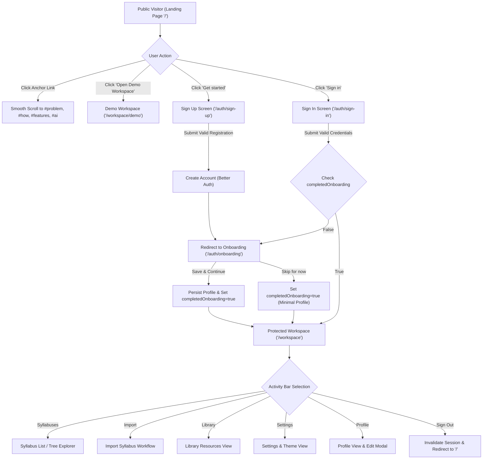
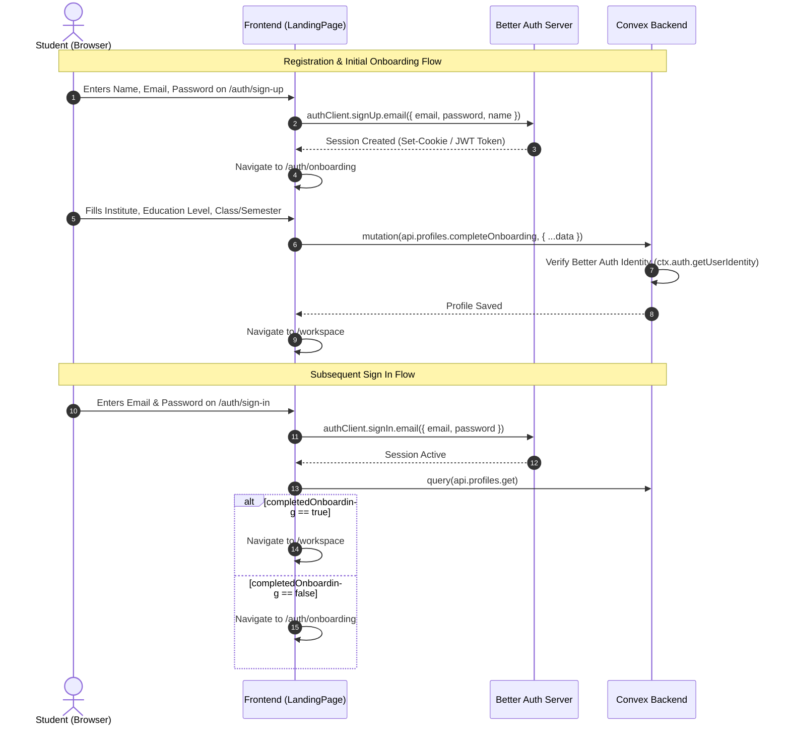
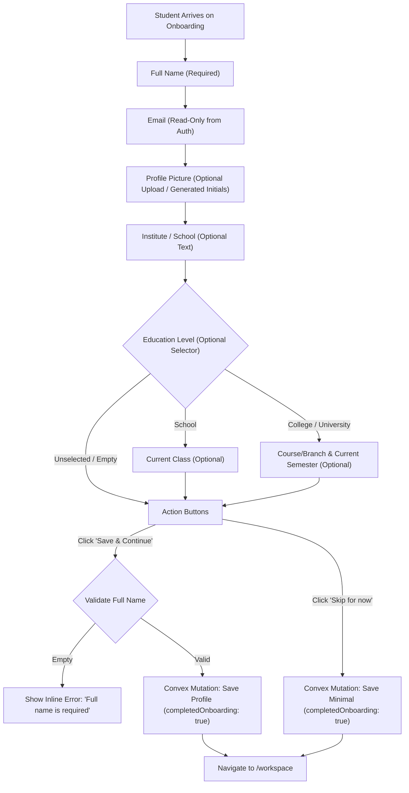
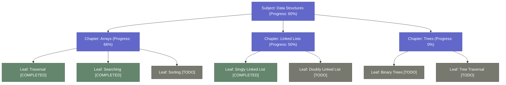
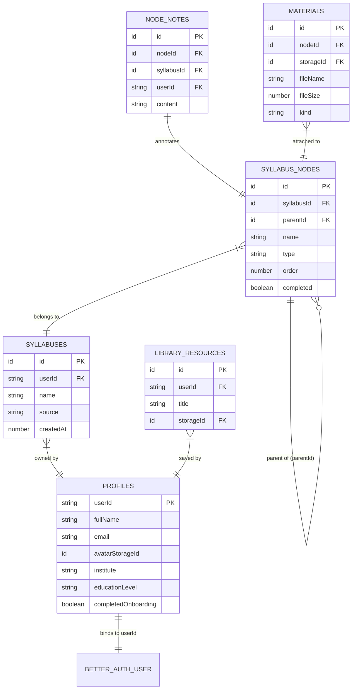
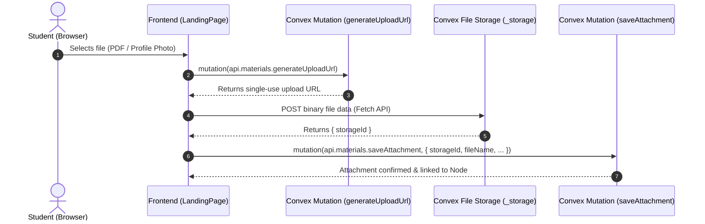

# StudyOS — Complete Backend Architecture & Implementation Handoff

> **Document Status:** Implementation Blueprint  
> **Target System:** StudyOS Backend (Better Auth + Convex Database + Convex File Storage)  
> **Active Frontend Reference:** `Frontend/LandingPage`  
> **Author:** Senior Software Architect, Backend Engineer & Technical Documentation Specialist  
> **Date:** November 2026  

---

## 1. Project Overview

### 1.1 Purpose & Vision
**StudyOS** is an academic-first study workspace. Its core purpose is to:
**Turn a student's syllabus into an editable study tree, track completion progress, keep notes and learning materials directly alongside syllabus nodes, and provide optional, student-directed AI assistance.**

StudyOS deliberately departs from generic AI chatbots and bloated productivity dashboards:
- The syllabus tree is the primary organizing paradigm, not a calendar, chat prompt, or kanban board.
- Student control is central: the student determines the structure, edits nodes, marks completion, and dictates when AI is invoked.
- Zero AI lock-in: The application must be 100% operational without AI.
- Calm, distraction-free aesthetic: Styled in muted earth tones (parchment, charcoal, slate navy, sage green) supporting deep study in both Light and Dark themes.

```
                    ┌──────────────────────────────────────────────┐
                    │                   StudyOS                    │
                    │        Syllabus-First Study Workspace        │
                    └──────────────────────┬───────────────────────┘
                                           │
         ┌──────────────────┬──────────────┴─────┬──────────────────┐
         ▼                  ▼                    ▼                  ▼
┌─────────────────┐ ┌───────────────┐ ┌────────────────────┐ ┌───────────────┐
│  Hierarchical   │ │  Leaf-Driven  │ │ Contextual Notes & │ │  Optional AI  │
│  Syllabus Tree  │ │   Progress    │ │  Study Materials   │ │   Assistant   │
│ (Arbitrary Depth│ │ (Non-Double-  │ │ (Directly Attached │ │ (On-Demand,   │
│  CRUD & Reorder)│ │   Counted)    │ │   to Tree Nodes)   │ │  Zero Lock-in)│
└─────────────────┘ └───────────────┘ └────────────────────┘ └───────────────┘
```

### 1.2 Core Capabilities
1. **Multi-Syllabus Management:** A student can maintain multiple independent syllabuses (e.g., "3rd Semester CSE", "Class 11 Mathematics", "Python Fundamentals").
2. **Arbitrary-Depth Study Trees:** Syllabuses are hierarchical trees of variable depth (e.g., Subject $\rightarrow$ Module $\rightarrow$ Chapter $\rightarrow$ Topic $\rightarrow$ Subtopic $\rightarrow$ Item).
3. **Derived Leaf-Driven Progress:** Only leaf nodes represent direct completion units. Parent progress is mathematically derived from the percentage of completed descendant leaves, eliminating double-counting.
4. **Contextual Notes & Attachments:** Text notes and file attachments (PDFs, slides, documents) are bound directly to specific syllabus nodes.
5. **Student Profile:** Captures full name, email, profile picture, institute, and conditional academic details (School vs. College/University).
6. **Multi-Tenant Cloud Persistence:** Fully authenticated, user-isolated data storage across devices using Better Auth and Convex.

---

## 2. Existing Frontend Architecture

### 2.1 Workspace Directory Structure
The repository contains three top-level directories:

```
Frontend/
├── LandingPage/       # << ACTIVE UNIFIED FRONTEND APPLICATION >>
│   ├── src/           # React 18 + Vite + Tailwind + Router codebase
│   └── package.json   # vite-react-typescript-starter
├── Authentication/    # Legacy standalone prototype (hash-based routing #/auth)
├── Workspace/         # Legacy standalone prototype (Builder.io/Fusion starter)
├── package.json       # Proxy scripts delegating to LandingPage/
└── handoff.md         # This technical specification
```

> [!IMPORTANT]
> **Active Codebase Rule:** All backend integration hooks, client adapters, and routing modifications must target `Frontend/LandingPage`. The `Authentication/` and `Workspace/` directories are historical prototypes and must remain untouched.

### 2.2 Component Hierarchy & Entry Points
- **Entry Point:** `LandingPage/src/main.tsx` mounts `<App />` onto `#root` in `LandingPage/index.html`.
- **Global Custom Pointer:** `LandingPage/src/components/GlobalCursor.tsx` provides desktop pointer tracking.
- **Routing Engine:** React Router DOM v6 in `LandingPage/src/App.tsx`.
- **Application Shell:** `LandingPage/src/pages/WorkspacePage.tsx` provides the 3-column desktop layout (`activity-bar`, `secondary-sidebar`, `main-area`).

---

## 3. Technology Stack

| Layer | Selected Technology | Version / Configuration | Purpose |
|---|---|---|---|
| **Client Framework** | React | `^18.3.1` | Component UI layer |
| **Language** | TypeScript | `^5.5.3` (Strict mode) | Type safety across client & backend contracts |
| **Client Bundler** | Vite | `^7.3.7` | Fast HMR and production bundle optimization |
| **Client Routing** | React Router DOM | `^6.30.6` | Client-side routing with route guards |
| **Styling & Design** | Tailwind CSS + CSS Variables | `^3.4.1` | Design token system with native light/dark modes |
| **Animations & Scroll** | GSAP + Lenis | `gsap ^3.15.0`, `lenis ^1.3.27` | Smooth scrolling and timeline choreography |
| **Authentication Engine**| **Better Auth** | Recommended: `^1.1.x` | User accounts, password hashing, Google OAuth, session management |
| **Database & Server** | **Convex** | Recommended: `^1.17.x` | Real-time reactive document database, serverless queries/mutations/actions |
| **File Storage** | **Convex File Storage** | Built-in `_storage` system | Binary storage for profile pictures and node attachments |
| **Deployment** | Vercel / Netlify + Convex Cloud | Production Hosting | Static client distribution + Managed serverless backend |

---

## 4. Complete Website Navigation

### 4.1 Route Map

```
/ (Landing Page)
│
├── #problem, #how, #features, #ai (Smooth in-page anchor scroll)
├── /auth/sign-in (Split-screen Sign In)
├── /auth/sign-up (Split-screen Sign Up)
│    └── [New Registration Success] ──> /auth/onboarding
├── /auth/onboarding (Profile Onboarding - Step 2 of 2)
│    ├── "Save & Continue" ──> /workspace
│    └── "Skip for now"    ──> /workspace
├── /workspace (Protected Workspace Root)
│    ├── /workspace/:syllabusId (Active Syllabus Workspace)
│    └── /workspace/profile (Student Profile View)
└── /workspace/demo (Frontend Demo Mode Bypass - controlled by VITE_DEMO_MODE)
     ├── /workspace/demo/:syllabusId
     └── /workspace/demo/profile
```

### 4.2 Website User Journey Diagram



---

## 5. Public Landing Page

### 5.1 Component Structure
Constructed in `LandingPage/src/pages/LandingPage.tsx`:
- `<Navbar />`: Sticky header. Responsive desktop links + mobile drawer.
- `<Hero />`: Editorial typography (`Fraunces`), interactive `<SyllabusTree />` visualization with mouse parallax.
- `<ProblemSection />`: "Syllabuses are broken" narrative.
- `<TreeStory />`: Visual hierarchy demonstration.
- `<HowItWorks />`: 3-step workflow (Import $\rightarrow$ Organize $\rightarrow$ Study).
- `<Features />`: Interactive workspace preview tabs.
- `<StudentControl />`: Philosophy on student agency over algorithms.
- `<MaterialsSection />`: Material attachment overview.
- `<AISection />`: "AI when you ask for it" section.
- `<Philosophy />`: Contrast manifesto.
- `<FAQ />`: Collapsible accordion FAQ.
- `<FinalCTA />`: Conversion prompt.
- `<Footer />`: Copyright, branding, and links.

### 5.2 Navigation Triggers & State
- **Smooth Scrolling:** Uses `Lenis` and GSAP ticker via `useSmoothScroll.ts`. Clicking `#problem`, `#how`, `#features`, or `#ai` executes `scrollToId(id)`.
- **CTA Actions:**
  - `Sign in` $\rightarrow$ React Router navigation to `/auth/sign-in`.
  - `Get started` $\rightarrow$ React Router navigation to `/auth/sign-up`.
  - `Open Demo Workspace` $\rightarrow$ (rendered only when `IS_DEMO_MODE=true` via `LandingPage/src/lib/demo.ts`) navigates to `/workspace/demo`.
- **Theme Toggle:** Reusable toggle button bound to `useTheme()` hook. Toggles `.dark` class on `<html>` and updates `localStorage.getItem('studyos-theme')`.

---

## 6. Authentication Flows

### 6.1 Architecture Overview
The current client uses an isolated adapter boundary in `LandingPage/src/lib/auth.ts`.
- **Current State:** Defaults to `notConfiguredAdapter`, which returns `null` for `getSession()` and throws `AuthNotConfiguredError` on sign-in, sign-up, Google OAuth, and password reset.
- **Backend Goal:** Replace `notConfiguredAdapter` with a production Better Auth client adapter that communicates with the Better Auth server endpoint.



### 6.2 Sign-Up Specification
- **Form:** `LandingPage/src/components/auth/AuthForm.tsx` (`mode === 'sign-up'`).
- **Input Fields:**
  1. `Full Name`: Required, non-whitespace.
  2. `Email`: Required, validated against RFC 5322 regex via `validateEmail()` in `EmailField.tsx`.
  3. `Password`: Required, minimum 8 characters (`MIN_PASSWORD_LENGTH = 8`).
  4. `Confirm Password`: Required, must exactly match `Password`.
- **Client Submission:** Calls `auth().signUpWithPassword({ email, password, name })`.
- **Post-Submission Hook:** On resolution, invokes `onAuthenticated({ isNewUser: true })`, triggering `AuthShell.tsx` to execute `navigate('/auth/onboarding', { replace: true })`.

### 6.3 Sign-In Specification
- **Form:** `LandingPage/src/components/auth/AuthForm.tsx` (`mode === 'sign-in'`).
- **Input Fields:**
  1. `Email`: Required, email format.
  2. `Password`: Required, non-empty.
- **Client Submission:** Calls `auth().signInWithPassword({ email, password })`.
- **Post-Submission Hook:** Invokes `onAuthenticated({ isNewUser: false })`. `AuthShell.tsx` inspects onboarding status:
  - If `hasCompletedOnboarding()` is `true` $\rightarrow$ navigates to `/workspace`.
  - If `hasCompletedOnboarding()` is `false` $\rightarrow$ navigates to `/auth/onboarding`.

### 6.4 Google Authentication Specification
- **Button:** `LandingPage/src/components/auth/GoogleAuthButton.tsx`.
- **Current State:** Frontend simulation. Calls `auth().signInWithGoogle()`, which throws `AuthNotConfiguredError`.
- **Backend Requirement:** Configure Better Auth Google Social Provider (`authClient.signIn.social({ provider: 'google', callbackURL: '/auth/onboarding' })`).
- **Account Linking:** If an account exists with the same verified email, Better Auth must link the OAuth identity or return `account_exists` according to configured security policies.

### 6.5 Password Recovery Specification
- **Component:** Inline collapsible form in `AuthForm.tsx` (`forgot === 'form'`).
- **Action:** Calls `auth().resetPassword(email)`.
- **Expected Backend Behavior:** Better Auth generates a secure token and sends an email containing a signed password reset link. Shows confirmation screen (`forgot === 'sent'`).

### 6.6 Session Persistence & Route Guarding
- **Hook:** `LandingPage/src/hooks/useAuthSession.ts`.
- **Guard Component:** `LandingPage/src/components/ProtectedRoute.tsx`.
  - Queries session on mount.
  - While `loading`: Renders a full-screen CSS spinner with message `"Loading your workspace…"`.
  - When `unauthenticated`:
    - In demo mode (`IS_DEMO_MODE=true`): Redirects `/workspace` to `/workspace/demo`.
    - In production mode (`IS_DEMO_MODE=false`): Redirects to `/auth/sign-in` with `state: { from: location }`.
  - When `authenticated`: Renders children (`<WorkspacePage />`).

---

## 7. Student Onboarding

### 7.1 Page Specification
- **Route:** `/auth/onboarding` (alias `/onboarding`).
- **Component:** `LandingPage/src/pages/OnboardingPage.tsx`.
- **Visual Design:** Split-screen layout. Left: `<BrandPanel />` with tagline `"Your syllabus. Your workspace. Built around your studies."`. Right: `<ProfileFormFields />`.

### 7.2 Onboarding Form Fields & Conditional Rules



| Field Name | Type | Validation / Constraints | UI Behavior |
|---|---|---|---|
| **Full Name** | Text | Required. Non-empty, trimmed string. | Pre-filled from registration name. Editable. Displays inline error if submitted blank. |
| **Email Address** | Email | Read-only. | Pre-filled from auth session. Disabled input with badge `"From authentication · Read only"`. |
| **Profile Picture** | Binary / Base64 | Optional. Max 8MB input. | Canvas auto-resizes to 256x256 JPEG. Previews image. Shows fallback initials if empty. Includes "Remove" button. |
| **Institute / School**| Text | Optional. Trimmed string. | Placeholder: `"e.g. Stanford University or Lincoln High School"`. |
| **Education Level** | Select | Optional: `""`, `"School"`, `"College / University"`. | Dropdown. Controls visibility of conditional branch below. |
| **Current Class** | Text | Conditional: Shown **only** if Level is `"School"`. | e.g. `"Class 10"`, `"Class 12"`, `"Grade 11"`. |
| **Course / Branch** | Text | Conditional: Shown **only** if Level is `"College / University"`. | e.g. `"B.Tech Computer Science"`, `"B.Sc Mathematics"`. |
| **Current Semester**| Text | Conditional: Shown **only** if Level is `"College / University"`. | e.g. `"3rd Semester"`, `"Year 2"`. |

> [!WARNING]
> **State Hygiene Rule:** When `Education Level` is changed from "School" to "College / University" (or vice versa), `ProfileFormFields.tsx` explicitly wipes the alternative branch's fields (`currentClass` or `courseOrBranch` & `currentSemester`) to prevent stale data from persisting.

### 7.3 Submission & Skip Logic
- **Save & Continue:** Validates that `fullName.trim().length > 0`. Persists full payload to backend with `completedOnboarding: true`. Navigates to `/workspace`.
- **Skip for now:** Does not validate `fullName`. If `fullName` is empty, falls back to auth name or `"Student"`. Persists minimal profile with `completedOnboarding: true`. Navigates to `/workspace`.

---

## 8. Workspace Architecture

### 8.1 3-Column Shell Specification
Implemented in `LandingPage/src/pages/WorkspacePage.tsx` using `workspace.css`:

```
┌─────────┬──────────────────────┬────────────────────────────────────────────────────────┐
│ Activity│  Secondary Sidebar   │                       Main Area                        │
│   Bar   │       (260px)        │                     (Minmax 0, 1fr)                    │
│  (60px) │                      │                                                        │
├─────────┼──────────────────────┼────────────────────────────────────────────────────────┤
│ [Logo]  │ Header: "STUDYOS"    │ Topbar (48px): Breadcrumb > Demo Chip > Theme > Help   │
│         │ Activity Title       ├────────────────────────────────────────────────────────┤
│ [List]  │                      │                                                        │
│ [Import]│ Contextual Content:  │ Dynamic Page Content:                                  │
│ [Lib]   │ - Syllabus Catalogue │ - Syllabus Catalogue Grid (`catalogue-main`)           │
│         │ - Active Tree View   │ - Active Node Workspace (`workspace-content`)          │
│         │ - Import 2-Step Line │ - Import Workflow (`import-page`, `review-page`)       │
│ [Set]   │ - Profile Info Card  │ - Student Profile View (`ProfileView`)                 │
│ [Logout]│                      │ - Library Placeholder / Settings Placeholder           │
│ [Prof]  │                      │                                                        │
│ [Avatar]│                      │                                                        │
└─────────┴──────────────────────┴────────────────────────────────────────────────────────┘
```

1. **Activity Bar (`.activity-bar` — 60px):**
   - Brand Icon: GraduationCap glyph in 34x34 container (`var(--accent)`).
   - Navigation Buttons: Syllabus List (`BookOpen`), Import (`Plus`), Library (`Library`).
   - Bottom Utility Buttons: Settings (`Settings`), Sign Out (`LogOut`), Profile (`UserRound`).
   - Dynamic Student Avatar: 29x29 circular button showing uploaded profile photo or generated initials (`useProfile().initials`).
2. **Secondary Sidebar (`.secondary-sidebar` — 260px):**
   - Header (76px): Displays uppercase `"STUDYOS"` kicker + dynamic activity heading (`"Syllabus List"`, `"EXPLORER"`, `"NEW SYLLABUS"`, `"LIBRARY"`, `"SETTINGS"`, `"PROFILE"`).
   - In Syllabus List: Shows workspace count, list of syllabuses, quick action menu (Rename, Delete), and footnote.
   - In Workspace Tree: Shows active syllabus title, "Add subject" shortcut, and interactive hierarchy tree.
   - In Profile: Shows student mini card (avatar, name, email) and curriculum notice.
   - Responsive behavior: Completely hidden (`display: none`) on viewports $\le 680\text{px}$.
3. **Main Content Area (`.main-area`):**
   - Header / Topbar (48px): Activity breadcrumbs, "Local demo" badge, theme toggle (`Sun`/`Moon`), Help button.
   - Content Container: Mounts `<ProfileView />`, `<div className="catalogue-main">`, `<div className="workspace-content">`, or import wizards.

---

## 9. Syllabus Management

### 9.1 Syllabus Entity
A student can create, inspect, rename, and delete multiple syllabuses.
- **Initial Hardcoded Data:** `LandingPage/src/pages/WorkspacePage.tsx` lines 61-79 defines:
  - `"sem3"`: 3rd Semester CSE (Data Structures, Digital Electronics, Mathematics).
  - `"python"`: Python Fundamentals.
  - `"math11"`: Class 11 Mathematics.
  - `"sem2"`: 2nd Semester CSE.
- **Backend Requirement:** Syllabuses must be stored as private documents in Convex, tied to `userId`.

### 9.2 Contextual Node Creation Hierarchy
StudyOS enforces semantic node hierarchies based on depth:
```ts
type ItemType = "subject" | "chapter" | "topic" | "subtopic" | "item";
```

The frontend helper `addActionsFor(type: ItemType)` in `WorkspacePage.tsx` defines the allowed creation actions:

| Current Node Type | Child Action Label | Created Child Type | Sibling Action Label | Created Sibling Type |
|---|---|---|---|---|
| **Subject** (`depth = 0`) | "Add chapter" | `chapter` (`depth = 1`) | "Add subject" | `subject` (`depth = 0`) |
| **Chapter** (`depth = 1`) | "Add topic" | `topic` (`depth = 2`) | "Add chapter" | `chapter` (`depth = 1`) |
| **Topic** (`depth = 2`) | "Add subtopic" | `subtopic` (`depth = 3`)| "Add topic" | `topic` (`depth = 2`) |
| **Subtopic** (`depth = 3`)| "Add item" | `item` (`depth = 4`) | "Add subtopic" | `subtopic` (`depth = 3`)|
| **Item** (`depth \ge 4`)| "Add item" | `item` (`depth + 1`) | *(None)* | *(None)* |

> [!NOTE]
> **Depth Flexibility:** While default naming reflects typical academic conventions (Subject $\rightarrow$ Chapter $\rightarrow$ Topic), the underlying data structure is an arbitrary tree. Nodes can nest to any level without backend database schema constraints.

### 9.3 Tree Editing Operations
- **Inline Add:** Triggered by `+` button in tree row. Inserts input field at target depth. `Enter` commits, `Escape` cancels.
- **Inline Rename:** Triggered by pencil icon. Converts label to input field. Validates non-empty string.
- **Delete Node:** Triggered by trash icon. Displays confirmation `<Modal>`: *"Delete node? This will also remove the items inside it."* Recursively removes all descendant nodes. Fallback selection moves to parent or sibling.

---

## 10. Tree Data Model and Progress Logic

### 10.1 Tree Traversal & Recursion Model



### 10.2 Progress Calculation Rules
Implemented in `WorkspacePage.tsx` lines 116-126:
```ts
function leafNodes(item: StudyNode): StudyNode[] {
  if (!item.children.length) return [item];
  return item.children.flatMap(leafNodes);
}

function progressOf(item: StudyNode) {
  const leaves = leafNodes(item);
  const complete = leaves.filter((leaf) => leaf.completed).length;
  return {
    complete,
    total: leaves.length,
    percent: leaves.length ? Math.round((complete / leaves.length) * 100) : 0,
  };
}
```

#### Invariants:
1. **Direct Completion is Exclusive to Leaves:**
   In `toggleComplete(nodeId)`:
   ```ts
   const target = findNode(tree, nodeId);
   if (!target || target.children.length) return; // Non-leaf nodes CANNOT be checked directly!
   ```
2. **Derived Parent Progress:** A parent node with 3 completed leaf children and 2 incomplete leaf children is exactly $\frac{3}{5} = 60\%$ complete.
3. **No Double-Counting:** Parents do not add to the leaf denominator. Only leaves ($children.length == 0$) count toward totals.
4. **Syllabus Progress:** Calculated by gathering all leaf descendants across all top-level roots:
   $$\text{Progress} \% = \operatorname{round}\left(\frac{\sum \text{Completed Leaves}}{\sum \text{Total Leaves}} \times 100\right)$$

---

## 11. Notes and Materials

### 11.1 Contextual Notes
- **UI Location:** Workspace main view $\rightarrow$ "Notes" tab (`activeTab === "Notes"`).
- **Current Behavior:** Controlled textarea bound to React state:
  ```ts
  const [notes, setNotes] = useState<Record<string, string>>({});
  // onChange updates notes[current.id]
  ```
- **Limitation:** In-memory state only. Lost on tab refresh or syllabus switch.
- **Backend Requirement:** Notes must be stored in Convex, associated with both `nodeId` and `syllabusId`.

### 11.2 Study Materials
- **UI Location:** Workspace main view $\rightarrow$ "Materials" tab (`activeTab === "Materials"`).
- **Current Behavior:** Displays placeholder message: `"Resource uploads are not connected in this local demo."`.
- **Backend Requirement:** Allow students to attach files (PDF, DOCX, slides, images) to any syllabus node. File binary is stored in Convex File Storage; metadata is stored in a `materials` Convex table.

---

## 12. Library

- **UI Location:** Activity Bar $\rightarrow$ "Library" icon (`activity === "library"`).
- **Secondary Sidebar:** Shows message: `"Resources are separate from your syllabus tree."`.
- **Main Area:** Displays placeholder container: `"Your resource area is separate from your syllabus tree. Library features are not connected in this demo."`.
- **Intended Specification:** A personal repository of reusable academic documents, textbooks, lecture slides, and references not tied to a single syllabus node, with the future capability to link a library resource to multiple syllabus topics.

---

## 13. AI Functionality

- **UI Location:** Workspace main view $\rightarrow$ "Ask AI" tab (`activeTab === "Ask AI"`).
- **Current Behavior:** Input field and button are hardcoded with `disabled` attribute. Message states: `"AI assistance is not connected in this demo. The selected syllabus item is shown here as context."`.
- **Architectural Principle:** **Zero AI Lock-in**. StudyOS is a functional, complete workspace without AI.
- **Backend Implementation Requirement:**
  - AI requests will be dispatched as Convex actions (`api.ai.askAboutNode`).
  - Context payload constructed on the server:
    1. Active Node Name and Breadcrumb Ancestor Hierarchy (e.g., *"Data Structures > Trees > Binary Trees"*).
    2. Node Notes (if any).
    3. Node Attached Materials Text Snippets (if extracted).
    4. Sibling Topics (for curriculum scope).
  - Streaming response back to the client using Convex action subscriptions or HTTP streaming.

---

## 14. Student Profile

### 14.1 Workspace Profile View
- **Component:** `LandingPage/src/components/profile/ProfileView.tsx`.
- **Trigger:** Activity Bar $\rightarrow$ Profile button (`activity === "profile"`) or direct route `/workspace/profile`.
- **Features:**
  - Displays large avatar (photo or initials fallback).
  - Displays Full Name, Email Address, Institute/School.
  - Displays Education Level, Current Class (School) or Course/Branch and Semester (College).
  - Displays active syllabus count and last updated timestamp.
  - Displays "Edit Profile" button opening `<EditProfileModal />`.

### 14.2 Profile Synchronization & Activity-Bar Avatar
- **State Engine:** `LandingPage/src/hooks/useProfile.ts`.
- **Avatar Button:** `LandingPage/src/pages/WorkspacePage.tsx` lines 436-448 renders `.profile-avatar-btn`:
  - If `profile.avatarUrl` exists: renders ``.
  - Otherwise: renders `<div className="profile-avatar">{initials}</div>`.
- **Real-Time Sync:** When a student edits their profile in `<EditProfileModal />`, the hook dispatches `studyos:profile-changed` and writes to `localStorage`. The activity-bar avatar and sidebar update synchronously without page reload.

---

## 15. Routing and Application State

### 15.1 Route Inventory

| Path | Component | Guard / Access Policy | Purpose |
|---|---|---|---|
| `/` | `<LandingPage />` | Public | Marketing landing page |
| `/auth/sign-in` | `<AuthShell mode="sign-in" />` | Public (Redirects to `/workspace` if session active) | User sign in |
| `/auth/sign-up` | `<AuthShell mode="sign-up" />` | Public (Redirects to `/workspace` if session active) | User registration |
| `/auth/onboarding`| `<OnboardingPage />` | Protected (Must have active session) | Post-signup profile collection |
| `/workspace` | `<WorkspacePage />` | `<ProtectedRoute>` (Valid session required) | Primary study workspace |
| `/workspace/:id` | `<WorkspacePage />` | `<ProtectedRoute>` (Valid session required) | Direct syllabus link |
| `/workspace/profile` | `<WorkspacePage initialActivity="profile" />` | `<ProtectedRoute>` (Valid session required) | Profile inside workspace |
| `/workspace/demo`| `<WorkspacePage />` | Bypass enabled when `VITE_DEMO_MODE=true` | In-memory demo workspace |
| `/workspace/demo/:id` | `<WorkspacePage />` | Bypass enabled when `VITE_DEMO_MODE=true` | Demo syllabus link |
| `*` | `<Navigate to="/" replace />` | Public | Catch-all redirect |

### 15.2 Transition Invariants
1. `LandingPage` $\rightarrow$ `Get Started` $\rightarrow$ `/auth/sign-up`.
2. Successful `Sign-Up` $\rightarrow$ **Always** `/auth/onboarding`.
3. `Onboarding` (`Save & Continue` OR `Skip for now`) $\rightarrow$ `/workspace`.
4. Successful `Sign-In` $\rightarrow$ If `completedOnboarding == true` $\rightarrow$ `/workspace`; Else $\rightarrow$ `/auth/onboarding`.
5. `Sign Out` $\rightarrow$ Invalidate Better Auth session $\rightarrow$ Redirect to `/`.

---

## 16. Convex Database Schema

### 16.1 Design Rationale
- **Document Model:** Convex uses transactional document tables with TypeScript schema validation (`convex/schema.ts`).
- **Normalized Tree vs Embedded Tree:**
  - *Decision:* Store `syllabuses` as root documents, with `syllabusNodes` stored in a normalized table keyed by `syllabusId` and `parentId`.
  - *Justification:* Supports arbitrary nesting without hitting document size limits (1MB), allows granular node completion toggles, and allows notes and materials to reference permanent `nodeId`s cleanly.

### 16.2 Complete `schema.ts` Definition

```typescript
import { defineSchema, defineTable } from "convex/server";
import { v } from "convex/values";

export default defineSchema({
  // 1. Student Profiles (1:1 with Better Auth User)
  profiles: defineTable({
    userId: v.string(), // Stable Better Auth Subject ID
    fullName: v.string(),
    email: v.string(),
    avatarStorageId: v.optional(v.id("_storage")),
    avatarUrl: v.optional(v.string()), // Generated or signed URL
    institute: v.optional(v.string()),
    educationLevel: v.optional(
      v.union(v.literal("School"), v.literal("College / University"))
    ),
    schoolDetails: v.optional(
      v.object({
        currentClass: v.string(),
      })
    ),
    collegeDetails: v.optional(
      v.object({
        courseOrBranch: v.string(),
        currentSemester: v.string(),
      })
    ),
    completedOnboarding: v.boolean(),
    createdAt: v.number(),
    updatedAt: v.number(),
  })
    .index("by_userId", ["userId"])
    .index("by_email", ["email"]),

  // 2. Syllabuses (Workspaces owned by student)
  syllabuses: defineTable({
    userId: v.string(), // Owner
    name: v.string(), // e.g. "3rd Semester CSE"
    source: v.optional(v.string()), // Original filename if imported (e.g. "MAKAUT_Syllabus.pdf")
    isArchived: v.optional(v.boolean()),
    createdAt: v.number(),
    updatedAt: v.number(),
  })
    .index("by_userId", ["userId"])
    .index("by_userId_updatedAt", ["userId", "updatedAt"]),

  // 3. Hierarchical Syllabus Nodes (Arbitrary Depth)
  syllabusNodes: defineTable({
    syllabusId: v.id("syllabuses"),
    userId: v.string(), // For fast ownership validation
    parentId: v.optional(v.id("syllabusNodes")), // undefined for top-level roots
    name: v.string(),
    type: v.union(
      v.literal("subject"),
      v.literal("chapter"),
      v.literal("topic"),
      v.literal("subtopic"),
      v.literal("item")
    ),
    order: v.number(), // Sibling sequence order (0, 1, 2...)
    completed: v.boolean(), // Direct completion flag (only meaningful on leaves)
    createdAt: v.number(),
    updatedAt: v.number(),
  })
    .index("by_syllabusId", ["syllabusId"])
    .index("by_syllabusId_parentId", ["syllabusId", "parentId"])
    .index("by_userId", ["userId"]),

  // 4. Node Personal Notes (1:1 with Node)
  nodeNotes: defineTable({
    nodeId: v.id("syllabusNodes"),
    syllabusId: v.id("syllabuses"),
    userId: v.string(),
    content: v.string(), // Markdown or plain text content
    updatedAt: v.number(),
  })
    .index("by_nodeId", ["nodeId"])
    .index("by_syllabusId", ["syllabusId"])
    .index("by_userId", ["userId"]),

  // 5. Node Attachments & Materials (1:Many with Node)
  materials: defineTable({
    nodeId: v.id("syllabusNodes"),
    syllabusId: v.id("syllabuses"),
    userId: v.string(),
    storageId: v.id("_storage"), // Convex File Storage ID
    fileName: v.string(),
    fileSize: v.number(), // in bytes
    mimeType: v.string(),
    kind: v.union(
      v.literal("pdf"),
      v.literal("docx"),
      v.literal("slides"),
      v.literal("note"),
      v.literal("image"),
      v.literal("other")
    ),
    createdAt: v.number(),
  })
    .index("by_nodeId", ["nodeId"])
    .index("by_syllabusId", ["syllabusId"])
    .index("by_userId", ["userId"]),

  // 6. Global Library Resources (Reusable across syllabuses)
  libraryResources: defineTable({
    userId: v.string(),
    title: v.string(),
    description: v.optional(v.string()),
    storageId: v.optional(v.id("_storage")),
    externalUrl: v.optional(v.string()),
    kind: v.string(),
    tags: v.array(v.string()),
    createdAt: v.number(),
    updatedAt: v.number(),
  })
    .index("by_userId", ["userId"])
    .index("by_userId_createdAt", ["userId", "createdAt"]),

  // 7. Student Preferences
  userPreferences: defineTable({
    userId: v.string(),
    theme: v.union(v.literal("light"), v.literal("dark"), v.literal("system")),
    compactMode: v.optional(v.boolean()),
    updatedAt: v.number(),
  }).index("by_userId", ["userId"]),
});
```

### 16.3 Entity Relationship Diagram



---

## 17. Better Auth + Convex Architecture

### 17.1 Architecture & Token Bridge
Convex functions require proof of user identity. Better Auth provides session management. The integration works via standard **JWT / OIDC verification**:

```
┌────────────────────────────────────────────────────────┐
│                   Frontend Client                      │
│ (React + Better Auth Client SDK + Convex React Client) │
└──────────────┬──────────────────────────┬──────────────┘
               │ 1. Sign In / Session     │ 3. WebSocket Query / Mutation
               │    (Cookies / Headers)   │    (Authorization: Bearer <JWT>)
               ▼                          ▼
┌─────────────────────────────┐   ┌──────────────────────────────┐
│     Better Auth Server      │   │        Convex Backend        │
│  (Node / API Route / Hono)  │   │  (Serverless Query/Mutation) │
├─────────────────────────────┤   ├──────────────────────────────┤
│ - Manages Users & Accounts  │   │ - ctx.auth.getUserIdentity() │
│ - Google OAuth Provider     │   │ - Verifies JWT against JWKS  │
│ - Issues Signed JWT (RS256) │──>│ - Enforces userId isolation  │
└─────────────────────────────┘   └──────────────────────────────┘
```

### 17.2 Convex Authentication Configuration (`convex/auth.config.ts`)
```typescript
export default {
  providers: [
    {
      // Domain where Better Auth serves JWKS and OpenID discovery
      domain: process.env.BETTER_AUTH_URL, 
      applicationID: "studyos-app",
    },
  ],
};
```

### 17.3 Identity Verification Helper (`convex/lib/auth.ts`)
```typescript
import { QueryCtx, MutationCtx } from "./_generated/server";
import { ConvexError } from "convex/values";

export async function requireUser(ctx: QueryCtx | MutationCtx): Promise<{ userId: string; email: string; name?: string }> {
  const identity = await ctx.auth.getUserIdentity();
  if (!identity) {
    throw new ConvexError({
      code: "UNAUTHENTICATED",
      message: "You must be signed in to perform this operation.",
    });
  }

  return {
    userId: identity.subject, // The stable Better Auth User ID
    email: identity.email ?? "",
    name: identity.name,
  };
}
```

---

## 18. Backend Functions and Contracts

### 18.1 Profiles API (`convex/profiles.ts`)

#### 1. `profiles.get`
- **Type:** Query
- **Inputs:** *(None)*
- **Auth:** Required
- **Returns:** `StudentProfile | null`
- **Logic:** Queries `profiles` by `by_userId`. If `avatarStorageId` is present, resolves public URL via `ctx.storage.getUrl(avatarStorageId)`.

#### 2. `profiles.completeOnboarding`
- **Type:** Mutation
- **Inputs:**
  ```typescript
  {
    fullName: v.string(),
    avatarStorageId: v.optional(v.id("_storage")),
    institute: v.optional(v.string()),
    educationLevel: v.optional(v.union(v.literal("School"), v.literal("College / University"))),
    schoolDetails: v.optional(v.object({ currentClass: v.string() })),
    collegeDetails: v.optional(v.object({ courseOrBranch: v.string(), currentSemester: v.string() })),
  }
  ```
- **Auth:** Required
- **Returns:** `v.id("profiles")`
- **Logic:** Inserts or updates the student's profile. Sets `completedOnboarding: true`. Clears opposing education level fields if level changed.

#### 3. `profiles.update`
- **Type:** Mutation
- **Inputs:** Same as `completeOnboarding`
- **Auth:** Required
- **Logic:** Enforces ownership. Updates profile and timestamps. If a new `avatarStorageId` is provided and an older one existed, deletes the old storage file via `ctx.storage.delete(oldStorageId)`.

---

### 18.2 Syllabuses API (`convex/syllabuses.ts`)

#### 1. `syllabuses.list`
- **Type:** Query
- **Inputs:** *(None)*
- **Auth:** Required
- **Returns:** Array of syllabuses with aggregated progress statistics:
  ```typescript
  Array<{
    _id: Id<"syllabuses">;
    name: string;
    source?: string;
    createdAt: number;
    updatedAt: number;
    totalLeaves: number;
    completedLeaves: number;
    percentComplete: number;
  }>
  ```

#### 2. `syllabuses.getTree`
- **Type:** Query
- **Inputs:** `{ syllabusId: v.id("syllabuses") }`
- **Auth:** Required
- **Returns:** Fully nested hierarchical study tree matching client `StudyNode[]` structure:
  ```typescript
  {
    syllabus: Doc<"syllabuses">;
    tree: Array<StudyNode>; // Recursively assembled from syllabusNodes table
  }
  ```

#### 3. `syllabuses.create`
- **Type:** Mutation
- **Inputs:**
  ```typescript
  {
    name: v.string(),
    source?: v.string(),
    initialTree?: v.array(v.any()), // Optional extracted structure from import
  }
  ```
- **Auth:** Required
- **Returns:** `Id<"syllabuses">`
- **Logic:** Creates syllabus record. If `initialTree` is passed, recursively inserts nodes into `syllabusNodes` with correct `parentId` and `order` properties.

#### 4. `syllabuses.rename`
- **Type:** Mutation
- **Inputs:** `{ syllabusId: v.id("syllabuses"), name: v.string() }`
- **Auth:** Required (Verifies `userId === syllabus.userId`)
- **Returns:** `null`

#### 5. `syllabuses.delete`
- **Type:** Mutation
- **Inputs:** `{ syllabusId: v.id("syllabuses") }`
- **Auth:** Required (Verifies `userId === syllabus.userId`)
- **Logic:** Cascade deletes:
  1. Deletes all `materials` storage files via `ctx.storage.delete`.
  2. Deletes all `materials` records.
  3. Deletes all `nodeNotes` records.
  4. Deletes all `syllabusNodes` records.
  5. Deletes `syllabuses` record.

---

### 18.3 Syllabus Nodes API (`convex/nodes.ts`)

#### 1. `nodes.create`
- **Type:** Mutation
- **Inputs:**
  ```typescript
  {
    syllabusId: v.id("syllabuses"),
    parentId: v.optional(v.id("syllabusNodes")),
    name: v.string(),
    type: v.union(v.literal("subject"), v.literal("chapter"), v.literal("topic"), v.literal("subtopic"), v.literal("item")),
    anchorId: v.optional(v.id("syllabusNodes")), // For insertAfter ordering
  }
  ```
- **Auth:** Required
- **Returns:** `Id<"syllabusNodes">`

#### 2. `nodes.rename`
- **Type:** Mutation
- **Inputs:** `{ nodeId: v.id("syllabusNodes"), name: v.string() }`
- **Auth:** Required
- **Returns:** `null`

#### 3. `nodes.toggleComplete`
- **Type:** Mutation
- **Inputs:** `{ nodeId: v.id("syllabusNodes") }`
- **Auth:** Required
- **Validation:** Verifies that target node has **no children** (only leaves can be toggled).
- **Logic:** Inverts `completed: !node.completed`. Updates `updatedAt`.

#### 4. `nodes.delete`
- **Type:** Mutation
- **Inputs:** `{ nodeId: v.id("syllabusNodes") }`
- **Auth:** Required
- **Logic:** Recursively finds all descendant nodes. Deletes associated notes and material files, then deletes the node records.

---

### 18.4 Notes & Materials API (`convex/materials.ts` & `convex/notes.ts`)

#### 1. `notes.getByNode`
- **Type:** Query
- **Inputs:** `{ nodeId: v.id("syllabusNodes") }`
- **Returns:** `Doc<"nodeNotes"> | null`

#### 2. `notes.save`
- **Type:** Mutation
- **Inputs:** `{ nodeId: v.id("syllabusNodes"), content: v.string() }`
- **Logic:** Upserts note document by `nodeId`.

#### 3. `materials.generateUploadUrl`
- **Type:** Mutation
- **Inputs:** *(None)*
- **Auth:** Required
- **Returns:** Signed upload URL string from `ctx.storage.generateUploadUrl()`.

#### 4. `materials.saveAttachment`
- **Type:** Mutation
- **Inputs:**
  ```typescript
  {
    nodeId: v.id("syllabusNodes"),
    storageId: v.id("_storage"),
    fileName: v.string(),
    fileSize: v.number(),
    mimeType: v.string(),
  }
  ```
- **Auth:** Required
- **Returns:** `Id<"materials">`

---

## 19. File Storage

### 19.1 Storage Flow with Convex



### 19.2 Storage Limits & Policies
1. **Profile Pictures:**
   - Client pre-resizes to $\le 256\times 256$ pixels JPEG via canvas.
   - Size limit: 2MB max raw file.
   - MIME Types: `image/jpeg`, `image/png`, `image/webp`.
2. **Syllabus Materials:**
   - Size limit: 25MB per file.
   - MIME Types: `application/pdf`, `application/vnd.openxmlformats-officedocument.wordprocessingml.document` (DOCX), `text/plain`, presentation slides, images.
3. **Orphan Cleanup:** Every mutation replacing or deleting an attachment or avatar must invoke `ctx.storage.delete(storageId)`.

---

## 20. Frontend-to-Backend Integration Map

| Page / Component | User Action | Current Frontend Behavior | Required Backend Operation | Expected Result |
|---|---|---|---|---|
| `AuthForm.tsx` | Click "Create account" | Throws `AuthNotConfiguredError` | `betterAuth.signUp.email(...)` | User registered, session active, redirect to `/auth/onboarding` |
| `AuthForm.tsx` | Click "Sign in" | Throws `AuthNotConfiguredError` | `betterAuth.signIn.email(...)` | Session active, checks onboarding status, redirect to `/workspace` or `/auth/onboarding` |
| `AuthForm.tsx` | Click "Continue with Google" | Throws `AuthNotConfiguredError` | `betterAuth.signIn.social({ provider: 'google' })` | OAuth redirect flow to Google and return to app |
| `OnboardingPage.tsx` | Click "Save & Continue" | Saves to `localStorage`, navigates | `mutation(api.profiles.completeOnboarding)` | Profile saved in Convex, `completedOnboarding=true`, redirect to `/workspace` |
| `OnboardingPage.tsx` | Click "Skip for now" | Saves to `localStorage`, navigates | `mutation(api.profiles.completeOnboarding)` (minimal data) | Fallback profile saved, redirect to `/workspace` |
| `ProfileView.tsx` | Click "Edit Profile" $\rightarrow$ Save | Updates `localStorage` and custom event | `mutation(api.profiles.update)` | Profile updated in Convex, all UI avatars reflect changes immediately |
| `WorkspacePage.tsx` | Mount `/workspace` | Loads hardcoded `initialSyllabuses` | `query(api.syllabuses.list)` | Real syllabuses and progress loaded from Convex |
| `WorkspacePage.tsx` | Select Syllabus | Updates local state `activeId` | `query(api.syllabuses.getTree)` | Hierarchy tree loaded for selected syllabus |
| `WorkspacePage.tsx` | Click "Add first subject" / `+` | Modifies React state `syllabuses` | `mutation(api.nodes.create)` | Node inserted in `syllabusNodes`, tree updates reactively |
| `WorkspacePage.tsx` | Inline Rename Node | Updates local React tree | `mutation(api.nodes.rename)` | Node name updated in Convex |
| `WorkspacePage.tsx` | Delete Node | Recursively filters React state | `mutation(api.nodes.delete)` | Node and descendants deleted in Convex |
| `WorkspacePage.tsx` | Toggle Leaf Checkbox | Toggles `completed` in local tree | `mutation(api.nodes.toggleComplete)` | Completion saved; parent progress recomputed |
| `WorkspacePage.tsx` | Type in Notes tab | Updates `notes[current.id]` state | `mutation(api.notes.save)` (debounced) | Note text persisted in `nodeNotes` |
| `WorkspacePage.tsx` | Upload Material | Placeholder notice | `materials.generateUploadUrl` $\rightarrow$ `POST` $\rightarrow$ `materials.saveAttachment` | File uploaded to Convex Storage, listed in Materials view |
| `WorkspacePage.tsx` | Click "Sign out" | Dummy `signOut()`, navigates to `/` | `betterAuth.signOut()` | Session cookie invalidated, client redirects to `/` |

---

## 21. Data Ownership and Security

### 21.1 Authorization Rules
1. **Tenant Isolation:** Every private record (`syllabuses`, `syllabusNodes`, `nodeNotes`, `materials`, `profiles`, `libraryResources`) has a `userId` field.
2. **Server-Side Enforcement:** Every query and mutation checks:
   ```typescript
   if (record.userId !== currentUser.userId) {
     throw new ConvexError({ code: "FORBIDDEN", message: "Unauthorized access." });
   }
   ```
3. **No Client-Supplied User IDs:** The client never passes `userId` as an argument. The server extracts it strictly from `ctx.auth.getUserIdentity().subject`.
4. **Hierarchy Integrity:**
   - When adding a child node, the backend verifies that `parentId` belongs to the specified `syllabusId` and is owned by the caller.
   - Nodes can never become their own descendant (cycle prevention during moves).

---

## 22. Local Data Migration

### 22.1 Existing Client Storage
- `studyos-theme`: Theme preference (`"light"` | `"dark"`). Kept in `localStorage` for immediate synchronous hydration in `index.html`.
- `studyos_student_profile`: In-memory and `localStorage` profile used during demo mode.
- `VITE_DEMO_MODE`: Environment variable enabling `/workspace/demo`.

### 22.2 Migration Strategy
When a student registers or signs in:
1. Check if `localStorage.getItem('studyos_student_profile')` exists and has `completedOnboarding === true`.
2. Offer the student a 1-click prompt: *"Would you like to import your local demo profile into your new account?"*.
3. If confirmed: Execute `mutation(api.profiles.completeOnboarding, localData)`.
4. Clear `studyos_student_profile` from `localStorage` once migrated.
5. In-memory syllabuses created in demo mode are not silently imported; the student starts with a clean account workspace with an option to load sample curriculum templates.

---

## 23. Error Handling and Edge Cases

| Scenario | Client Manifestation | Backend Behavior |
|---|---|---|
| **Expired Session** | Automatically bounces to `/auth/sign-in` | Queries throw `UNAUTHENTICATED`. Client auth hook detects 401 and resets session state. |
| **Network Disconnection** | UI shows offline indicator | Convex automatically retries connections and queues mutations; WebSocket reconnects on restoration. |
| **Attempt to Toggle Non-Leaf** | Checkbox is not clickable in UI | Mutation throws `INVALID_OPERATION: Cannot directly toggle completion on parent node`. |
| **Large File Upload** | File selector shows error banner | Client checks `file.size > 25MB` before requesting upload URL. Server rejects oversized streams. |
| **Deleted Syllabus Active** | User viewing a syllabus deleted elsewhere | Reactive query updates; client redirects to `/workspace` catalog. |
| **Storage Quota Exceeded** | Modal displays error message | Mutation catches storage error and surfaces actionable guidance to remove old files. |

---

## 24. Testing Requirements

### 24.1 Critical Test Matrix
1. **Authentication Tests:**
   - Email/password signup creates Better Auth user and redirects to `/auth/onboarding`.
   - Passwords $<8$ characters rejected.
   - Returning user with `completedOnboarding=true` skips onboarding.
   - Returning user with `completedOnboarding=false` routed to `/auth/onboarding`.
2. **Security & Authorization Tests:**
   - User B attempts to query User A's `syllabusId` $\rightarrow$ Throws `FORBIDDEN`.
   - User B attempts to toggle a node owned by User A $\rightarrow$ Throws `FORBIDDEN`.
   - User B cannot read User A's private notes or material files.
3. **Hierarchy & Progress Tests:**
   - Adding a node increases descendant count.
   - Marking a leaf complete recalculates parent percentage accurately without double-counting.
   - Deleting a parent node deletes all nested children and decrements denominator leaves.
4. **File Storage Tests:**
   - Uploading a 2MB avatar succeeds and displays in the activity bar.
   - Replacing avatar deletes previous storage object in Convex.

---

## 25. Implementation Roadmap

```
Phase 1: Backend Setup & Better Auth Bridge
├── Initialize Convex project (`npx convex dev`)
├── Configure Better Auth server & client adapter
├── Setup `convex/auth.config.ts` JWT validation
└── Implement `convex/schema.ts`

Phase 2: Profiles & Onboarding Integration
├── Implement `profiles.ts` queries and mutations
├── Connect `OnboardingPage.tsx` to `profiles.completeOnboarding`
├── Connect `ProfileView.tsx` and `EditProfileModal.tsx`
└── Test avatar uploads to Convex File Storage

Phase 3: Core Syllabus & Tree Operations
├── Implement `syllabuses.ts` CRUD & tree assembler
├── Implement `nodes.ts` (create, rename, toggle, delete)
├── Connect `WorkspacePage.tsx` to Convex queries/mutations
└── Remove hardcoded `initialSyllabuses` in authenticated mode

Phase 4: Notes & Materials Persistence
├── Implement `notes.ts` auto-save
├── Implement `materials.ts` upload and list
└── Connect "Notes" and "Materials" tabs in Workspace

Phase 5: Real Document Import (PDF Extraction)
├── Build Convex action for syllabus parsing
├── Extract PDF/DOCX structure into proposed tree
└── Connect `import-page` and `review-page` workflows

Phase 6: AI Integration (Student-Directed)
├── Configure LLM provider action (`api.ai.askAboutNode`)
├── Assemble node context (notes, breadcrumbs, materials)
└── Connect "Ask AI" tab with live streaming response
```

---

## 26. Environment Variables

### 26.1 Client Variables (`Frontend/LandingPage/.env`)
```bash
# Demo mode flag (Set to 'false' in production)
VITE_DEMO_MODE=false

# Convex Deployment URL
VITE_CONVEX_URL=https://your-convex-deployment.convex.cloud

# Better Auth Backend URL
VITE_BETTER_AUTH_URL=https://auth.studyos.com
```

### 26.2 Server Variables (Better Auth / Convex Environment)
```bash
# Better Auth Secret Key (Generated with `openssl rand -base64 32`)
BETTER_AUTH_SECRET=your_super_secret_key_here

# Better Auth Base URL
BETTER_AUTH_URL=https://auth.studyos.com

# Google OAuth Credentials
GOOGLE_CLIENT_ID=your_google_client_id.apps.googleusercontent.com
GOOGLE_CLIENT_SECRET=your_google_client_secret

# Optional: AI Provider Key (for Phase 6)
OPENAI_API_KEY=your_openai_api_key
```

---

## 27. Deployment Architecture

```
                  ┌──────────────────────────────────────────────┐
                  │                 DNS Routing                  │
                  │                 studyos.com                  │
                  └──────────────┬───────────────────────────────┘
                                 │
         ┌───────────────────────┴───────────────────────────────┐
         ▼                                                       ▼
┌──────────────────────────────┐                ┌────────────────────────────────┐
│   Vercel / Netlify Edge      │                │          Convex Cloud          │
│   (Static Frontend SPA)      │                │    (Managed Serverless DB)     │
├──────────────────────────────┤                ├────────────────────────────────┤
│ - React 18 / Vite Bundle     │                │ - Real-time WebSocket Engine   │
│ - Global CDN Distribution    │                │ - Transactional Document Store │
│ - Client-side Routing        │                │ - Built-in File Storage        │
└──────────────────────────────┘                │ - Scheduled Cron Jobs          │
                                                └────────────────────────────────┘
```

- **Frontend Hosting:** Vercel or Netlify. Single Page Application (SPA) rewrite rule enabled (`/* -> /index.html`).
- **Backend Hosting:** Convex Cloud (auto-scaling serverless database and WebSocket push architecture).
- **Authentication Service:** Hosted alongside Convex as HTTP actions, or on a lightweight serverless Node endpoint (e.g. Vercel Serverless Functions).

---

## 28. Existing Limitations and Unresolved Decisions

1. **AI Provider Decision:** The AI interface in `WorkspacePage.tsx` is completely unbacked. The exact provider (OpenAI, Anthropic Claude, Google Gemini) and token budget policies must be decided in Phase 6.
2. **Document Extraction Engine:** File extraction in the import wizard is currently simulated using `setTimeout` and hardcoded data. A dedicated document parsing service (e.g., LlamaParse, unstructured.io, or an LLM vision prompt) will be needed to convert arbitrary PDF tables into nested JSON study trees.
3. **Concurrent Multi-Device Edits:** If a student edits a syllabus node on mobile while viewing it on desktop, Convex's optimistic updates will automatically resolve in real-time. However, collaborative multi-user editing on a shared syllabus is out of scope for the current single-student product model.

---

## 29. Backend Completion Checklist

- [ ] Better Auth configured with email/password and Google OAuth.
- [ ] Better Auth JWKS endpoint verified by Convex `auth.config.ts`.
- [ ] Convex `schema.ts` deployed with all 7 tables and indexes.
- [ ] `profiles.ts` mutations and queries implemented.
- [ ] Onboarding flow directs new students to `/auth/onboarding` and persists profile.
- [ ] Syllabuses list and hierarchical tree assembler queries operational.
- [ ] Node CRUD operations (create, rename, delete) functional.
- [ ] Leaf completion toggle updates without double-counting parent progress.
- [ ] Notes persistence connected and debounced.
- [ ] Materials upload working via Convex File Storage.
- [ ] Activity-bar avatar dynamically renders image or initials.
- [ ] Security rules verify `userId` ownership on all queries and mutations.
- [ ] Production build passes with zero errors and demo mode disabled (`VITE_DEMO_MODE=false`).

